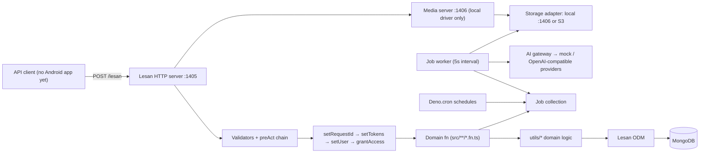
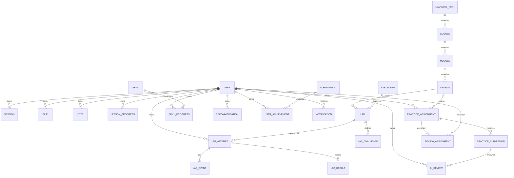
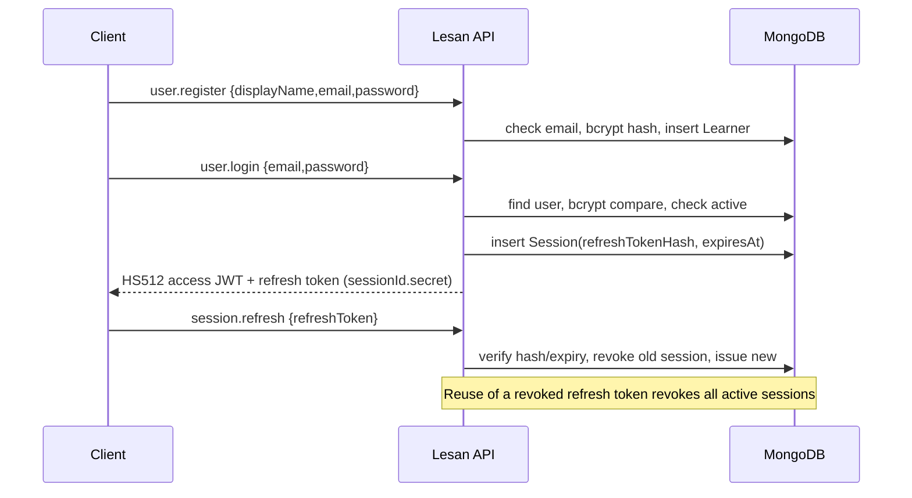
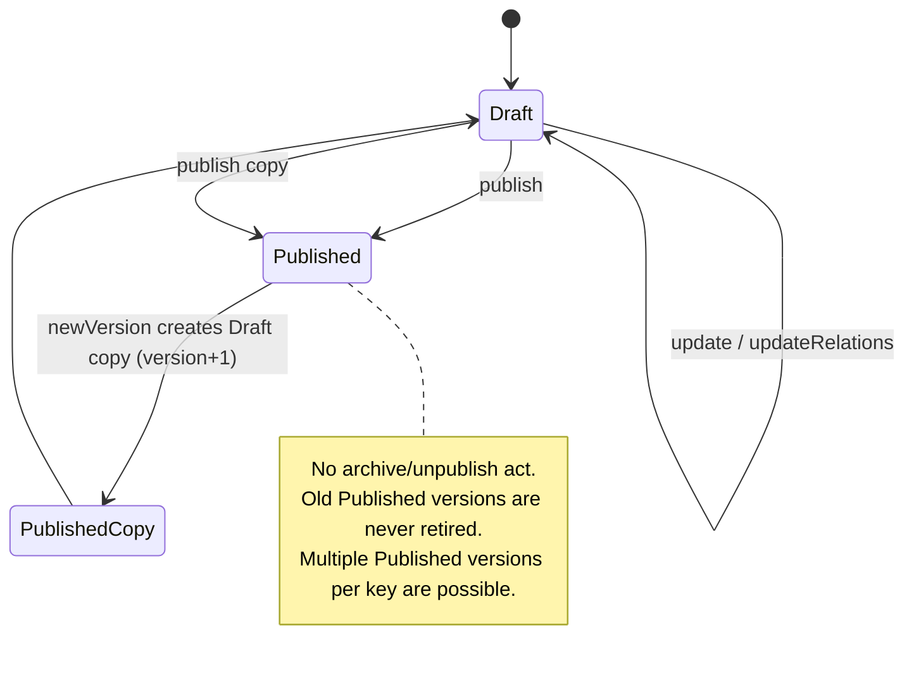
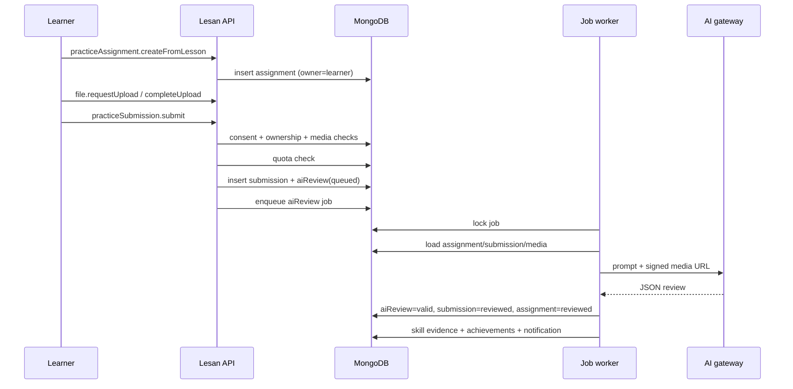
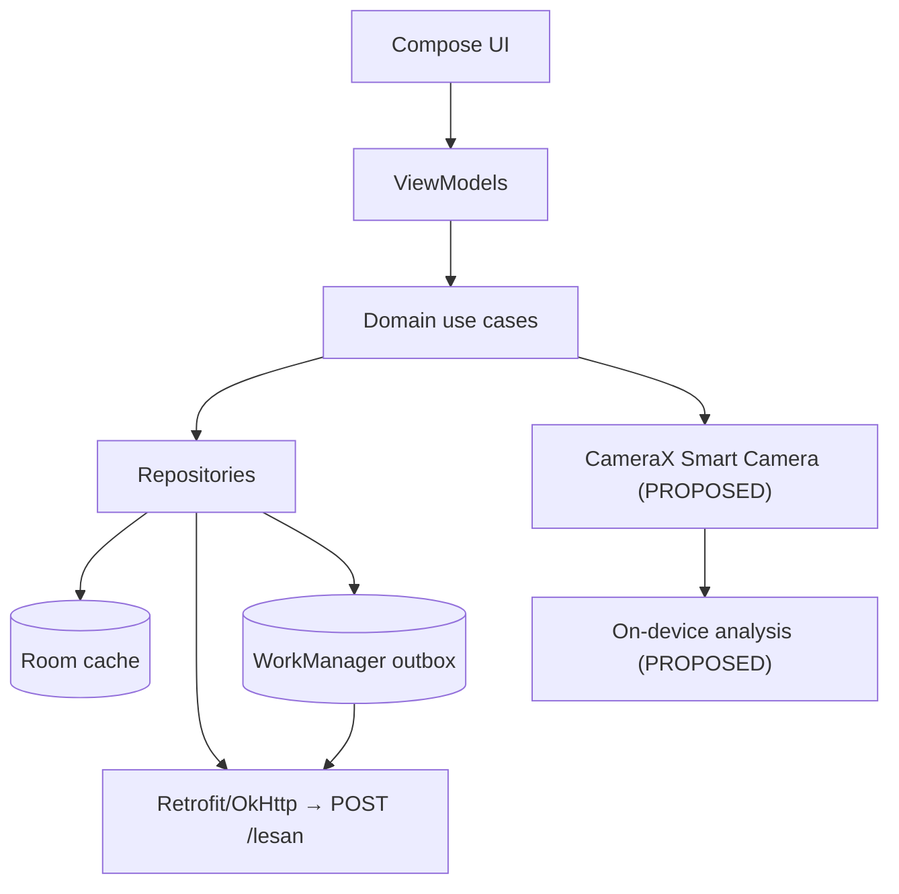

# CAMAI — Complete Project Audit & Technical Documentation

**Audit date:** 2026-11-08
**Repository:** `/home/amin-sadeghian/work/camai`
**Branch / HEAD:** `main` / `3b4b352` (`✨ feat: bootstrap CAMAI project scaffold with docs and Deno/Lesan backend`)
**Mode:** Read-only. No source, configuration, database, or git mutation was performed. The only file created by this audit is this report.

---

## 1. Executive Summary

### 1.1 Bottom line

CAMAI is **substantially more implemented than its own documentation admits**, but it is **not a complete product and not production-ready**. The repository contains a real Deno + Lesan + MongoDB backend with 28 models, 28 domain modules, roughly 124 registered API acts, deterministic lab scoring, an AI review pipeline, a MongoDB-backed job worker, media storage adapters, reviewer-scoped access, offline sync endpoints, and a small but meaningful test suite.

However:

- The **Android app does not exist** (`mobile/` absent).
- The **Web Admin portal does not exist** (`web/` absent).
- The **Smart Camera does not exist** anywhere (no client, no backend guidance engine).
- Almost all work is **uncommitted**: 56 modified files and 103 untracked paths exist only in the working tree on top of a single scaffold commit.
- There are **high-impact correctness and security gaps** in production secrets, AI quota/consent handling, content versioning, sync, job recovery, deployment packaging, and auth abuse controls.
- The **SEC-01 credential-exposure finding from the prior handoff is now fixed and independently verified** (see Section 7).

**Verdict:** a credible **backend beta foundation**, not a shippable CAMAI product. Go for continued backend stabilization and mobile/web bootstrap; **no-go for production deployment** until the P0 items in Section 20 are closed.

### 1.2 Status by major area

| Area | Status | Notes |
|---|---|---|
| Deno + Lesan runtime, models, acts | COMPLETED | 28 models, 28 modules, strict TypeScript |
| Authentication (register/login/refresh/logout/reset/delete) | PARTIALLY IMPLEMENTED | No email delivery, rate limiting, verification, role bootstrap |
| Authorization / object ownership / reviewer scope | PARTIALLY IMPLEMENTED | Broadly present; role management and production hardening absent |
| User admin (get/gets/setStatus/dashboard) | COMPLETED | SEC-01 projection hardening applied |
| Learning content CMS | PARTIALLY IMPLEMENTED | CRUD + publish + newVersion; no archive, no latest-version invariant |
| Lesson progress | PARTIALLY IMPLEMENTED | Write path works; resume resolver not wired; no read act |
| Photo Lab backend | COMPLETED | Deterministic scoring + attempts/events/results |
| Smart Camera | NOT IMPLEMENTED | No backend or mobile code |
| Practice + submissions | COMPLETED | Consent, ownership, idempotency present |
| AI review pipeline | PARTIALLY IMPLEMENTED | Mock default, double quota check, no consent re-check |
| Reviewer workflow | PARTIALLY IMPLEMENTED | Assign/revoke/scoped reads; no reviewer decision/comment act |
| Notes | COMPLETED | CRUD + soft delete + idempotency |
| Offline sync | PARTIALLY IMPLEMENTED | Push/pull exist; module/labScene and cursor defects |
| Notifications | PARTIALLY IMPLEMENTED | DB records only; no email/SMS/push delivery |
| Analytics | PARTIALLY IMPLEMENTED | Ingest + admin read; no canonical server events, dead metric |
| Skills / achievements | PARTIALLY IMPLEMENTED | Engines + read acts; no seed, no skill catalog acts |
| Recommendations | PARTIALLY IMPLEMENTED | Deterministic engine + getNext; no dismiss/complete |
| Media / storage | PARTIALLY IMPLEMENTED | Local + S3 adapters, signed tokens; size/cleanup gaps |
| Jobs / worker | PARTIALLY IMPLEMENTED | Retry/backoff/dead-letter; stale running jobs never reclaimed |
| Audit log | PARTIALLY IMPLEMENTED | Admin mutations audited; auth/security events not |
| Android | NOT IMPLEMENTED | Planned only |
| Web Admin | NOT IMPLEMENTED | Planned only |
| Tests | PARTIALLY IMPLEMENTED | 59 tests (50 unit + 9 integration steps), no E2E |
| CI | PARTIALLY IMPLEMENTED | Workflow exists but is untracked |
| Deployment | BLOCKED | Production Docker omits `http/`, media port not exposed |
| Documentation | PARTIALLY IMPLEMENTED | README/AGENTS stale; spec moved to `docs/` |

### 1.3 What was verified this session

All commands below were executed read-only from `back/`:

| Command | Result |
|---|---|
| `deno --version` | `deno 2.9.8 (stable)`, TypeScript 6.0.3 |
| `deno task check` | PASS (exit 0) |
| `deno task lint` | PASS, 299 files checked (exit 0) |
| `deno fmt --check` | PASS, 299 files checked (exit 0) |
| `deno task test` | PASS — `59 passed (9 steps) | 0 failed` |

MongoDB was reachable at `127.0.0.1:27017`, so the Mongo-backed security integration test **executed** (it was not auto-skipped).

---

## 2. Scope, Method, and Evidence Limits

### 2.1 What was audited

- Entire repository tree, git state, docs, env templates, Docker/CI config.
- All 28 Lesan models, relation definitions, excludes, and index bootstrap.
- All `utils/` modules, including authz, tokens, CRUD factory, storage, media, sync, AI, jobs, and domain engines.
- All hand-written act folders (`mod.ts`, `*.fn.ts`, `*.val.ts`) plus the shared CRUD factory.
- Workers, schedules, media HTTP server, and seed/migration placeholders.
- Test suite and CI workflow.
- The prior handoff (`docs/CAMAI_Current_Project_Status_and_Development_Handoff.md`) was used as a **cross-check**, not as truth. Each material claim cited in this report was re-checked against current code.

### 2.2 What could not be verified

| Item | Reason |
|---|---|
| Android behavior | No `mobile/` code |
| Web Admin behavior | No `web/` code |
| Smart Camera | No implementation |
| Real AI provider calls | No production keys; only adapters inspected |
| External S3 behavior | No credentials/endpoint |
| Production HTTP error mapping | Not fully exercised; observed validator errors return HTTP 501 |
| Load, performance, security penetration | Out of scope for a read-only static audit |
| Production deployment | Docker packaging defect prevents a clean production build |

### 2.3 Confidence labels

- **VERIFIED** — reproduced by command or direct code read.
- **CODE-READ** — confirmed by reading implementation; not exercised at runtime.
- **UNVERIFIED** — plausible but not proven; must be tested before relying on it.
- **PRIOR CLAIM** — taken from the handoff and re-checked where possible.

---

## 3. Repository and Git State

### 3.1 Snapshot

```
branch: main
HEAD:   3b4b352 ✨ feat: bootstrap CAMAI project scaffold with docs and Deno/Lesan backend
status: 56 modified, 103 untracked
```

Only one commit exists. The repository’s apparent “current state” is **working-tree only**. If this working tree is lost, most of the backend disappears. This is the single largest delivery risk in the project.

### 3.2 Critical untracked work

The untracked set includes nearly every domain implementation:

- `back/src/{achievement,aiReview,analyticsEvent,auditLog,course,file,job,lab*,learningPath,lesson*,module,note,notification,practice*,recommendation,reviewAssignment,skillProgress,sync,userAchievement}/…`
- `back/utils/{file,learning,notes,achievements,sync,reviewScope,reviewAccess,userProjection}.ts` and all new tests
- `back/models/reviewAssignment.ts`, `back/jobs/{schedules.ts}`, `back/http/mediaServer.ts`
- `back/deno.lock`
- `.github/workflows/backend.yml`
- `docs/CAMAI_Complete_Master_Specification_v4_1_Lesan_EN.md` and the prior handoff

### 3.3 Documentation drift

- `README.md` still says “This repository is at the scaffold stage” and lists only user/session/file. That is false as of this working tree.
- Root `AGENTS.md` and `back/AGENTS.md` describe scaffold-era scope.
- The master specification was **deleted from the repo root** and moved to `docs/` (both changes are uncommitted). `AGENTS.md` already points at the `docs/` path, so the move is directionally correct but the deletion at root is staged and confusing.
- `back/AGENTS.md` and the spec disagree on some conventions (e.g. spec mentions `utils/errors.ts`; implementation uses `utils/throwError.ts`).

### 3.4 Repository hygiene

- `back/back/` is an empty accidental directory.
- `back/http/e2e.json` and `e2e-with-remove.json` are 3-byte placeholders.
- `back/scripts/migrations/` contains only `.gitkeep`.
- `back/uploads/` contains only `.gitkeep`.
- `back/declarations/selectInp.ts` is a 358 KB generated file (ignored by git).
- `docs/superpowers/plans/…` contains planning artifacts; one plan file is modified.

---

## 4. Architecture and Runtime Topology

### 4.1 Implemented components



### 4.2 Startup sequence (`back/mod.ts`)

1. Import all models and `functionsSetup()` from `src/mod.ts`.
2. Connect `MongoClient`, bind `coreApp.odm.setDb`.
3. Instantiate every model.
4. Register all acts.
5. `await createIndexes()`.
6. `startJobWorker()` and `startSchedules()`.
7. Start the local media server only when `STORAGE_DRIVER=local`.
8. `coreApp.runServer({port, typeGeneration: true, playground: ENV === "development"})`.

Startup is eager and has no readiness gate: if Mongo or index creation fails, the process fails before serving. There is no `/health` endpoint.

### 4.3 Architecture strengths

- Clear separation: `src/` acts → `utils/` domain logic → models.
- Relations are defined one-directionally on the owning model, with `relatedRelations` for reverse traversal.
- A shared CRUD factory removes duplication across eight content/admin models.
- Deterministic domain logic (lab scoring, skill evaluation, recommendations, resume) is isolated and unit-tested.
- AI providers sit behind an interface; keys are environment-only.
- Media tokens are HMAC-signed and bound to file ID + action + expiry.
- Index bootstrap is centralized in `models/indexes.ts`.

### 4.4 Architectural risks

- **No transactions** around multi-write workflows (submission→review→job, lab completion→result→skill→achievement).
- **No centralized error middleware** in `mod.ts`; Lesan’s default response behavior is not mapped to the documented error contract.
- **No structured logging/metrics/tracing**; `requestId` is generated but not consistently propagated.
- **Worker and API in one process**; worker crash/restart semantics and graceful shutdown are absent.
- **Content versioning has no “current version” concept.**
- **No migration framework**; `scripts/migrations/` is empty.

---

## 5. Data Model, Relations, Indexes

### 5.1 Models (28)

Auth/identity: `user`, `session`, `file`.
Learning: `learningPath`, `course`, `module`, `lesson`, `lessonProgress`, `labScene`, `lab`, `labChallenge`, `labAttempt`, `labEvent`, `labResult`.
Practice/AI: `practiceAssignment`, `practiceSubmission`, `reviewAssignment`, `aiReview`.
Personalization: `skill`, `skillProgress`, `recommendation`, `achievement`, `userAchievement`, `note`.
Platform: `notification`, `analyticsEvent`, `auditLog`, `job`.

### 5.2 Relation and ownership map



### 5.3 Index coverage

`createIndexes()` covers the high-traffic access paths well:

- Unique: user email, skill key, achievement key, job idempotency key, `(user,lesson)` progress, `(user,operationId)` lab attempt, `(attempt,operationId)` lab event, `(assignment,operationId)` submission, `(user,operationId)` note, `(user,skill)` skill progress, `(user,achievement)` award, `(user,dedupeKey)` notification.
- Partial unique: active `(assignment,reviewer)` review assignment; notification dedupe when string; analytics `operationId` sparse.
- TTL: sessions on `expiresAt`; analytics events 90 days.
- Query indexes: status/createdAt, user/status, relation IDs, content key/version.

### 5.4 Model-level issues

| ID | Severity | Finding | Evidence |
|---|---|---|---|
| D-01 | High | Content version uniqueness is not enforced: `(key, version)` is a plain index, and there is no “one Published per key” invariant. | `back/models/indexes.ts:37-39`, `back/utils/crud.ts` |
| D-02 | Medium | `labResult` has no unique constraint per attempt; retries can duplicate results. | `back/models/indexes.ts:62` |
| D-03 | Medium | No unique scoped role constraint (`roleId` is random per role); duplicate roles are possible. | `back/models/user.ts` |
| D-04 | Medium | `module` and `labScene` have no content status/version fields, yet sync treats them as published content. | `back/models/module.ts`, `back/models/labScene.ts`, `back/utils/sync.ts:391`, `:422` |
| D-05 | Medium | `syncOperation` and analytics daily collections have no retention/cleanup. | `back/models/indexes.ts` |
| D-06 | Low | `labEvent.eventType` and payload are untyped strings/objects. | `back/models/labEvent.ts` |

---

## 6. Authentication, Authorization, Security

### 6.1 Authentication flow (implemented)



- Access JWT: `{_id,email,exp}` signed HS512; default TTL 900 s.
- Refresh: random secret, bcrypt-hashed in `Session`; default 30 days; rotation with reuse detection.
- Password reset: random secret, bcrypt-hashed, 30-minute expiry, all sessions revoked on success.
- `setUser` reloads the user from DB on every authenticated act and rejects non-active accounts.

### 6.2 Authorization model (implemented)

Every authenticated act runs `setTokens → setUser → grantAccess`, then performs object-level checks derived from the database:

- Notes, progress, attempts, submissions, files, notifications: owner checks.
- Reviewers: must have an **active `reviewAssignment`** for the target assignment/submission/file.
- Managers/Admins: broad staff access; ContentEditor: content write/publish; Reviewer: scoped review reads/retry.
- Learner content reads are forced to `status=Published` via `currentContentAccess()`.
- `isGhostScopeBypass` allows a ghost user without role scope to bypass role gates.

### 6.3 Security findings

| ID | Severity | Status | Finding | Evidence |
|---|---|---|---|---|
| SEC-01 | High (was High/Critical) | **CLOSED — verified** | User acts exposed `passwordResetTokenHash`/`passwordResetExpiresAt` through arbitrary projections. Fixed with allowlist projection + recursive response sanitization. | `back/utils/userProjection.ts`, `back/src/user/*/*.fn.ts`, Section 7 |
| S-01 | Critical (conditional) | OPEN | JWT secret silently falls back to a public dev constant; no startup validation. A production deploy missing `TOKEN_KEY` is forgeable. | `back/utils/tokens.ts:5` |
| S-02 | High | OPEN | Media signing falls back to `TOKEN_KEY` then a public dev constant. | `back/utils/signedUrl.ts:3-5` |
| S-04 | High | OPEN | No rate limiting, backoff, or account lockout on register/login/reset/quota/upload. | No middleware; acts call functions directly |
| S-05 | High | OPEN | No email/SMS delivery. `forgotPassword` returns the raw reset token whenever `ENV !== "production"`; a production env missing `ENV` leaks it. | `back/src/user/forgotPassword/forgotPassword.fn.ts:48` |
| S-06 | High | OPEN | No role bootstrap or management. First user is always Learner; a fresh deployment can have no Manager/Admin. | `back/src/user/register/register.fn.ts`, no roles act |
| S-07 | High | OPEN | Client-controlled `hardCascade` on content remove can delete whole trees. | `back/utils/crud.ts:482`, `:502` |
| S-08 | Medium | OPEN | Email matching and uniqueness are case-sensitive; duplicate casing accounts possible. | `back/src/user/register/register.fn.ts:13`, `login.fn.ts:13` |
| S-09 | Medium | OPEN | Password policy is length 8–100 only; no verification, breach check, or complexity. | `register.val.ts`, `resetPassword.val.ts` |
| S-10 | Medium | OPEN | A Manager/Admin can suspend another privileged account; no last-admin protection. | `back/src/user/setStatus/setStatus.fn.ts` |
| S-11 | Medium | OPEN | `deleteMe` has no re-authentication and no cancel/grace act. | `back/src/user/deleteMe/deleteMe.fn.ts` |
| S-12 | Medium | OPEN | Login/logout/reset/role/media-access events are not audited. | `back/utils/audit.ts` |
| S-13 | Medium | OPEN | No security headers, HSTS, CSP, or frame policy on API/media. | `back/mod.ts`, `back/http/mediaServer.ts` |
| S-14 | Medium | UNVERIFIED | CORS allowlist is environment-driven; production values unknown. | `back/mod.ts` |
| S-15 | Low | PARTIAL | User projections are now sanitized; other models rely on Lesan `excludes` only. | `back/models/excludes.ts` |
| S-16 | Low | OPEN | Access tokens lack `iat`, `iss`, `aud`, `jti`; revocation is only via DB status. | `back/utils/tokens.ts` |
| S-17 | Low | OPEN | `setUser` loads reset-token fields into the request context (deletes only `password`). | `back/utils/setUser.ts:14`, `:28` |

### 6.4 Authorization matrix (actual behavior)

| Capability | Learner | Reviewer | ContentEditor | Admin | Manager |
|---|---|---|---|---|---|
| Own profile/progress/notes/labs/practice | Yes | Yes | Yes | Yes | Yes |
| Read published content | Yes | Yes | Yes | Yes | Yes |
| Read drafts | No | No | Yes | Yes | Yes |
| Create/update content | No | No | Yes | Yes | Yes |
| Publish content | No | No | Yes | Yes | Yes |
| Remove content | No | No | No | Yes | Yes |
| Review assigned submissions | No | Yes (scoped) | No | Yes | Yes |
| Admin dashboard/audit/jobs/user list | No | No | No | Yes | Yes |
| Manage roles/permissions | No | No | No | No | No (no act) |

### 6.5 Privacy

- Photos are private by default and served through short-lived signed URLs.
- AI submission requires `settings.privacy.aiProcessingConsent === true` at submit time.
- Analytics ingestion returns success without storing when `analyticsConsent === false`.
- Account deletion is soft (status `suspended` → `deleted` job, sessions revoked, notes/files soft-deleted).
- **Gaps:** no data export, no retention policy enforcement beyond cleanup, consent is not re-checked at AI processing/retry time, and image bytes are forbidden in analytics only by a shallow key blocklist.

---

## 7. SEC-01 Independent Verification

### 7.1 Finding under test

The prior handoff claimed authenticated users could request `passwordResetTokenHash` and `passwordResetExpiresAt` through `getMe` and other user-returning acts, and Managers/Admins could do the same for arbitrary users.

### 7.2 Implemented fix (VERIFIED)

`back/utils/userProjection.ts` introduces:

- `SENSITIVE_USER_FIELDS = password, passwordResetTokenHash, passwordResetExpiresAt`
- `SENSITIVE_NESTED_FIELDS = refreshTokenHash, storageKey`
- `USER_PUBLIC_FIELDS` — an explicit allowlist of user fields and relation names
- `sanitizeUserProjection(projection)` — strips non-allowlisted and sensitive fields; converts empty projections to the full safe allowlist; handles exclusion projections by starting from the safe default and deleting requested fields; recursively sanitizes nested relation projections; drops all-sensitive nested objects by returning `null`.
- `sanitizeUserResponse(value)` — recursively deletes every sensitive response field from returned objects and arrays.

Integration (VERIFIED by grep and tests):

| Act | Projection sanitized | Response sanitized |
|---|---|---|
| `getMe` | yes (`getMe.fn.ts:18`) | yes (`:26`) |
| `get` | yes (`get.fn.ts:10`) | yes (`:15`) |
| `gets` | yes (`gets.fn.ts:50`) | yes (`:53`) |
| `updateMe` | yes (`updateMe.fn.ts:41`) | yes (`:46`) |
| `updateSettings` | yes (`updateSettings.fn.ts:54`) | yes (`:59`) |
| `setStatus` | yes (`setStatus.fn.ts:37`) | yes (`:59`) |
| `register` | yes (`register.fn.ts:37`) | yes (`:40`) |

Additionally, relations that embed users (`session.user`, `file.owner`, `note.user`, `reviewAssignment.reviewer/assignedBy`, etc.) declare `user_excludes`, which removes `password`, reset fields, `settings`, and timestamps.

### 7.3 Independent runtime verification

The session ran the repository test suite:

- `back/src/user/userSensitiveFields.test.ts` starts a **real backend process** on a free port against a **real temporary MongoDB database** (`camai_sec_<uuid>`), seeds users containing reset secrets, a nested avatar `storageKey`, and a nested session `refreshTokenHash`, then exercises nine steps:
  1. `getMe` with reset fields requested
  2. `getMe` with an empty projection
  3. `getMe` with nested avatar + sessions
  4. `user.get` with reset fields requested
  5. `user.gets` with reset fields requested
  6. `user.get` exclusion projection
  7. `updateMe`
  8. `updateSettings`
  9. `setStatus`

Result (VERIFIED): **all nine steps passed**; no sensitive field appeared anywhere in any response. The test was **not skipped** because Mongo was reachable. Temp DB cleanup ran in `finally`.

### 7.4 Adversarial relation-projection probe (VERIFIED)

A temporary read-only probe (outside the repo, in `/tmp`) seeded a note owned by a user containing reset secrets, then attempted to pull the secret through the note’s user relation:

- `note.gets` with `get.user.passwordResetTokenHash = 1` → HTTP 501, `Expected a value of type never`.
- `note.gets` with `get.user.password = 1` → HTTP 501, `Expected a value of type never`.
- `note.gets` with `get.user.settings = 1` → HTTP 501, `Expected a value of type never`.
- `note.gets` with safe user fields → HTTP 200, nested user returned without secrets.

Conclusion: Lesan’s `selectStruct`/relation `excludes` reject sensitive fields at validation time, providing defense in depth beyond the user-act sanitizer.

### 7.5 Residual SEC-01 risks

| ID | Severity | Residual risk |
|---|---|---|
| R-SEC-01a | Low | Sanitization is applied **per act**, not centrally. A future act that returns a raw user document will bypass it. Recommend a model-level/response-level hook or a single repository helper. |
| R-SEC-01b | Low | `sanitizeUserResponse` mutates objects in place; safe today, but unexpected if callers reuse the object. |
| R-SEC-01c | Low | `setUser` still loads reset-token fields into request context. They are not returned, but least-privilege would exclude them. |
| R-SEC-01d | Info | `sanitizeUserProjection`’s default allowlist includes all relation fields; an empty projection can return large relation graphs (performance, not disclosure). |

**SEC-01 verdict: PASS — fixed and independently verified.** Tracked as CLOSED.

---

## 8. API Surface and Act Inventory

### 8.1 Counts (VERIFIED)

| Metric | Count |
|---|---|
| Lesan models | 28 |
| Domain setups registered in `back/src/mod.ts` | 28 |
| Hand-written act folders (`setAct`) | 59 |
| CRUD factory domains | 8 (`learningPath`, `course`, `module`, `lesson`, `labScene`, `lab`, `labChallenge`, `achievement`) |
| Approx. generated CRUD acts | ~65 (7 per domain + publish/newVersion where configured) |
| Approx. total registered acts | ~124 |
| TypeScript lines excluding generated declarations/tests | 12,412 |

### 8.2 Hand-written acts by domain

| Domain | Acts |
|---|---|
| user | register, login, forgotPassword, resetPassword, getMe, updateMe, updateSettings, deleteMe, get, gets, setStatus, dashboardStatistic |
| session | refresh, logout |
| file | requestUpload, completeUpload, getSignedUrl, getReviewMediaUrl |
| note | add, update, remove, gets |
| lessonProgress | start, update, complete |
| labAttempt | add, get, gets, complete |
| labEvent | addBatch |
| labResult | gets |
| practiceAssignment | createFromLesson, get, gets |
| practiceSubmission | submit, get, gets |
| reviewAssignment | assign, revoke, gets |
| aiReview | gets, getForAssignment, retry |
| skillProgress | get, gets, getOverview, getHistory |
| recommendation | getNext |
| userAchievement | gets |
| notification | gets, markRead, markAllRead |
| sync | push, pull |
| analyticsEvent | add, gets |
| auditLog | gets |
| job | gets, retry |

### 8.3 API conventions actually implemented

- Single `POST /lesan`; body `{ model, act, details: { set, get } }`.
- Bearer JWT in `Authorization` (or `token` header).
- `activeRoleId` is required in `set` for every authenticated act and must match a role on the token user.
- Projection is client-controlled via `get`, validated by `selectStruct`.
- Errors are thrown as `CODE: message` via `throwError`.
- Idempotency: `operationId` on submissions, notes, lab attempts/events, analytics, sync operations.

### 8.4 Missing act families

- `file.gets` / photo library list/search/delete/restore.
- `lessonProgress.gets` / resume read.
- `skill` catalog acts.
- Role/permission management.
- Data export.
- Content archive/restore.
- Admin user detail/session management (beyond `user.get`).
- Admin analytics/top-content/weak-skill reads.
- Reviewer decision/comment/rubric act.
- Notification admin create/queue and real delivery dispatch.
- Email verification.
- Account deletion cancel.

### 8.5 Error contract

`AppError` defines `code`, `status`, `retryable`, and a numeric status map. However, `mod.ts` registers no error handler that maps `AppError.status` to the HTTP response. Direct probes showed validator failures returning **HTTP 501** with Lesan’s message shape, not the documented `{code,message,requestId,retryable}` envelope. **Treat the documented error contract as NOT IMPLEMENTED at the HTTP boundary.**

---

## 9. Learning Content, Publishing, Versioning

### 9.1 Implemented lifecycle



### 9.2 Findings

| ID | Severity | Finding | Evidence |
|---|---|---|---|
| C-01 | High | `add` accepts `status`, `version`, and `publishedAt` because only timestamps are stripped. A ContentEditor can create content directly as `Published`, bypassing `publish` and its audit. | `back/utils/crud.ts:286-295` |
| C-02 | High | Publishing a new version does not archive/supersede the previous published version. Multiple `Published` versions coexist. | `back/utils/crud.ts:538-575` |
| C-03 | High | No archive act exists, despite the remove guard telling operators to archive. | `back/utils/content.ts:41` |
| C-04 | High | Learner `gets` filters only `status=Published`; it never selects the latest version. | `back/utils/crud.ts:164` |
| C-05 | Medium | `validatePublish` is called with a projection containing only `_id` and `status`, so any real validation cannot inspect the document; no config currently supplies it. | `back/utils/crud.ts:544-557` |
| C-06 | Medium | No unique `(key,version)` or single-published-version index. | `back/models/indexes.ts:37-39` |
| C-07 | Medium | No parent/child publish validation (lesson→module, lab→lesson/scene, challenge→lab). | `back/utils/crud.ts:538-575` |
| C-08 | Medium | Relations are converted to ObjectIds without existence checks; dangling relations possible. | `back/utils/crud.ts:120-160` |
| C-09 | Medium | Audit is written after the mutation; a failed audit leaves the mutation committed while the act fails. | `back/utils/crud.ts:300-306` |
| C-10 | Low | `newVersion` has no explicit supersedes/parent link beyond the version number. | `back/utils/crud.ts:598-674` |

### 9.3 What works

- Role gates for read/write/remove/publish are present.
- Draft content is editable; published content is immutable (`PUBLISHED_IMMUTABLE`).
- Learner reads are forced to published content for learningPath/course/lesson/lab/challenge.
- New-version cloning copies scalar fields and relation IDs.
- Every content mutation is audited (subject to C-09).

---

## 10. Learning Progress, Resume, and Notes

### 10.1 Progress (implemented)

- `lessonProgress.start` verifies the lesson is published, creates a unique `(user,lesson)` record, or updates `lastOpenedAt`.
- `update` clamps `currentBlock` to the lesson’s block count.
- `complete` sets `status=completed`, `completedAt`, and the final block.
- Sync supports start/update/complete.

### 10.2 Progress findings

| ID | Severity | Finding | Evidence |
|---|---|---|---|
| L-01 | High | `resolveResume` is implemented and tested but **never called** by any act or sync path. | `back/utils/resumeResolver.ts:16`; no other references |
| L-02 | Medium | No `completedBlockIds`; precise block-level resume is impossible. | `back/models/lessonProgress.ts` |
| L-03 | Medium | `complete` does not verify required blocks; a client can complete immediately. | `back/utils/learning.ts` |
| L-04 | Medium | No read act for a single progress record or recent lessons. | act inventory |
| L-05 | Low | Progress `version` is fixed to the lesson version at start and not reconciled on changes. | `back/utils/learning.ts` |

### 10.3 Notes (implemented)

- Add/update/remove/gets with owner checks, soft delete, pinning, search, and idempotent `operationId`.
- Target validation for lesson/lab/practice/photo (published content, assignment ownership, file ownership).
- No restore act, no attachment model, no conflict resolution (last-write-wins).

---

## 11. Photo Lab, Deterministic Scoring, Smart Camera

### 11.1 Implemented backend

- Models for labs, scenes, challenges, attempts, events, results.
- Staff CRUD via the content factory.
- Learner `labAttempt.add` validates published lab/challenge, derives deterministic metrics, and enforces `(user,operationId)` idempotency.
- `labAttempt.complete` scores attempts from challenge targets or predictions, writes `labResult`, applies skill evidence, evaluates achievements, and is owner/staff checked.
- `labEvent.addBatch` validates attempt ownership and deduplicates per `(attempt,operationId)`.
- `labScoring.ts` implements exposure value, motion-blur risk, noise, field of view, depth of field, perspective/framing, and target/prediction scoring. Unit tests cover the spec’s photography regressions.

### 11.2 Findings

| ID | Severity | Finding | Evidence |
|---|---|---|---|
| PL-01 | Medium | `labEvent.addBatch` has no maximum event count and accepts arbitrary `eventType`/payload. | `back/src/labEvent/addBatch/addBatch.val.ts` |
| PL-02 | Medium | Lab completion is multi-write with no transaction; partial completion possible. | `back/utils/learning.ts` |
| PL-03 | Medium | No unique `labResult` per attempt; retries can duplicate results. | `back/models/indexes.ts:62` |
| PL-04 | Medium | No cancel/abandon/resume act or explicit session state machine. | act inventory |
| PL-05 | Low | No act returning scoring breakdown beyond `labResult.gets`. | act inventory |
| PL-06 | Low | Event payloads are unvalidated nested objects. | `back/models/labEvent.ts` |

### 11.3 Smart Camera

**NOT IMPLEMENTED.** There is no backend act, model, or client code for live scene analysis, composition suggestions, or camera guidance. The specification describes it as a mobile/client feature, but neither the mobile app nor a supporting backend module exists. Marked **PROPOSED** in all diagrams.

---

## 12. Practice, AI Review, Reviewer Workflow

### 12.1 Flow (implemented)



### 12.2 Findings

| ID | Severity | Finding | Evidence |
|---|---|---|---|
| A-01 | High | AI quota is checked twice for one submission. Submit counts the new queued review, then `runAiReview` checks again. At `usage = quota - 1`, submit succeeds but the job fails; orphaned queued reviews occur. | `back/src/practiceSubmission/submit/submit.fn.ts:72`, `back/utils/ai/gateway.ts:44` |
| A-02 | High | Mock provider fallback is enabled by default: `AI_MOCK_FALLBACK !== "false" || providers.length === 0`. Production can silently serve fake reviews. | `back/utils/ai/providers/index.ts:27-30` |
| A-03 | High | AI processing/retry does not re-check `aiProcessingConsent`; a user who revokes consent can still have media sent. | `back/jobs/handlers.ts`, `back/src/aiReview/retry/retry.fn.ts` |
| A-04 | High | Learner-controlled assignment `title/objective/constraints/requirements` are inserted into the AI prompt; prompt injection is possible. | `back/src/practiceAssignment/createFromLesson/createFromLesson.fn.ts`, `back/utils/ai/prompts.ts` |
| A-05 | Medium | Client-supplied EXIF is trusted as fallback evidence. | `back/src/practiceSubmission/submit/submit.fn.ts`, `back/jobs/handlers.ts` |
| A-06 | Medium | Local signed URLs point at `localhost:1406`; an external AI provider cannot reach them. Real providers only work with S3 or a public media URL. | `back/utils/storage/local.ts` |
| A-07 | Medium | `aiReview.retry` uses `Date.now()` in the job key, allowing duplicate retry jobs and bypassing quota. | `back/src/aiReview/retry/retry.fn.ts` |
| A-08 | Medium | On AI failure only `aiReview` becomes `failed`; submission/assignment remain `submitted`. No user-visible failed/retry state contract. | `back/jobs/handlers.ts` |
| A-09 | Medium | Success path is multi-write and non-transactional; partial state possible. | `back/jobs/handlers.ts` |
| A-10 | Medium | No content moderation/safety filter on AI text. | `back/utils/ai/schema.ts` |
| A-11 | Medium | `settingPattern.test()` uses a global regex whose `lastIndex` persists; after the first sanitized string, a later string can evade sanitization. | `back/utils/ai/truthfulness.ts:3-19` |
| A-12 | Low | Signed media URL is embedded in the third-party prompt; no retention/privacy disclosure. | `back/jobs/handlers.ts`, `back/utils/ai/prompts.ts` |

### 12.3 Reviewer workflow

Implemented: assign/revoke (Manager/Admin), unique active assignment, reviewer-scoped assignment/submission/media reads, `aiReview.getForAssignment`, `aiReview.retry` with scope checks.

Missing: reviewer decision/rubric/comment act, assignment notifications, claim queue, reviewer-side failure handling, audit of reviewer reads.

---

## 13. Offline Sync

### 13.1 Implemented

- `sync.push`: up to 50 operations, deduped in `syncOperation` by `(userId,operationId)`, applies note/lessonProgress/labAttempt/labEvent operations through shared domain functions, returns `ack|duplicate|rejected`.
- `sync.pull`: returns owned notes/progress/attempts/results/assignments/submissions/aiReviews/notifications/recommendations/achievements plus published content, with a single global cursor.

### 13.2 Findings

| ID | Severity | Finding | Evidence |
|---|---|---|---|
| SY-01 | High | `module` and `labScene` are filtered by `status: "Published"` but those models have no `status` field, so sync always returns empty arrays for them. | `back/utils/sync.ts:391`, `:422`, `back/models/module.ts`, `back/models/labScene.ts` |
| SY-02 | High | One global cursor is computed from per-collection results each limited independently; if any group exceeds the limit, rows can be skipped permanently. | `back/utils/sync.ts` cursor computation |
| SY-03 | Medium | Client `get` projection is not used for pull (server projections), which is safer, but the response shape is not versioned or size-bounded. | `back/src/sync/pull/pull.fn.ts` |
| SY-04 | Medium | `sync.push` bypasses act validators: note body length, lab event batch size, and payloads are unbounded. | `back/utils/sync.ts` |
| SY-05 | Medium | No conflict detection/version precondition; last-write-wins silently. | `back/utils/notes.ts` |
| SY-06 | Medium | `syncOperation` has no TTL/cleanup. | `back/models/indexes.ts` |
| SY-07 | Low | Pull can return many groups × up to 500 docs with no aggregate size limit. | `back/utils/sync.ts` |

**Verdict:** sync is a real implementation but currently **incorrect for content** (modules/scenes missing) and **unsafe for large datasets** (global cursor). Not ready for mobile offline-first use.

---

## 14. Notifications, Admin Operations, Audit

### 14.1 Notifications

- Model supports type, title, body, read/scheduled/dispatch timestamps, dedupe key.
- Reads and mark-read/mark-all-read acts exist with owner/staff scoping.
- Only one notification type is actually generated: `aiReviewReady` after a successful AI review.
- `notification` job queue exists but nothing enqueues to it; `notificationDispatch` only stamps `dispatchedAt`.
- **No email, SMS, or push delivery exists.**

### 14.2 Admin operations

Implemented: dashboard statistics, user list/detail, user status change, content CRUD/publish, AI review list/retry, audit log list, job list/retry.

Missing: role assignment, user session management, admin analytics, content archive, media moderation, notification creation, data export.

### 14.3 Audit

- Content create/update/relations/remove/publish/newVersion, user status, review assignment/revoke, AI retry, job retry, and account deletion write audit records.
- Missing: authentication events, authorization denials, media access, role changes.
- Audit is written **after** mutations; failure can desynchronize state.

---

## 15. Analytics, Skills, Achievements, Recommendations

### 15.1 Analytics

- `analyticsEvent.add` honors `analyticsConsent`, dedupes by `operationId`, and blocks a shallow set of private keys (`image`, `imageBytes`, `base64`, `photo`, `file`).
- Admin `gets` supports event type, user, and time range.
- Daily rollup job aggregates yesterday’s events.
- Missing: canonical server-side event emission for the spec’s required events, recursive payload redaction, event taxonomy enforcement, admin aggregate reads.
- `dashboardStatistic.syncFailures` is actually the dead-job count, not sync failures.

### 15.2 Skills and achievements

- `skillEngine.ts` computes mastery from weighted, recency-adjusted evidence with five states.
- `applySkillEvidence` upserts `(user,skill)` progress and appends evidence (capped at 50).
- Achievements are evaluated from definitions after lab/AI success.
- Missing: skill catalog acts, achievement seed/migration, achievement notifications, admin management.

### 15.3 Recommendations

- Deterministic priority engine: resume lesson → pending practice → weak skill → low lab score → next lesson → review fundamentals → explore.
- `getNext` persists/shows a recommendation.
- Missing: dismiss/complete lifecycle acts.

---

## 16. Media and Storage

### 16.1 Implemented

- `requestUpload` validates declared size (≤25 MB) and name, creates a `pending` file owned by the caller, and returns a signed upload target.
- Local adapter writes to `UPLOAD_DIR` with path-traversal guards and signs upload/download tokens.
- S3 adapter uses `aws4fetch` query signing (path-style or virtual-host).
- `completeUpload` re-reads the object, detects magic bytes (JPEG/PNG/WebP/GIF/PDF/MP4), verifies declared MIME, validates size, and marks `uploaded`.
- Media HTTP server verifies HMAC tokens bound to file ID + action + expiry; uploads are PUT-only, downloads GET/HEAD, with `no-store` and `nosniff`.
- `getSignedUrl` allows owner or Manager/Admin; `getReviewMediaUrl` additionally allows actively assigned Reviewers.

### 16.2 Findings

| ID | Severity | Finding | Evidence |
|---|---|---|---|
| M-01 | High | S3 upload size is not enforced at upload time (only declared size is checked); `completeUpload` buffers the whole object. | `back/utils/file.ts`, `back/utils/storage/s3.ts` |
| M-02 | High | No photo-library API (`file.gets`, search, delete, restore). | act inventory |
| M-03 | Medium | Pending uploads leak; no cleanup job for `status=pending` files. | `back/jobs/handlers.ts` cleanup |
| M-04 | Medium | Local upload buffering (`request.arrayBuffer()`) allows memory pressure up to the 25 MB cap; chunked handling absent. | `back/http/mediaServer.ts` |
| M-05 | Medium | Upload/download tokens are replayable until expiry (no nonce/single-use). | `back/utils/signedUrl.ts` |
| M-06 | Medium | Inline PDFs could be risky depending on client rendering; no `content-disposition`. | `back/http/mediaServer.ts` |
| M-07 | Medium | Compose does not expose port 1406, so local media URLs are unreachable from the host/client. | `docker-compose.dev.yml:19-20` |
| M-08 | Medium | Local media is unreachable by external AI providers. | `back/utils/storage/local.ts` |

---

## 17. Jobs, Workers, Reliability

### 17.1 Implemented

- Mongo-backed `job` collection with queue, payload, status, attempts, maxAttempts, runAt, lockedUntil, lastError, idempotencyKey.
- `lockNextJob` atomically moves a queued due job to `running` and increments attempts.
- Worker ticks every 5 s, processes up to 5 jobs, marks done or failed with exponential backoff and dead-letter after max attempts.
- Cron schedules enqueue cleanup, analytics rollup, notification dispatch, and account deletion.
- Handlers: AI review, notification, notification dispatch, account deletion, cleanup, analytics rollup.

### 17.2 Findings

| ID | Severity | Finding | Evidence |
|---|---|---|---|
| J-01 | High | Stale `running` jobs are never reclaimed if a worker dies (`lockedUntil` is set but never consulted for requeue). | `back/utils/jobs.ts:60-68` |
| J-02 | High | `enqueueJob` swallows all insert errors and returns an existing lookup (possibly null); callers do not check. | `back/utils/jobs.ts` |
| J-03 | Medium | No graceful shutdown; in-flight jobs may be interrupted. | `back/jobs/worker.ts` |
| J-04 | Medium | Notification queue is unreachable; dispatch is effectively a no-op. | `back/jobs/handlers.ts`, `back/jobs/schedules.ts` |
| J-05 | Medium | AI retry duplicates (timestamped key) and bypasses quota. | `back/src/aiReview/retry/retry.fn.ts` |
| J-06 | Medium | No job metrics/observability. | `back/jobs/worker.ts` |

---

## 18. Android, Web Admin, AI/Offline Architecture Readiness

### 18.1 Android

**Status: NOT IMPLEMENTED.** No `mobile/` directory exists. The API surface is partially ready but has blockers:

- No stable resume read endpoint.
- Sync is incorrect for modules/scenes and cursor semantics.
- No photo-library API.
- Error HTTP mapping is not the documented contract.
- No role bootstrap for admin flows.
- No camera/Smart Camera backend.

**PROPOSED** mobile architecture from the spec:



### 18.2 Web Admin

**Status: NOT IMPLEMENTED.** No `web/` directory. Backend admin acts exist, but there is no role management, no admin analytics, no content archive, and no user session management.

**PROPOSED** admin architecture:

```mermaid
flowchart LR
  Admin["Next.js Admin (PROPOSED)"] --> API["POST /lesan"]
  API --> Dashboard["Dashboard"]
  API --> Users["Users + status"]
  API --> CMS["Content CMS + publish"]
  API --> Reviews["AI review queue"]
  API --> Audit["Audit logs"]
  API --> Jobs["Jobs + retry"]
  note right of Admin: RBAC server-side; tokens handled securely
```

### 18.3 AI / offline architecture

- AI is asynchronous and does not block Photo Lab scoring (deterministic).
- Providers are adapter-based; the mock provider is deterministic.
- Offline-first is only partially supported: sync push/pull exist, but correctness defects block acceptance.
- Smart Camera digital guidance is entirely absent.

---

## 19. Testing, CI/CD, Deployment, Documentation

### 19.1 Tests (VERIFIED)

- 11 test files, 59 tests (one Mongо-backed test with 9 steps).
- Unit coverage: authz policy, content guards, lab scoring, media detection, recommendation engine, resume resolver, review access, signed URLs, token parsing, AI schema validation.
- Integration coverage: real HTTP + real MongoDB user credential-exposure test.
- `deno task check/lint/fmt/test` all pass.

**Gaps:** no E2E user journeys, no sync tests, no job/worker tests, no AI gateway/provider tests, no storage adapter tests, no coverage thresholds, no migration tests.

### 19.2 CI

- `.github/workflows/backend.yml` runs check, lint, fmt --check, test on `back/**` changes.
- **The workflow and `back/deno.lock` are untracked**, so CI is not actually active on the repository as committed. The single commit predates the workflow.

### 19.3 Deployment

| ID | Severity | Finding | Evidence |
|---|---|---|---|
| D-01 | High | Production Docker stage copies `models/`, `src/`, `utils/`, `jobs/` but **not `http/`**. `mod.ts` imports `./http/mediaServer.ts`, so the production image cannot type-check/cache/run. | `back/Dockerfile:18-22` |
| D-02 | High | Compose exposes only 1405; the media server on 1406 is unpublished. | `docker-compose.dev.yml:19-20` |
| D-03 | Medium | Lockfile is untracked; no `--cached-only`/`--frozen` install. | `back/deno.lock` untracked |
| D-04 | Medium | No production manifests, backups, restore, or migration runner. | repo |
| D-05 | Medium | No health/readiness endpoint or container healthcheck. | `back/mod.ts` |
| D-06 | Medium | Dev image uses `deno cache` then `deno task dev` with `--watch`; production omits `http/`. | `back/Dockerfile` |

### 19.4 Documentation

| ID | Severity | Finding |
|---|---|---|
| DOC-01 | Medium | `README.md` and both `AGENTS.md` describe a scaffold that no longer matches the working tree. |
| DOC-02 | Medium | Root spec deletion + `docs/` move is uncommitted and confusing. |
| DOC-03 | Low | API docs rely on generated declarations and playground; no maintained endpoint reference. |
| DOC-04 | Low | `back/http/e2e*.json` are empty placeholders. |

---

## 20. Findings Register, Roadmap, Final Technical Assessment

### 20.1 Consolidated findings register

Severity is production/user impact. Status is as of this audit.

| ID | Severity | Area | Status | Finding | Required action |
|---|---|---|---|---|---|
| SEC-01 | High | Security | **CLOSED** | User acts exposed reset-token fields. | Done: allowlist + response sanitizer (Section 7). |
| S-01 | Critical (cond.) | Security | OPEN | JWT secret falls back to public constant. | Fail startup if `TOKEN_KEY` missing/short outside dev. |
| S-02 | High | Security | OPEN | Media secret fallback. | Require dedicated `MEDIA_SECRET` in production. |
| S-04 | High | Security | OPEN | No rate limits/lockout. | Per-IP/user limits, login backoff, quota middleware. |
| S-05 | High | Security | OPEN | Dev reset token returned by default; no email. | Integrate email; never return token unless explicit dev flag. |
| S-06 | High | Security | OPEN | No role bootstrap/management. | Seed first Manager; add audited role management. |
| S-07 | High | Security | OPEN | Client `hardCascade` on content remove. | Remove from client; restrict to account deletion. |
| S-08 | Medium | Identity | OPEN | Case-sensitive email uniqueness. | Normalize lowercase + unique index. |
| S-09 | Medium | Identity | OPEN | Weak password policy. | Add policy + verification. |
| S-10 | Medium | Admin | OPEN | No last-admin protection. | Guard privileged suspensions. |
| S-11 | Medium | Privacy | OPEN | Delete-me has no re-auth/cancel. | Add re-auth and grace/cancel flow. |
| S-12 | Medium | Audit | OPEN | Auth/security events not audited. | Audit login/logout/reset/denials. |
| S-13 | Medium | Security | OPEN | No security headers. | Add HSTS/CSP/nosniff/frame policy. |
| S-14 | Medium | Security | UNVERIFIED | CORS production allowlist. | Document/test production origins. |
| S-16 | Low | Security | OPEN | JWT lacks iat/iss/aud/jti. | Add standard claims. |
| S-17 | Low | Security | OPEN | Reset fields loaded into context. | Exclude from `setUser` projection. |
| C-01 | High | Content | OPEN | Create can publish directly. | Strip status/version/publishedAt from add/update. |
| C-02 | High | Content | OPEN | Old published versions never archived. | Archive/supersede on publish. |
| C-03 | High | Content | OPEN | No archive act. | Add archive/unpublish. |
| C-04 | High | Content | OPEN | Learner reads return all published versions. | Add latest/current invariant. |
| C-05 | Medium | Content | OPEN | Publish validation gets only `_id/status`. | Pass full doc; implement validators. |
| C-06 | Medium | Content | OPEN | No unique key/version or published invariant. | Add partial unique indexes. |
| C-07 | Medium | Content | OPEN | No parent publish validation. | Validate parents on publish. |
| C-08 | Medium | Content | OPEN | No relation existence checks. | Validate targets. |
| C-09 | Medium | Content | OPEN | Audit after mutation. | Pre-write/transactional audit. |
| L-01 | High | Learning | OPEN | Resume resolver not wired. | Add resume read act. |
| L-02 | Medium | Learning | OPEN | No completed block tracking. | Add `completedBlockIds`. |
| L-03 | Medium | Learning | OPEN | Complete without required blocks. | Server-side completion rules. |
| PL-01 | Medium | Labs | OPEN | Unbounded lab event batches. | Cap batch; validate event types. |
| PL-02 | Medium | Labs | OPEN | Non-transactional completion. | Transaction/idempotent reconciliation. |
| PL-03 | Medium | Labs | OPEN | No unique lab result per attempt. | Unique index/upsert. |
| A-01 | High | AI | OPEN | Double quota check/off-by-one. | Check once; reserve quota atomically. |
| A-02 | High | AI | OPEN | Mock fallback default-on. | Explicit opt-in; fail closed in production. |
| A-03 | High | AI | OPEN | Consent not re-checked at processing/retry. | Re-check in handler/retry. |
| A-04 | High | AI | OPEN | Prompt injection via learner assignment fields. | Derive trusted text; sanitize/limit. |
| A-05 | Medium | AI | OPEN | Client EXIF trusted as fallback. | Prefer server metadata; mark untrusted. |
| A-06 | Medium | AI | OPEN | Local media unreachable by external AI. | Reachable URL or upload bytes. |
| A-07 | Medium | AI | OPEN | Retry duplicates and bypasses quota. | Stable key; quota on provider call. |
| A-08 | Medium | AI | OPEN | No user-visible failed state. | Define failed/retry contract. |
| A-09 | Medium | AI | OPEN | Non-transactional success path. | Transaction/reconciliation. |
| A-10 | Medium | AI | OPEN | No content moderation. | Safety filter/allowlist. |
| A-11 | Medium | AI | OPEN | Regex `lastIndex` can skip sanitization. | Reset lastIndex or use non-global test. |
| SY-01 | High | Sync | OPEN | Modules and lab scenes never returned. | Remove status filter or add publication semantics. |
| SY-02 | High | Sync | OPEN | Global cursor with per-group limits skips rows. | Single feed or per-group cursors. |
| SY-03 | Medium | Sync | OPEN | Response shape unversioned/unbounded. | Version and bound responses. |
| SY-04 | Medium | Sync | OPEN | Push bypasses validators. | Apply act validators/batch caps. |
| SY-05 | Medium | Sync | OPEN | No conflict detection. | Version precondition or documented LWW. |
| SY-06 | Medium | Sync | OPEN | `syncOperation` unbounded. | TTL/cleanup. |
| N-01 | High | Notifications | OPEN | No email/SMS/push delivery. | Provider adapters + dispatcher. |
| N-02 | High | Notifications | OPEN | Most notification types never generated. | Hook domain events. |
| N-03 | Medium | Notifications | OPEN | Preferences ignored for delivery. | Honor push/email prefs. |
| N-04 | Medium | Notifications | OPEN | No admin create act; queue unused. | Add audited admin create/queue. |
| M-01 | High | Media | OPEN | S3 upload size not enforced; full buffering. | Sign content-length; stream/limit. |
| M-02 | High | Media | OPEN | No photo-library API. | Add list/search/delete/restore. |
| M-03 | Medium | Media | OPEN | Pending uploads leak. | Cleanup stale pending files. |
| M-05 | Medium | Media | OPEN | Tokens replayable. | Single-use nonce. |
| M-07 | Medium | Deployment | OPEN | Media port not exposed. | Publish/proxy 1406. |
| J-01 | High | Jobs | OPEN | Stale running jobs never reclaimed. | Requeue when `lockedUntil < now`. |
| J-02 | High | Jobs | OPEN | Enqueue errors swallowed. | Propagate/handle failures. |
| J-03 | Medium | Jobs | OPEN | No graceful shutdown. | Drain/stop worker. |
| J-04 | Medium | Jobs | OPEN | Notification queue unreachable. | Wire enqueues + delivery. |
| AN-01 | Medium | Analytics | OPEN | No admin aggregate reads. | Add aggregate endpoints. |
| AN-02 | Medium | Analytics | OPEN | `syncFailures` is dead-job count. | Compute real sync failures. |
| AN-03 | Medium | Analytics | OPEN | Arbitrary event types. | Enforce taxonomy. |
| AN-04 | Medium | Analytics | OPEN | Nested sensitive payloads allowed. | Recursive redaction. |
| G-01 | High | Gamification | OPEN | No achievement seed. | Migration/seed definitions. |
| G-02 | Medium | Gamification | OPEN | No skill catalog acts. | Add catalog/list/admin. |
| G-03 | Medium | Gamification | OPEN | No achievement notifications. | Emit notification on unlock. |
| G-04 | Medium | Guidance | OPEN | No recommendation dismiss/complete. | Add lifecycle acts. |
| D-01 | High | Deployment | OPEN | Production Docker omits `http/`. | Copy `http/`; smoke-test image. |
| D-02 | High | Deployment | OPEN | Media port not exposed. | Compose/proxy fix. |
| D-03 | Medium | Deployment | OPEN | Lockfile untracked. | Commit lock; use frozen install. |
| D-04 | Medium | Deployment | OPEN | No production manifests/backup/restore. | Add runbook and backups. |
| D-05 | Medium | Deployment | OPEN | No healthchecks. | Add `/health` and container checks. |
| T-01 | High | Quality | PARTIAL | Only one integration test; no E2E. | Add critical journey + sync/job tests. |
| T-02 | High | Quality | OPEN | CI workflow untracked. | Commit workflow and lock. |
| T-03 | Medium | Quality | OPEN | No coverage thresholds. | Add coverage gates. |
| DOC-01 | Medium | Docs | OPEN | README/AGENTS stale. | Update status/architecture. |

### 20.2 What is genuinely strong

1. **Deterministic domain math** (lab scoring, skill mastery, recommendation, resume) is isolated and unit-tested.
2. **Object-level authorization** is consistently present across user-scoped acts, including reviewer scoping.
3. **Credential handling for sessions/reset** is fundamentally sound (bcrypt-hashed, rotation, reuse detection, reset revokes sessions).
4. **SEC-01 fix** is well-designed, integrated across every user-returning act, and proven by a real HTTP + real Mongo test plus an adversarial probe.
5. **Media security primitives** (magic-byte verification, signed action-scoped tokens, path traversal guard) are better than typical early-stage implementations.
6. **The data model is coherent** and covers the spec’s domains with sensible relations and indexes.

### 20.3 Recommended roadmap

**P0 — before any beta**

1. Commit the working tree in logical, atomic commits; track `.github/` and `deno.lock`.
2. Fix production deployment: add `http/` to the Docker build, expose/proxy media, add healthchecks, fail on missing secrets.
3. Fix content lifecycle: archive old versions, enforce latest-published, strip status/version from create/update, add archive act.
4. Fix sync: module/labScene filters, per-group or single-feed cursor.
5. Fix AI: single quota check, explicit mock opt-in, consent re-check, stable retry key, sanitize learner prompt text.
6. Add auth abuse controls + role bootstrap/management.
7. Add integration tests for auth, content publish, sync, jobs, and media.

**P1 — usable learner experience**

1. Photo library API.
2. Lesson progress read + resume act.
3. Notification delivery and domain notifications.
4. Reviewer decision/rubric flow.
5. Skill catalog + achievement seed.
6. Admin analytics, user session management, content archive.
7. Email verification and real password reset delivery.

**P2 — scale/quality**

1. Cursor pagination across list acts.
2. Transactions/reconciliation for multi-write workflows.
3. Structured logging, metrics, tracing, health.
4. Security headers, rate limiting, quota middleware.
5. Media thumbnails/moderation.
6. Backups, migrations, deployment manifests.
7. Documentation refresh and ADRs.

### 20.4 Answers to the key questions

**Is the backend real?**
Yes. It is a functioning Deno + Lesan + MongoDB backend with 28 models and ~124 acts, not a mock.

**Is it complete?**
No. It is missing archive/latest content semantics, resume reads, photo library, notification delivery, role management, data export, reviewer decisions, and production hardening.

**Is it secure enough for production?**
No. SEC-01 is fixed, but production secrets can silently fall back to public constants, there is no rate limiting, AI consent is not re-checked, and media/deployment gaps remain.

**Is Android/Web/Smart Camera implemented?**
No. All three are absent. Only the backend exists.

**Can a mobile team start now?**
Only against the auth/content/practice/lab core. Resume, sync, photo library, and error contracts must be fixed first to avoid rework.

**Can this be deployed?**
Not cleanly. The production Docker image is missing `http/`, and media is not reachable.

**What is the single most urgent non-security action?**
Commit the working tree. The entire implementation currently exists only as uncommitted changes.

### 20.5 Final Technical Assessment

| Dimension | Rating | Summary |
|---|---|---|
| Architecture | Good | Clean separation, coherent modules, sensible adapters |
| Data model | Good | Comprehensive and indexed; a few invariants missing |
| Security | Mixed | Strong object auth and SEC-01 fix; weak production hardening |
| Correctness | Mixed | Core flows work; content/sync/AI defects are material |
| Testing | Fair | Good unit coverage for math/guards; thin integration/E2E |
| Maintainability | Good | Typed, modular, mostly consistent; docs drift |
| Deployment readiness | Poor | Docker/media/health/lockfile gaps |
| Product completeness | Low | Backend-only; no Android, Web, or Smart Camera |
| Delivery hygiene | Poor | 159 uncommitted changes on one scaffold commit |

**Overall:** **6.0 / 10** — a promising, genuinely functional backend foundation with verified security remediation in one critical area. It should be treated as a **pre-beta backend**, not a shippable product. With the P0 list closed, it becomes a credible platform on which to build Android and Web Admin.

---

*End of audit. This report was produced read-only. No source, configuration, database, or git state was modified; no secrets were printed.*
