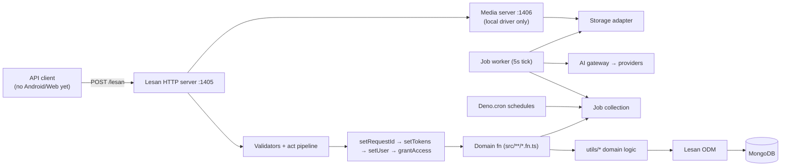
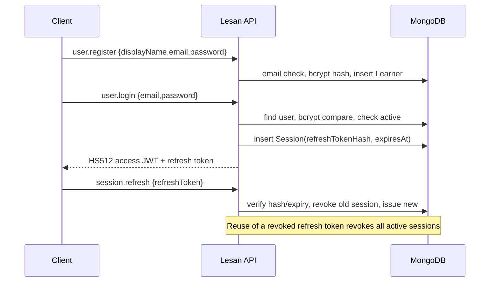
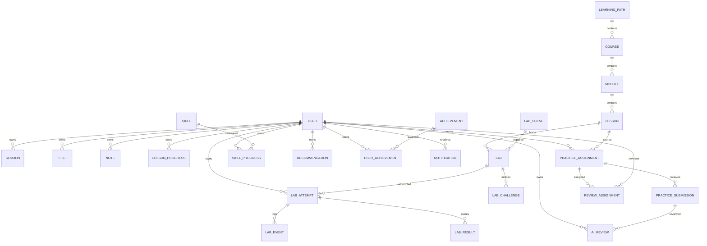
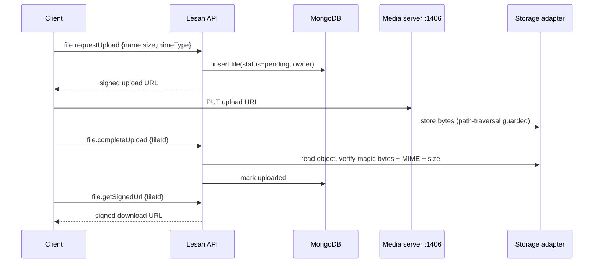
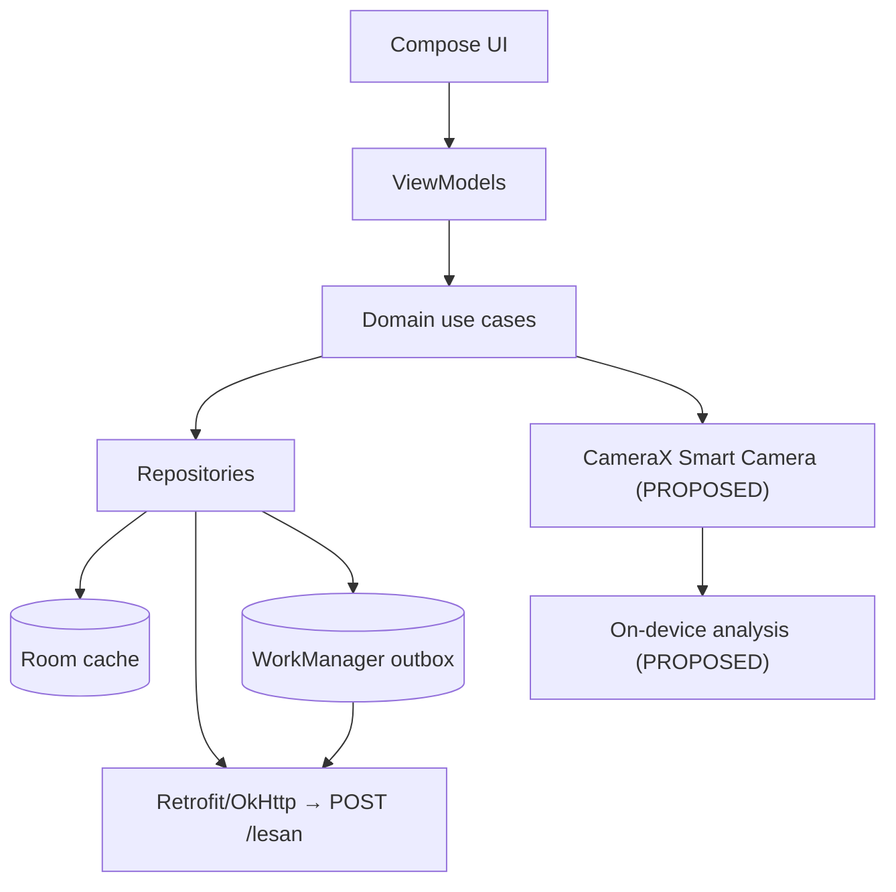
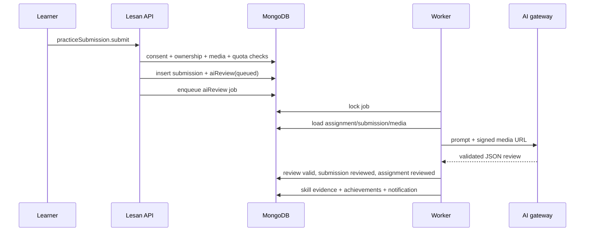

# CAMAI — Master Project Documentation

**Document type:** Central technical reference and onboarding guide
**Repository:** `camai/` (branch `main`)
**Generated:** 2026-11-08
**Method:** Read-only inspection of the working tree, git history, configuration, all 28 models, all domain acts, `utils/`, `jobs/`, `http/`, tests, CI, Docker, and the existing audit/handoff documents. No source, configuration, database, or git state was modified to produce this document.
**Status labels used:** `IMPLEMENTED`, `VERIFIED`, `PARTIALLY IMPLEMENTED`, `NOT IMPLEMENTED`, `NEEDS VERIFICATION`, `BLOCKED`, `PROPOSED`.
**Evidence conventions:** `VERIFIED` = reproduced by command or direct code read during the audit; `CODE-READ` = confirmed by reading implementation but not exercised at runtime; `UNVERIFIED` = plausible but not proven.
**Security note:** This document names environment variables but never records secret values. `.env.backend` is git-ignored and was not read or printed.

---

## How to Use This Document

- Start with Sections 1–4 for the current truth about the project.
- Use Sections 5–18 for architecture, data, API, security, and operations.
- Use Sections 19–26 for findings, roadmap, and the exact next actions.
- Use Sections 27–30 before making changes or delegating work to an AI agent.
- When this document and a source file disagree, the source file wins; update this document.
- When this document and the master specification disagree, the specification defines intended product behavior; this document records what is actually implemented.

---

## 1. Executive Summary

### 1.1 Bottom line

CAMAI is a photography learning and intelligent shooting platform. The repository contains a **real backend**, not a mock: Deno + Lesan + MongoDB with 28 models, 28 domain modules, about **59 hand-written API acts** plus a CRUD factory (roughly **124 registered acts** total), deterministic photo-lab scoring, an asynchronous AI review pipeline, a MongoDB-backed job worker, local/S3 media storage, reviewer-scoped access, offline sync endpoints, and a meaningful (if small) test suite.

It is **not a complete product and not production-ready**:

- **Android does not exist** (`mobile/` absent).
- **Web Admin does not exist** (`web/` absent).
- **Smart Camera does not exist** anywhere (no client and no backend guidance engine).
- Several high-impact correctness and hardening gaps remain in content versioning, sync, AI quota/consent handling, job recovery, deployment packaging, and abuse controls.
- The previous credential-exposure finding (SEC-01) is **fixed and independently verified**.
- The previously uncommitted work is now committed; the tree is clean and CI workflow + `deno.lock` are tracked.

### 1.2 Verdict

A credible **pre-beta backend foundation**. It is suitable for continued backend stabilization and for bootstrapping Android/Web Admin against the auth, content, practice, and lab core. It is **not** suitable for production deployment until the P0 items in Section 25 are closed.

### 1.3 Key metrics

| Metric | Value | Status |
|---|---|---|
| Lesan models | 28 | VERIFIED (code read) |
| Domain setups registered in `back/src/mod.ts` | 28 | VERIFIED |
| Hand-written act folders (`setAct`) | 59 | VERIFIED |
| CRUD factory domains | 8 | VERIFIED |
| Approximate total registered acts | ~124 | CODE-READ |
| TypeScript lines excluding generated declarations/tests | ~12,412 | VERIFIED (audit) |
| Test files | 11 | VERIFIED |
| Tests | 59 (50 unit + 9 integration steps) | VERIFIED (audit) |
| API port | 1405 | VERIFIED |
| Local media port | 1406 | VERIFIED |
| Access token TTL | 900 s (HS512) | VERIFIED |
| Refresh token TTL | 30 days | VERIFIED |
| Max media size | 25 MiB | VERIFIED |
| AI daily quota | 20 (default) | VERIFIED |

---

## 2. Product Vision

### 2.1 Vision

CAMAI combines a **Smart Camera** with structured lessons, interactive **Photo Labs**, real-world practice, AI photography critique, personal notes, account synchronization, and progress tracking. The intended experience is a guided loop: learn a concept, simulate it in a lab, shoot it in the real world, receive AI critique, and track skill growth.

### 2.2 Primary areas (from the master specification)

1. **User accounts and identity** — registration, login, refresh, password reset, account deletion.
2. **Smart Camera** — live scene analysis and composition guidance on the mobile device.
3. **Step-by-step learning** — curriculum of paths, courses, modules, and lessons.
4. **Photo Lab / interactive camera simulator** — deterministic simulation and scoring.
5. **Practice and challenges** — real-world assignments and submissions.
6. **AI Photography Teacher** — asynchronous, structured critique of submissions.
7. **Notes system** — private notes attached to lessons, labs, practice, and photos.
8. **Learning progress and resume** — layered progress and a resume algorithm.
9. **Profile, skill graph, and progress** — mastery states and evidence-based skills.
10. **Personal photo library** — private photo storage, search, and management.
11. **Web Admin portal** — content CMS, users, reviews, analytics, audit, jobs.
12. **Offline-first synchronization** — outbox/pull model for mobile.

### 2.3 Supporting systems

Authentication/authorization, media storage, background jobs, notifications, analytics, audit logging, achievements, and recommendations.

### 2.4 Non-goals (from the specification)

Do not build social networking/feed, public photo sharing, or a general-purpose photo editor. Do not start `web/` or `mobile/` until the backend is functional and the human partner asks for them.

---

## 3. Feature Overview

| Feature | Intended behavior | Backend status | Client status |
|---|---|---|---|
| Registration / login / refresh / logout | Secure session lifecycle with rotation | IMPLEMENTED | NOT IMPLEMENTED |
| Password reset | Email-delivered reset token | PARTIALLY IMPLEMENTED (no email; dev token returned) | NOT IMPLEMENTED |
| Account deletion | Consent, revoke sessions, soft delete | PARTIALLY IMPLEMENTED (no re-auth/cancel) | NOT IMPLEMENTED |
| Role-based access | Manager/Admin/ContentEditor/Reviewer/Learner | PARTIALLY IMPLEMENTED (no role management/bootstrap) | NOT IMPLEMENTED |
| Learning content CMS | Draft → Published → Archived, versioning | PARTIALLY IMPLEMENTED (no archive/latest invariant) | NOT IMPLEMENTED |
| Lesson progress | Start/update/complete, resume | PARTIALLY IMPLEMENTED (resume not wired) | NOT IMPLEMENTED |
| Photo Lab | Attempts, events, deterministic scoring | IMPLEMENTED | NOT IMPLEMENTED |
| Smart Camera | Live scene analysis and guidance | NOT IMPLEMENTED | NOT IMPLEMENTED |
| Practice | Assignments and submissions | IMPLEMENTED | NOT IMPLEMENTED |
| AI review | Async structured critique with quota | PARTIALLY IMPLEMENTED (quota/consent/mock gaps) | NOT IMPLEMENTED |
| Reviewer workflow | Assign/revoke, scoped reads | PARTIALLY IMPLEMENTED (no decision/rubric act) | NOT IMPLEMENTED |
| Notes | CRUD, soft delete, pin, search | IMPLEMENTED | NOT IMPLEMENTED |
| Offline sync | Push/pull with idempotency | PARTIALLY IMPLEMENTED (content/cursor defects) | NOT IMPLEMENTED |
| Notifications | In-app records | PARTIALLY IMPLEMENTED (no delivery) | NOT IMPLEMENTED |
| Analytics | Event ingestion + admin read | PARTIALLY IMPLEMENTED | NOT IMPLEMENTED |
| Skills / achievements | Evidence-based mastery, unlocks | PARTIALLY IMPLEMENTED (no seed/catalog) | NOT IMPLEMENTED |
| Recommendations | Deterministic next-step engine | PARTIALLY IMPLEMENTED (no lifecycle) | NOT IMPLEMENTED |
| Media library | Upload, sign, fetch, manage | PARTIALLY IMPLEMENTED (no list/search/delete) | NOT IMPLEMENTED |
| Audit log | Security and admin events | PARTIALLY IMPLEMENTED | NOT IMPLEMENTED |
| Web Admin | Next.js portal | NOT IMPLEMENTED | NOT IMPLEMENTED |
| Android app | Kotlin/Compose/clean architecture | NOT IMPLEMENTED | NOT IMPLEMENTED |

---

## 4. Current Project Status

### 4.1 Status by major area

| Area | Status | Notes |
|---|---|---|
| Deno + Lesan runtime, models, acts | IMPLEMENTED | Strict TypeScript; 28 models, 28 modules |
| Authentication | PARTIALLY IMPLEMENTED | Solid token design; no email, rate limiting, or verification |
| Authorization / ownership / reviewer scope | PARTIALLY IMPLEMENTED | Broadly present; role management absent |
| User admin | IMPLEMENTED | Projection/response hardening applied (SEC-01) |
| Learning content CMS | PARTIALLY IMPLEMENTED | CRUD/publish/newVersion; no archive/latest invariant |
| Lesson progress | PARTIALLY IMPLEMENTED | Write path works; resume resolver unused; no read act |
| Photo Lab backend | IMPLEMENTED | Deterministic scoring + attempts/events/results |
| Smart Camera | NOT IMPLEMENTED | No backend or mobile code |
| Practice + submissions | IMPLEMENTED | Consent, ownership, idempotency present |
| AI review pipeline | PARTIALLY IMPLEMENTED | Mock default, double quota check, no consent re-check |
| Reviewer workflow | PARTIALLY IMPLEMENTED | Assign/revoke/scoped reads; no decision act |
| Notes | IMPLEMENTED | CRUD, soft delete, idempotency |
| Offline sync | PARTIALLY IMPLEMENTED | Module/labScene and cursor defects |
| Notifications | PARTIALLY IMPLEMENTED | DB records only; no email/SMS/push |
| Analytics | PARTIALLY IMPLEMENTED | Ingest + admin read; dead sync metric |
| Skills / achievements | PARTIALLY IMPLEMENTED | Engines + read acts; no seed/catalog |
| Recommendations | PARTIALLY IMPLEMENTED | Engine + getNext; no lifecycle |
| Media / storage | PARTIALLY IMPLEMENTED | Local + S3 adapters; size/cleanup gaps |
| Jobs / worker | PARTIALLY IMPLEMENTED | Retry/backoff/dead-letter; stale jobs not reclaimed |
| Audit log | PARTIALLY IMPLEMENTED | Admin mutations only |
| Android | NOT IMPLEMENTED | Planned only |
| Web Admin | NOT IMPLEMENTED | Planned only |
| Tests | PARTIALLY IMPLEMENTED | 59 tests (50 unit + 9 integration steps); no E2E |
| CI | IMPLEMENTED | Workflow tracked and configured |
| Deployment | BLOCKED | Production image omits `http/`; media port unpublished |
| Documentation | PARTIALLY IMPLEMENTED | README/AGENTS stale; spec moved to `docs/` |

### 4.2 Maturity snapshot

| Dimension | Rating | Summary |
|---|---|---|
| Architecture | Good | Clean layering, coherent modules, sensible adapters |
| Data model | Good | Comprehensive and indexed; a few invariants missing |
| Security | Mixed | Strong object auth and SEC-01 fix; weak production hardening |
| Correctness | Mixed | Core flows work; content/sync/AI defects are material |
| Testing | Fair | Good unit coverage for math/guards; thin integration/E2E |
| Maintainability | Good | Typed, modular, mostly consistent; docs drift |
| Deployment readiness | Poor | Docker/media/health gaps |
| Product completeness | Low | Backend-only; no Android, Web, or Smart Camera |
| Overall | **6.0 / 10** | Pre-beta backend foundation |

### 4.3 Investigation limitations affecting status

The following limitations apply to every status label in this document:

1. **Android, Web Admin, and Smart Camera — NOT IMPLEMENTED and NOT AUDITED.** Their implementation code was not available during the audit. They must not be described as implemented, operational, or fully audited. Only their absence and the proposed architecture are documented here.
2. **Real AI provider integration and external S3 operations — NEEDS VERIFICATION.** These integrations were not exercised because valid credentials were unavailable. Only adapter code, configuration names, and mock/local paths were inspected. Do not treat real-provider or external-S3 behavior as proven.
3. **The 59-test result is historical.** It belongs to the audit run performed on 2026-11-08. The tests were **not** independently rerun during the current documentation task. It is evidence about that audit run, not a fresh verification of the current tree.
4. **Test environment variables are not loaded by the test task.** `deno task test` runs `deno test --allow-all` and does not pass `--env-file`. See Sections 14.6 and 16.4 for the current behavior and the recommended secure handling of `TOKEN_KEY` / `MEDIA_SECRET`.

---

## 5. Repository Structure

```text
camai/
├── AGENTS.md                     # Root agent instructions (partly stale)
├── README.md                     # Quick start (partly stale)
├── CAMAI_COMPLETE_PROJECT_AUDIT.md      # Complete audit (2026-11-08)
├── CAMAI_MASTER_PROJECT_DOCUMENTATION.md # This document
├── .env.backend.example          # Environment template (names only)
├── docker-compose.dev.yml        # Mongo + backend dev stack
├── .github/workflows/backend.yml # CI: check, lint, fmt, test
├── back/                         # Deno + Lesan backend
│   ├── AGENTS.md                 # Backend patterns
│   ├── deno.json                 # Tasks, imports, strict TS
│   ├── deno.lock                 # Tracked lockfile
│   ├── Dockerfile                # development + (incomplete) production
│   ├── mod.ts                    # Entry point, model instantiation, server
│   ├── models/                   # 28 Lesan models + excludes/indexes/content helpers
│   │   ├── mod.ts                # Model barrel export
│   │   ├── excludes.ts           # Relation field exclusions
│   │   ├── indexes.ts            # createIndexes() bootstrap
│   │   ├── content.ts            # Content status/version helpers
│   │   └── <model>.ts            # One file per model
│   ├── src/                      # Acts (Lesan functions)
│   │   ├── mod.ts                # functionsSetup() registers 28 domains
│   │   └── <domain>/mod.ts + <act>/{mod.ts,*.fn.ts,*.val.ts}
│   ├── utils/                    # Shared/domain logic
│   │   ├── ai/                   # Gateway, providers, prompts, schema, truthfulness
│   │   ├── storage/              # local + S3 adapters
│   │   ├── *.ts                  # auth, crud, media, sync, learning, jobs, etc.
│   │   └── *.test.ts             # Unit tests
│   ├── jobs/                     # Worker, handlers, schedules
│   ├── http/                     # Local media server + e2e placeholders
│   ├── uploads/                  # Local uploads (git-ignored except .gitkeep)
│   ├── declarations/             # Generated Lesan type declarations (git-ignored)
│   ├── scripts/migrations/       # Empty placeholder (.gitkeep)
│   └── back/src/note/...         # Empty accidental duplicate directory
├── docs/
│   ├── CAMAI_Complete_Master_Specification_v4_1_Lesan_EN.md
│   ├── CAMAI_Current_Project_Status_and_Development_Handoff.md
│   └── superpowers/plans/        # Planning artifacts
├── web/                          # NOT PRESENT (planned Next.js admin)
├── mobile/                       # NOT PRESENT (planned Android app)
└── ignore-scripts/               # Untracked ad-hoc scripts (git-ignored)
```

### 5.1 Repository hygiene observations

| Item | Observation |
|---|---|
| `back/back/src/note/{add,update,remove,gets}/` | Empty accidental directory tree; safe to remove |
| `back/http/e2e.json`, `e2e-with-remove.json` | ~3-byte placeholders, not real E2E fixtures |
| `back/scripts/migrations/` | Only `.gitkeep`; no migration framework |
| `back/declarations/selectInp.ts` | ~358 KB generated file; git-ignored |
| `back/uploads/` | Only `.gitkeep`; local dev storage |
| `.superpowers/` | Scratch/planning state; git-ignored |
| `ignore-scripts/` | Intended home for ad-hoc scripts; git-ignored |

---

## 6. Technology Stack

| Layer | Technology | Version / Notes |
|---|---|---|
| Language | TypeScript (strict) | `compilerOptions.strict: true` |
| Runtime | Deno | Local verified `2.9.8`; Docker images pin `2.1.4` (mismatch) |
| Web/API framework | Lesan | `jsr:@hemedani/lesan@^0.2.3` |
| Database | MongoDB | Driver via Lesan; dev image `mongo:7` |
| ODM | Lesan ODM | Models, relations, projections, excludes |
| Auth tokens | `djwt` (HS512) | `https://deno.land/x/djwt@v2.8/mod.ts` |
| Password hashing | `@da/bcrypt` | `jsr:@da/bcrypt@^1.0.1` |
| S3 signing | `aws4fetch` | `npm:aws4fetch@^1.0.20` |
| Cron | `Deno.cron` | Requires `unstable: ["cron"]` |
| Tests | `Deno.test` + `@std/assert` | `deno test --allow-all` |
| CI | GitHub Actions | `denoland/setup-deno@v2`, Deno v2.x |
| Container | Docker / Docker Compose | `denoland/deno:2.1.4`, `mongo:7` |
| Web Admin | Next.js + TypeScript | NOT IMPLEMENTED (planned) |
| Mobile | Kotlin + Jetpack Compose + Clean Architecture | NOT IMPLEMENTED (planned) |

### 6.1 Import map (`back/deno.json`)

| Alias | Target |
|---|---|
| `lesan` | `jsr:@hemedani/lesan@^0.2.3` |
| `@da/bcrypt` | `jsr:@da/bcrypt@^1.0.1` |
| `@std/assert` | `jsr:@std/assert@^1.0.0` |
| `djwt` | `https://deno.land/x/djwt@v2.8/mod.ts` |
| `aws4fetch` | `npm:aws4fetch@^1.0.20` |
| `@lib` | `./utils/mod.ts` |
| `@model` | `./models/mod.ts` |

### 6.2 Deno tasks

| Task | Command |
|---|---|
| `dev` | `deno run --allow-all --env-file=../.env.backend --watch mod.ts` |
| `start` | `deno run --allow-all --env-file=../.env.backend mod.ts` |
| `check` | `deno check mod.ts` |
| `test` | `deno test --allow-all` |
| `fmt` | `deno fmt` |
| `lint` | `deno lint` |

> Note: `test` does not pass `--env-file`, unlike `dev`/`start`. Tests that import token/media utilities require `TOKEN_KEY` and `MEDIA_SECRET` in the process environment; the integration test sets many env values itself, but the unit suites import the same modules. Run tests with the environment loaded when needed.

---

## 7. Backend Architecture

### 7.1 Runtime topology



### 7.2 Layering

1. **Act layer (`back/src/**`)** — one folder per act containing `mod.ts`, `<act>.fn.ts`, and `<act>.val.ts`. Validates input, enforces auth/role/scope, calls domain logic, returns validated projections.
2. **Domain logic layer (`back/utils/*.ts`)** — business rules: scoring, progress, resume, skills, recommendations, sync, media, jobs, AI, content lifecycle.
3. **Model layer (`back/models/*.ts`)** — Lesan schemas, relations, excludes, indexes.
4. **Runtime layer (`back/mod.ts`)** — model instantiation, act registration, index bootstrap, workers, schedules, media server, HTTP server.

### 7.3 Request pipeline

```
HTTP POST /lesan
  → requestId
  → token extraction/verification (setTokens)
  → user reload from DB + active check (setUser)
  → role/scope gate (grantAccess) using activeRoleId
  → act validator (*.val.ts)
  → act function (*.fn.ts)
  → domain utils
  → Lesan ODM
  → projection validation (selectStruct) + response
```

### 7.4 Strengths

- Clear separation of acts, domain logic, and models.
- One-directional relations with `relatedRelations` for reverse traversal.
- Shared CRUD factory removes duplication across eight content/admin models.
- Deterministic domain math (lab scoring, skill evaluation, recommendations, resume) is isolated and unit-tested.
- AI providers sit behind an interface; keys are environment-only.
- Media tokens are HMAC-signed and bound to file + action + expiry.

### 7.5 Architectural risks

- **No transactions** around multi-write workflows (submission → review → job; lab completion → result → skill → achievement).
- **No centralized error middleware**; the documented `{code,message,requestId,retryable}` contract is not mapped at the HTTP boundary.
- **No structured logging/metrics/tracing**; `requestId` exists but is not consistently propagated.
- **API and worker share a process**; no graceful shutdown or worker lifecycle isolation.
- **No “current published version” concept** in content.
- **No migration framework** (`scripts/migrations/` is empty).

---

## 8. Startup and Configuration

### 8.1 Startup sequence (`back/mod.ts`)

1. Import all model factories and `functionsSetup()`.
2. Create the Lesan app and connect `MongoClient`; bind `coreApp.odm.setDb(db)`.
3. Instantiate all 28 models (`users()`, `sessions()`, …).
4. Register all acts via `functionsSetup()`.
5. `await createIndexes()`.
6. Start the job worker (`startJobWorker()`).
7. Start cron schedules (`startSchedules()`).
8. Start the local media server **only** when `STORAGE_DRIVER=local`.
9. Start the HTTP server on `APP_PORT` (default 1405), with type generation and the playground enabled only in `development`.

Startup is eager: if Mongo or index creation fails, the process exits before serving. There is **no `/health` or readiness endpoint**.

### 8.2 Environment variables (names only; no values)

| Variable | Purpose | Default / Notes |
|---|---|---|
| `ENV` | Environment mode | `development`; playground enabled only in `development` |
| `APP_PORT` | API port | `1405` |
| `MONGO_URI` | MongoDB connection string | `mongodb://127.0.0.1:27017/` |
| `MONGO_DB` | Database name | `camai` |
| `TOKEN_KEY` | JWT signing secret | **Required, ≥32 bytes, else startup throws** |
| `ACCESS_TOKEN_TTL_SECONDS` | Access token lifetime | `900` |
| `REFRESH_TOKEN_TTL_DAYS` | Refresh token lifetime | `30` |
| `STORAGE_DRIVER` | Storage backend | `local` or `s3` (default `local`) |
| `UPLOAD_DIR` | Local upload directory | `uploads` |
| `MEDIA_PORT` | Local media server port | `1406` |
| `MEDIA_PUBLIC_URL` | Public base URL for local media | `http://localhost:1406` |
| `MEDIA_SECRET` | Media token signing secret | **Required, ≥32 bytes, else startup throws** |
| `S3_ENDPOINT` | S3-compatible endpoint | used when `STORAGE_DRIVER=s3` |
| `S3_REGION` | S3 region | `us-east-1` |
| `S3_BUCKET` | Private bucket | `camai-private` |
| `S3_ACCESS_KEY_ID` | S3 access key | required for S3 |
| `S3_SECRET_ACCESS_KEY` | S3 secret | required for S3 |
| `S3_SESSION_TOKEN` | Optional STS token | optional |
| `S3_FORCE_PATH_STYLE` | Path-style addressing | `true` |
| `AI_PROVIDER_A_KEY` / `AI_PROVIDER_B_KEY` | AI provider keys | optional; adapters only |
| `AI_DAILY_QUOTA` | Per-user daily AI quota | `20` |
| `CORS_ORIGINS` | Comma-separated allowed origins | default `http://localhost:3000`; **not in `.env.backend.example`** |

### 8.3 Secret enforcement (current)

`back/utils/tokens.ts` throws at module load if `TOKEN_KEY` is missing or shorter than 32 bytes. `back/utils/signedUrl.ts` throws if `MEDIA_SECRET` is missing or shorter than 32 bytes. This closes the earlier “silent fallback to a public constant” findings (S-01, S-02). Verified by direct code read; the corresponding commit is `5d62c52`.

### 8.4 Ports

| Port | Service |
|---|---|
| 1405 | Lesan API (and playground in development) |
| 1406 | Local media server (only when `STORAGE_DRIVER=local`) |
| 27017 | MongoDB (development) |

### 8.5 Commands

```bash
# From repository root
cp .env.backend.example .env.backend   # then fill secrets
docker compose -f docker-compose.dev.yml up --build

# Manual backend
cd back
deno task dev      # watch mode with env file
deno task check
deno task lint
deno task fmt
deno task test
```

---

## 9. Authentication and Authorization

### 9.1 Authentication flow



### 9.2 Token design

| Token | Format | Storage | Lifetime | Notes |
|---|---|---|---|---|
| Access JWT | HS512, claims `{_id,email,exp}` | Client memory | 900 s default | No `iat`/`iss`/`aud`/`jti` |
| Refresh token | `<sessionId>.<randomSecret>` | Client secure storage | 30 days default | Secret bcrypt-hashed in `Session` |
| Password reset | `<userId>.<randomSecret>` | Client | 30 min | Hash stored on user; all sessions revoked on success |
| Media token | base64url payload + HMAC-SHA256 | URL query | 900 s default | Bound to file ID + action + expiry |

### 9.3 Roles and authorization

Roles: `Manager`, `Admin`, `ContentEditor`, `Reviewer`, `Learner`.

Every authenticated act runs `setTokens → setUser → grantAccess`, then performs object-level checks derived from the database:

- **Owner checks**: notes, progress, attempts, submissions, files, notifications, recommendations, skill progress.
- **Reviewer scope**: an active `reviewAssignment` is required for the target assignment/submission/file.
- **Staff roles**: Manager/Admin broad access; ContentEditor content write/publish; Reviewer scoped review reads/retry.
- **Learner content reads**: forced to `status = Published` through `currentContentAccess()`.
- **Ghost bypass**: `isGhostScopeBypass` lets a ghost user without role scope bypass role gates (used by tests/seeding).

### 9.4 Authorization matrix (actual behavior)

| Capability | Learner | Reviewer | ContentEditor | Admin | Manager |
|---|---|---|---|---|---|
| Own profile/progress/notes/labs/practice | Yes | Yes | Yes | Yes | Yes |
| Read published content | Yes | Yes | Yes | Yes | Yes |
| Read drafts | No | No | Yes | Yes | Yes |
| Create/update content | No | No | Yes | Yes | Yes |
| Publish content | No | No | Yes | Yes | Yes |
| Remove content | No | No | No | Yes | Yes |
| Review assigned submissions | No | Yes (scoped) | No | Yes | Yes |
| Admin dashboard/audit/jobs/user list | No | No | No | Yes | Yes |
| Manage roles/permissions | No | No | No | No | No (no act) |

### 9.5 Authentication findings (summary)

- SEC-01 (user credential exposure) is **CLOSED and verified** (Section 14).
- No rate limiting, lockout, or login backoff (S-04).
- No email verification or real reset delivery (S-05).
- No role bootstrap/management; first user is a Learner (S-06).
- Email matching/uniqueness is case-sensitive (S-08).
- Weak password policy (length only) (S-09).
- Auth/security events are not audited (S-12).

---

## 10. Database Architecture

### 10.1 Overview

- **Database:** MongoDB, accessed through Lesan ODM.
- **Models:** 28 registered Lesan models.
- **Additional collection:** `syncOperation` (managed inside `utils/sync.ts`, not a top-level model).
- **Indexes:** centralized in `back/models/indexes.ts` and applied by `createIndexes()` at startup.
- **Migrations:** none; `back/scripts/migrations/` is empty.
- **Transactions:** not used; multi-write flows are non-transactional.

### 10.2 Index strategy

| Type | Coverage |
|---|---|
| Unique | user email, skill key, achievement key, job idempotency key, `(user,lesson)` progress, `(user,operationId)` lab attempt, `(attempt,operationId)` lab event, `(assignment,operationId)` submission, `(user,operationId)` note, `(user,skill)` skill progress, `(user,achievement)` award, `(user,dedupeKey)` notification |
| Partial unique | active `(assignment,reviewer)` review assignment; notification dedupe when string; analytics `operationId` sparse |
| TTL | sessions on `expiresAt`; analytics events after 90 days |
| Query | status/createdAt, user/status, relation IDs, content key/version |

### 10.3 Data-integrity gaps

| ID | Severity | Gap |
|---|---|---|
| D-01 | High | Content `(key, version)` is not unique; no “one Published version per key” invariant |
| D-02 | Medium | No unique `labResult` per attempt; retries can duplicate results |
| D-03 | Medium | No scoped role uniqueness (`roleId` is random per role) |
| D-04 | Medium | `module` and `labScene` have no status/version but sync treats them as published |
| D-05 | Medium | `syncOperation` and analytics daily collections have no retention/cleanup |
| D-06 | Low | `labEvent.eventType` and payload are untyped |

---

## 11. Models and Relationships

### 11.1 Model catalog (28)

| Domain | Model | Purpose / key fields |
|---|---|---|
| Identity | `user` | Display name, email, password hash, roles, settings (language/notifications/privacy), reset fields, deletion/last-login timestamps, avatar relation |
| Identity | `session` | Refresh token hash, expiry, revocation, user relation |
| Identity | `file` | Owner, name, MIME, size, type, status, storage key, metadata, soft-delete |
| Learning | `learningPath` | Content key, title, description, status/version, courses relation |
| Learning | `course` | Path relation, content fields, status/version, modules |
| Learning | `module` | Course relation, title/order; **no status/version** |
| Learning | `lesson` | Module relation, blocks, content, status/version, labs/practice |
| Learning | `labScene` | Scene definition; **no status/version** |
| Learning | `lab` | Lesson relation, scene relation, title, config, status/version |
| Learning | `labChallenge` | Lab relation, targets, difficulty, status/version |
| Progress | `lessonProgress` | User+lesson, status, current block, version, timestamps |
| Lab runtime | `labAttempt` | User, lab, challenge, operation ID, metrics, status |
| Lab runtime | `labEvent` | Attempt, operation ID, event type, payload |
| Lab runtime | `labResult` | Attempt, score, breakdown |
| Practice | `practiceAssignment` | Learner-owned assignment derived from lesson; title/objective/constraints/requirements; status |
| Practice | `practiceSubmission` | Assignment, user, file/media, EXIF, operation ID, status |
| Review | `reviewAssignment` | Assignment, reviewer, assigned-by, active status |
| Review | `aiReview` | Submission, status, result JSON, provider, error, attempts |
| Personalization | `skill` | Key, name, category, definition |
| Personalization | `skillProgress` | User+skill, mastery state, score, evidence (capped), updated |
| Personalization | `recommendation` | User, type, priority, payload, status |
| Personalization | `achievement` | Key, name, criteria/definition |
| Personalization | `userAchievement` | User+achievement, awarded timestamp |
| Personalization | `note` | User, target type/id, body, pinned, soft-delete, operation ID |
| Platform | `notification` | User, type, title, body, read/scheduled/dispatch timestamps, dedupe key |
| Platform | `analyticsEvent` | User, event type, payload, operation ID, TTL |
| Platform | `auditLog` | Actor, action, subject, metadata, timestamp |
| Platform | `job` | Queue, payload, status, attempts, max attempts, runAt, lockedUntil, lastError, idempotency key |

### 11.2 Relationship map



### 11.3 Sensitive-field handling

- `user_excludes`: `createdAt`, `updatedAt`, `password`, `passwordResetTokenHash`, `passwordResetExpiresAt`, `settings`.
- `session_excludes`: `createdAt`, `updatedAt`, `refreshTokenHash`.
- `file_excludes`: `createdAt`, `updatedAt`, `size`, `storageKey`, `metadata`.
- `utils/userProjection.ts` adds an explicit allowlist plus recursive response sanitization for user-returning acts.

### 11.4 Content lifecycle

`contentCommon` provides `version` (default 1), `status` (`Draft` / `Published` / `Archived`), and `publishedAt`. `isPublished()` checks status. `assertPublished()` guards learner access. Known gaps: no archive act, no latest-version selection, and multiple Published versions can coexist.

---

## 12. Acts and API Inventory

### 12.1 Protocol

- Single endpoint: `POST /lesan`.
- Body: `{ model, act, details: { set, get } }`.
- Auth: Bearer JWT in `Authorization` (or `token` header).
- `activeRoleId` is required in `set` for every authenticated act and must match a role on the token user.
- Projection is client-controlled via `get`, validated by `selectStruct`.
- Errors are thrown as `CODE: message` via `throwError`.
- Idempotency: `operationId` on submissions, notes, lab attempts/events, analytics, and sync operations.

### 12.2 Counts

| Metric | Count |
|---|---|
| Models | 28 |
| Domain setups | 28 |
| Hand-written act folders | 59 |
| CRUD factory domains | 8 |
| Generated CRUD acts | ~65 |
| Total registered acts | ~124 |

### 12.3 Hand-written acts by domain

| Domain | Acts |
|---|---|
| `user` | register, login, forgotPassword, resetPassword, getMe, updateMe, updateSettings, deleteMe, get, gets, setStatus, dashboardStatistic |
| `session` | refresh, logout |
| `file` | requestUpload, completeUpload, getSignedUrl, getReviewMediaUrl |
| `note` | add, update, remove, gets |
| `lessonProgress` | start, update, complete |
| `labAttempt` | add, get, gets, complete |
| `labEvent` | addBatch |
| `labResult` | gets |
| `practiceAssignment` | createFromLesson, get, gets |
| `practiceSubmission` | submit, get, gets |
| `reviewAssignment` | assign, revoke, gets |
| `aiReview` | gets, getForAssignment, retry |
| `skillProgress` | get, gets, getOverview, getHistory |
| `recommendation` | getNext |
| `userAchievement` | gets |
| `notification` | gets, markRead, markAllRead |
| `sync` | push, pull |
| `analyticsEvent` | add, gets |
| `auditLog` | gets |
| `job` | gets, retry |

### 12.4 CRUD factory domains

`learningPath`, `course`, `module`, `lesson`, `labScene`, `lab`, `labChallenge`, `achievement` (7 acts each: add, get, gets, update, updateRelations, remove, plus publish/newVersion where configured).

### 12.5 Missing act families

- `file.gets` / photo-library list, search, delete, restore.
- `lessonProgress.gets` / resume read.
- `skill` catalog acts.
- Role/permission management.
- Data export.
- Content archive/restore.
- Admin user detail/session management beyond `user.get`.
- Admin analytics/top-content/weak-skill reads.
- Reviewer decision/comment/rubric act.
- Notification admin create/queue and real delivery dispatch.
- Email verification.
- Account deletion cancel.

### 12.6 Error contract

`AppError` defines `code`, `status`, `retryable`, and a numeric status map, but `mod.ts` registers no error handler mapping `AppError.status` to HTTP. Validator failures were observed as **HTTP 501** with Lesan’s message shape, not the documented envelope. Treat the documented error contract as **NOT IMPLEMENTED at the HTTP boundary**.

---

## 13. File and Media

### 13.1 Flow



### 13.2 Implemented protections

- Declared size validated at request time (≤ 25 MiB).
- Local adapter uses path-traversal guards.
- S3 adapter uses `aws4fetch` query signing (path-style or virtual-host).
- `completeUpload` verifies magic bytes (JPEG/PNG/WebP/GIF/PDF/MP4), declared MIME, and size.
- Media server verifies HMAC tokens bound to file ID + action + expiry.
- Uploads are PUT-only; downloads GET/HEAD; responses use `no-store` and `nosniff`.
- `getSignedUrl` permits owner or Manager/Admin; `getReviewMediaUrl` additionally permits actively assigned Reviewers.

### 13.3 Media findings

| ID | Severity | Finding |
|---|---|---|
| M-01 | High | S3 upload size not enforced at upload time; `completeUpload` buffers the whole object |
| M-02 | High | No photo-library API (list/search/delete/restore) |
| M-03 | Medium | Pending uploads leak; no cleanup job for `status=pending` |
| M-04 | Medium | Local upload buffering can pressure memory up to 25 MiB; no chunking |
| M-05 | Medium | Upload/download tokens are replayable until expiry (no nonce/single-use) |
| M-06 | Medium | Inline PDFs lack `content-disposition` |
| M-07 | Medium | Compose does not expose port 1406, so local media is unreachable from the host |
| M-08 | Medium | Local media is unreachable by external AI providers |

---

## 14. Security

### 14.1 Closed / verified

| ID | Status | Summary |
|---|---|---|
| SEC-01 | **CLOSED — VERIFIED** | User acts exposed reset-token fields through arbitrary projections. Fixed with an explicit allowlist projection plus recursive response sanitization; proven by a real HTTP + real MongoDB test and an adversarial relation-projection probe. |
| S-01 | **CLOSED — VERIFIED (code read)** | JWT secret no longer falls back to a public constant; startup throws unless `TOKEN_KEY` is ≥32 bytes. |
| S-02 | **CLOSED — VERIFIED (code read)** | Media secret no longer falls back; startup throws unless `MEDIA_SECRET` is ≥32 bytes. |

### 14.2 Open security findings (high/medium)

| ID | Severity | Finding |
|---|---|---|
| S-04 | High | No rate limiting, backoff, or account lockout on register/login/reset/quota/upload |
| S-05 | High | No email/SMS delivery; `forgotPassword` returns the raw reset token when `ENV !== "production"` |
| S-06 | High | No role bootstrap or management; a fresh deployment can have no Manager/Admin |
| S-07 | High | Client-controlled `hardCascade` on content remove can delete whole trees |
| S-08 | Medium | Email matching/uniqueness is case-sensitive |
| S-09 | Medium | Weak password policy (length only) |
| S-10 | Medium | No last-admin protection when suspending privileged accounts |
| S-11 | Medium | `deleteMe` has no re-authentication and no cancel/grace flow |
| S-12 | Medium | Login/logout/reset/role/media-access events not audited |
| S-13 | Medium | No security headers (HSTS/CSP/nosniff/frame policy) |
| S-14 | Medium | CORS allowlist is environment-driven; production values unverified |
| S-16 | Low | Access tokens lack `iat`/`iss`/`aud`/`jti` |
| S-17 | Low | `setUser` loads reset-token fields into request context |

### 14.3 Privacy

- Photos are private by default and served through short-lived signed URLs.
- AI submission requires `settings.privacy.aiProcessingConsent === true` at submit time.
- Analytics ingestion returns success without storing when `analyticsConsent === false`.
- Account deletion is soft: status `suspended` → `deleted` job; sessions revoked; notes/files soft-deleted.
- Gaps: no data export, limited retention enforcement, consent not re-checked at AI processing/retry, and analytics payload redaction is a shallow key blocklist.

### 14.4 Secret hygiene

- `.env.backend` is git-ignored and not tracked; only `.env.backend.example` is tracked.
- No secret values appear in this document or in the repository history per the audit.
- Provider keys are read only from the environment and stay behind `utils/ai/providers`.

### 14.5 Unverified external integrations

| Integration | Status | Evidence boundary |
|---|---|---|
| Real AI provider A/B calls | **NEEDS VERIFICATION** | Adapters and configuration were inspected; no valid provider credentials were available, so no real call was made. Mock-provider behavior is deterministic but is not evidence that a real provider works. |
| External S3 upload/download/signing | **NEEDS VERIFICATION** | The S3 adapter code and environment variable names were inspected; no endpoint, bucket, or credentials were available, so no external S3 operation was exercised. |
| Android, Web Admin, Smart Camera | **NOT IMPLEMENTED / NOT AUDITED** | No implementation code was available. Absence is verified; behavior is not. |

This means “AI review pipeline” and “S3 media storage” are implemented **in code** but are not proven end-to-end. Treat them as `NEEDS VERIFICATION` in any release decision.

### 14.6 Test secret handling (security note)

- `deno task test` is `deno test --allow-all`; it does **not** load `.env.backend` or any env file.
- The current unit tests that import secret-dependent modules (`tokens.test.ts`, `signedUrl.test.ts`) set independent **test-only** values with `Deno.env.set(...)` **before** dynamic import. Those values are test fixtures, not production secrets.
- The integration test (`userSensitiveFields.test.ts`) passes its own test-only `TOKEN_KEY`, `MEDIA_SECRET`, and `MONGO_URI` to a spawned backend process.
- Consequence: the suite is self-contained today, but any new test that statically imports `utils/tokens.ts` or `utils/signedUrl.ts` before configuring the environment will fail at import time. CI and local runs therefore rely on implicit test setup rather than an explicit, auditable test environment.
- Recommendation: adopt a dedicated, git-ignored test env file (for example `.env.test`) populated from CI secrets or a secret manager, add a committed `.env.test.example` with placeholders only, and run tests with `deno test --allow-all --env-file=.env.test`. Never commit the real test env file, and never reuse development/production secrets in tests. See Section 16.4.

---

## 15. Background Jobs

### 15.1 Job model

MongoDB-backed `job` collection with queue, payload, status, attempts, max attempts, `runAt`, `lockedUntil`, `lastError`, and `idempotencyKey`.

### 15.2 Worker

- Interval: 5 seconds.
- Batch: up to 5 jobs per tick.
- `lockNextJob` atomically moves a queued due job to `running` and increments attempts.
- Success → `done`; failure → `failed` with exponential backoff and dead-letter after max attempts.
- Runs in the same process as the API.

### 15.3 Queues and schedules

| Queue / schedule | Purpose | Cron |
|---|---|---|
| `aiReview` | Run AI review jobs | event-driven |
| `notification` | Notification work | event-driven (currently unused) |
| `notificationDispatch` | Stamp `dispatchedAt` | `*/10 * * * *` |
| `analyticsRollup` | Aggregate previous day’s events | `15 * * * *` |
| `cleanup` | Housekeeping | `0 3 * * *` |
| `accountDeletion` | Complete account deletion | `0 4 * * *` |

### 15.4 Findings

| ID | Severity | Finding |
|---|---|---|
| J-01 | High | Stale `running` jobs are never reclaimed when a worker dies (`lockedUntil` is set but never consulted for requeue) |
| J-02 | High | `enqueueJob` swallows insert errors and may return null; callers do not check |
| J-03 | Medium | No graceful shutdown; in-flight jobs may be interrupted |
| J-04 | Medium | Notification queue is unreachable; dispatch is effectively a no-op |
| J-05 | Medium | AI retry uses a timestamped key, allowing duplicates and quota bypass |
| J-06 | Medium | No job metrics/observability |

---

## 16. Testing

### 16.1 Test inventory (11 files)

| File | Coverage |
|---|---|
| `back/src/user/userSensitiveFields.test.ts` | Real HTTP + real MongoDB integration; 9 steps proving SEC-01 hardening |
| `back/utils/authzPolicy.test.ts` | Authorization policy |
| `back/utils/content.test.ts` | Content guards/lifecycle helpers |
| `back/utils/labScoring.test.ts` | Deterministic photography scoring regressions |
| `back/utils/media.test.ts` | Magic-byte/MIME detection |
| `back/utils/recommendationEngine.test.ts` | Recommendation priority engine |
| `back/utils/resumeResolver.test.ts` | Resume algorithm |
| `back/utils/reviewAccess.test.ts` | Reviewer scope checks |
| `back/utils/signedUrl.test.ts` | HMAC media token verification |
| `back/utils/tokens.test.ts` | Token parsing/secret requirements |
| `back/utils/ai/schema.test.ts` | AI output schema validation |

### 16.2 Historical results from the audit run (2026-11-08)

> **Historical evidence only.** The results below were produced by the audit run on **2026-11-08**. The tests were **not independently rerun** during the current documentation task, so this table must not be treated as a fresh verification of the current tree. Re-run the commands before relying on them for a release decision.

| Command | Result (audit run 2026-11-08) |
|---|---|
| `deno task check` | PASS |
| `deno task lint` | PASS (299 files) |
| `deno fmt --check` | PASS (299 files) |
| `deno task test` | PASS — `59 passed (9 steps) | 0 failed` |

### 16.3 Gaps

- No end-to-end user journeys.
- No sync tests.
- No job/worker tests.
- No AI gateway/provider tests.
- No storage adapter tests.
- No coverage thresholds.
- No migration tests.
- The test task does not load an env file automatically.
- The reported 59-test result is historical (audit run only), not a current verification.

### 16.4 Test environment variable behavior (current)

- `back/deno.json` defines `"test": "deno test --allow-all"`. Unlike `dev` and `start`, it does **not** pass `--env-file=../.env.backend`.
- `utils/tokens.ts` reads `TOKEN_KEY` at module load and throws unless it is at least 32 bytes. `utils/signedUrl.ts` does the same for `MEDIA_SECRET`.
- Current tests work around this by setting independent test-only values before dynamic import:
  - `back/utils/tokens.test.ts`: sets a test-only `TOKEN_KEY` before importing `./tokens.ts`.
  - `back/utils/signedUrl.test.ts`: sets a test-only `MEDIA_SECRET` before importing `./signedUrl.ts`.
  - `back/src/user/userSensitiveFields.test.ts`: spawns the backend with test-only `TOKEN_KEY`, `MEDIA_SECRET`, and `MONGO_URI`.
- Therefore `deno task test` does not consume `.env.backend`, and the suite does not require production secrets. The trade-off is that test environment setup is implicit and repeated per file rather than centralized.

### 16.5 Recommended secure test environment

**Goal:** reproducible tests that never depend on developer `.env.backend` values and never commit secrets.

1. **Add a committed placeholder template** (for example `.env.test.example`) containing variable **names and safe non-secret placeholders only** (`TOKEN_KEY=<test-only-32-byte-value>`, `MEDIA_SECRET=<test-only-32-byte-value>`, `MONGO_URI=...`). Never place real secrets in it.
2. **Keep the real test env file git-ignored** (`.env.test`). The existing `.gitignore` rule `.env*` with narrow exceptions already ignores it; add an explicit `!.env.test.example` exception if a new template is introduced.
3. **Generate or inject values from a secret manager / CI secrets**, not from a developer’s `.env.backend`. Use dedicated test credentials with minimal privileges and a separate test database.
4. **Run tests explicitly** with the env file, e.g. `deno test --allow-all --env-file=.env.test`, or add a separate `test:env` task. Do not rely on shell-global secrets that are invisible in the repository.
5. **Keep unit tests hermetic.** Continue setting deterministic test-only values before dynamic import for pure unit tests; reserve the env file for integration tests that need real wiring.
6. **Rotate and scope** test secrets; never reuse production provider/S3 credentials. CI should fail closed if required variables are absent.

These are recommendations only. No source or configuration file was modified to implement them.

---

## 17. Infrastructure and Deployment

### 17.1 Docker

- **Development stage** (`denoland/deno:2.1.4`): copies everything, caches `mod.ts`, runs `deno task dev`.
- **Production stage**: copies `deno.json`, `mod.ts`, `models/`, `src/`, `utils/`, `jobs/` — **not `http/`** — then runs `deno run --allow-all mod.ts`. Because `mod.ts` imports `./http/mediaServer.ts`, the production image cannot type-check/cache/run. **BLOCKED**.
- Local runtime is Deno 2.9.8 while images pin 2.1.4; align versions.

### 17.2 Docker Compose (development)

- `mongo:7` on 27017 with a named volume.
- Backend built from `./back`, target `development`, env file `.env.backend`, `MONGO_URI` overridden to the compose service.
- Exposes only 1405; **1406 (media) is not published**.

### 17.3 CI

`.github/workflows/backend.yml` runs on `back/**` and workflow changes: `deno task check`, `deno task lint`, `deno fmt --check`, `deno task test` with Deno v2.x. The workflow and `back/deno.lock` are now tracked.

### 17.4 Deployment findings

| ID | Severity | Finding |
|---|---|---|
| D-01 | High | Production Docker omits `http/`, so the image cannot run |
| D-02 | High | Media port 1406 not exposed/proxied |
| D-03 | Medium | No frozen/cached-only install in deployment |
| D-04 | Medium | No production manifests, backups, restore, or migration runner |
| D-05 | Medium | No health/readiness endpoint or container healthcheck |
| D-06 | Medium | Dev image caches then runs watch mode; production is incomplete |

### 17.5 Unverified external infrastructure

| Dependency | Status | Boundary |
|---|---|---|
| Real AI providers | **NEEDS VERIFICATION** | No valid provider credentials; only adapters/mock were inspected |
| External S3-compatible storage | **NEEDS VERIFICATION** | No endpoint, bucket, or credentials; local adapter only was exercised in the audit |
| Production runtime | **BLOCKED** | Production Docker image omits `http/` and cannot run as written |
| CI test environment | **NEEDS VERIFICATION** | CI runs `deno task test`, which does not load an env file; the current suite is self-contained but not centrally configured |

CI does not inject AI/S3 credentials, and the workflow does not pass `--env-file`. Deployment readiness therefore remains unproven for any external integration.

---

## 18. Git Status

### 18.1 Current snapshot

| Field | Value |
|---|---|
| Branch | `main` |
| HEAD | `5d62c52 fix(security): require strong signing secrets` |
| Working tree | Clean (no modified/untracked non-ignored files) |
| Remote | `origin git@github.com:aminsadeghian1/camai.git` |
| Tracked CI/lock | `.github/workflows/backend.yml` and `back/deno.lock` are tracked |
| Secrets in git | `.env.backend` is ignored; only `.env.backend.example` is tracked |

### 18.2 Recent history

| Commit | Summary |
|---|---|
| `5d62c52` | fix(security): require strong signing secrets |
| `bcac6cc` | test: cover backend utilities and sensitive user fields |
| `02fef20` | feat: implement CAMAI backend domain APIs |
| `e3954ba` | chore: scaffold tooling and docs |
| `c6d7c7f` | docs: add specification and handoff |
| `3b4b352` | feat: bootstrap project scaffold |

### 18.3 Changes since the audit

The audit was performed at HEAD `3b4b352` with ~159 uncommitted changes. Since then:

- All implementation work was committed in logical commits.
- The CI workflow and lockfile are tracked.
- `TOKEN_KEY`/`MEDIA_SECRET` fallbacks were removed (S-01/S-02 closed).
- The working tree is clean.

The audit’s “single most urgent action: commit the working tree” is **done**. Remaining P0 items are unchanged.

---

## 19. Audit Findings

The full register lives in `CAMAI_COMPLETE_PROJECT_AUDIT.md` Section 20. This section summarizes the material findings by area. Statuses reflect the current tree (post-commit, post-secret fix).

### 19.1 Critical / high

| Area | Findings | Status |
|---|---|---|
| Security | S-01, S-02 fixed; S-04/05/06/07 open | PARTIAL |
| Content | C-01 create-as-published, C-02 no supersede, C-03 no archive, C-04 no latest version | OPEN |
| Learning | L-01 resume never called | OPEN |
| AI | A-01 double quota, A-02 mock default-on, A-03 consent not re-checked, A-04 prompt injection | OPEN |
| Sync | SY-01 modules/scenes empty, SY-02 global cursor skips rows | OPEN |
| Notifications | N-01 no delivery, N-02 most types never generated | OPEN |
| Media | M-01 S3 size not enforced, M-02 no photo library | OPEN |
| Jobs | J-01 stale jobs never reclaimed, J-02 enqueue errors swallowed | OPEN |
| Gamification | G-01 no achievement seed | OPEN |
| Deployment | D-01 production image omits `http/`, D-02 media port | BLOCKED |
| Quality | T-01 no E2E, T-02 CI now tracked | PARTIAL |

### 19.2 Medium themes

- Content validation and relation existence (C-05–C-10).
- Lab event bounds and non-transactional completion (PL-01–PL-06).
- AI truthfulness regex state and untrusted EXIF (A-05, A-11).
- Sync response versioning/bounds and validator bypass (SY-03–SY-07).
- Notification preferences and admin creation (N-03, N-04).
- Media token replay and pending cleanup (M-03, M-05).
- Analytics taxonomy/redaction and a dead sync metric (AN-01–AN-04).
- Deployment health/backup/migration (D-03–D-06).
- Documentation drift (DOC-01–DOC-04).

### 19.3 What is genuinely strong

1. Deterministic domain math is isolated and unit-tested.
2. Object-level authorization is consistently present, including reviewer scoping.
3. Session/reset credential handling is fundamentally sound (bcrypt, rotation, reuse detection, reset revokes sessions).
4. The SEC-01 fix is well-designed and independently verified.
5. Media primitives (magic-byte verification, signed action-scoped tokens, traversal guard) exceed typical early-stage implementations.
6. The data model is coherent and indexed.

---

## 20. Android Architecture (PROPOSED)

**Status: NOT IMPLEMENTED.** No `mobile/` directory exists. Do not create it until the human partner asks.

### 20.1 What the backend currently blocks

- No stable resume read endpoint.
- Sync is incorrect for modules/scenes and has cursor defects.
- No photo-library API.
- Error HTTP mapping does not match the documented contract.
- No role bootstrap for admin flows.
- No camera/Smart Camera backend.

### 20.2 Proposed architecture



### 20.3 Proposed layers (Clean Architecture)

- **Presentation:** Compose screens, ViewModels, UI state.
- **Domain:** use cases, entities, repository interfaces.
- **Data:** Retrofit API, Room cache, DataStore for tokens, outbox for offline writes.
- **Platform:** CameraX, WorkManager, secure storage.

### 20.4 Prerequisites before Android work

1. Fix sync (SY-01, SY-02).
2. Add resume read act (L-01).
3. Add photo-library API (M-02).
4. Fix HTTP error mapping.
5. Add role bootstrap.
6. Define the Smart Camera contract (on-device vs backend).

---

## 21. AI Architecture

### 21.1 Components

| Component | Responsibility |
|---|---|
| `utils/ai/gateway.ts` | Orchestrates provider call, quota, validation |
| `utils/ai/providers/index.ts` | Provider selection/fallback (A/B + mock) |
| `utils/ai/providers/openaiCompatible.ts` | OpenAI-compatible HTTP adapter |
| `utils/ai/providers/mock.ts` | Deterministic mock provider |
| `utils/ai/prompts.ts` | Prompt construction |
| `utils/ai/schema.ts` | Output schema validation |
| `utils/ai/truthfulness.ts` | Sanitization of unsupported claims |
| `jobs/handlers.ts` | Async review execution and state transitions |

### 21.2 Pipeline



### 21.3 Design characteristics

- AI is asynchronous and does not block deterministic Photo Lab scoring.
- Providers are adapter-based; the mock provider is deterministic.
- Keys are environment-only; no provider SDK leaks into acts.
- Offline AI is only partially supported (sync exists but has correctness defects).

### 21.4 Findings

A-01 double quota check; A-02 mock fallback default-on; A-03 consent not re-checked; A-04 prompt injection via learner fields; A-05 client EXIF trusted; A-06 local media unreachable by external providers; A-07 duplicate retry jobs bypass quota; A-08 no user-visible failed state; A-09 non-transactional success path; A-10 no moderation; A-11 regex `lastIndex` bug; A-12 signed URL embedded in third-party prompt.

---

## 22. Admin Dashboard (PROPOSED)

**Status: NOT IMPLEMENTED.** No `web/` directory exists. Do not create it until the human partner asks.

### 22.1 Backend capabilities already available

Dashboard statistics, user list/detail, user status change, content CRUD/publish, AI review list/retry, audit log list, job list/retry.

### 22.2 Missing backend capabilities for a real admin

- Role assignment and scoped role management.
- User session management.
- Admin analytics aggregates and top-content/weak-skill reads.
- Content archive/restore.
- Media moderation and library management.
- Notification creation/queueing.
- Data export.
- Last-admin protection.

### 22.3 Proposed architecture

```mermaid
flowchart LR
  Admin["Next.js Admin (PROPOSED)"] --> API["POST /lesan"]
  API --> Dashboard["Dashboard"]
  API --> Users["Users + status"]
  API --> CMS["Content CMS + publish"]
  API --> Reviews["AI review queue"]
  API --> Audit["Audit logs"]
  API --> Jobs["Jobs + retry"]
  note right of Admin: RBAC enforced server-side
```

### 22.4 Prerequisites

1. Role bootstrap/management (S-06).
2. Content archive/latest-version semantics (C-02, C-03, C-04).
3. Admin analytics reads (AN-01).
4. User session management.
5. Error contract mapping at the HTTP boundary.

---

## 23. Non-Functional Requirements

| Category | Current state | Target / gap |
|---|---|---|
| Performance | No benchmarks; sync and list acts lack aggregate bounds | Add pagination/size limits; benchmark list/sync |
| Scalability | Single process for API + worker; Mongo-backed jobs | Separate worker; horizontal API scaling; job metrics |
| Availability | No health/readiness; restart loses in-flight jobs | `/health`, graceful shutdown, stale-job recovery |
| Reliability | No transactions; partial states possible | Transactions or idempotent reconciliation |
| Security | Strong object auth and media primitives; weak abuse controls | Rate limiting, headers, role management, email verification |
| Privacy | Consent at submit; signed URLs; soft delete | Re-check consent, export, retention, recursive redaction |
| Observability | `requestId` only; no metrics/tracing | Structured logs, metrics, tracing, job dashboards |
| Maintainability | Typed, modular; docs drift | Update README/AGENTS; ADRs; API reference |
| Testability | Good unit coverage; thin integration/E2E | E2E journeys, sync/job/media tests, coverage gates |
| Accessibility/i18n | Settings include `language`; no client | Client-side accessibility and localization |
| Deployment | Docker production broken; no backups | Fix image, expose media, add manifests/backups |

---

## 24. Missing Features and Technical Debt

### 24.1 Missing product features

- Android app, Web Admin, Smart Camera. **NOT IMPLEMENTED**; their code was unavailable, so they are not audited and must not be described as operational.
- Real AI provider integration and external S3 operations. **NEEDS VERIFICATION**; not exercised without valid credentials.
- Photo library (list/search/delete/restore).
- Resume read endpoint and block-level completion.
- Content archive and single-current-published-version semantics.
- Reviewer decision/rubric/comment flow.
- Email/SMS/push delivery and notification preferences enforcement.
- Email verification and production password-reset delivery.
- Role management and first-admin bootstrap.
- Skill catalog and achievement seed/migration.
- Recommendation dismiss/complete lifecycle.
- Data export and deletion cancel/grace.
- Admin analytics aggregates and user session management.

### 24.2 Technical debt

- HTTP error contract not mapped.
- Non-transactional multi-write flows.
- Sync validator bypass and cursor correctness.
- Job requeue/observability and graceful shutdown.
- Media upload limits, pending cleanup, token single-use.
- Content relation existence checks and publish validation.
- AI quota/consent/mock/prompt-injection/truthfulness issues.
- Analytics taxonomy/redaction and dead `syncFailures` metric.
- Stale README/AGENTS and empty migration/placeholder artifacts.
- Deno version drift between local and Docker images.
- Test environment debt: `deno task test` does not load an env file, test secrets are set per-file rather than through a reproducible, git-ignored test environment, and the 59-test result is historical (audit run 2026-11-08) rather than freshly verified.
- Unverified integration debt: real AI providers and external S3 are code-only until exercised with valid, least-privilege credentials.

---

## 25. Development Roadmap

### 25.1 P0 — before any beta

1. **Deployment**: copy `http/` into the production image, expose/proxy media, add healthchecks, fail on missing secrets. *(Secrets now fail fast; the rest remains.)*
2. **Content lifecycle**: archive old versions, enforce latest-published, strip status/version/publishedAt from create/update, add archive act.
3. **Sync**: fix module/labScene filters, replace the global cursor with a correct feed or per-group cursors.
4. **AI**: single quota check with atomic reservation, explicit mock opt-in (fail closed in production), consent re-check at processing/retry, stable retry key, sanitize/limit learner prompt text, fix truthfulness regex.
5. **Auth hardening**: rate limiting/lockout, role bootstrap/management, email verification, secure reset delivery.
6. **Tests**: integration tests for auth, content publish, sync, jobs, media.
7. **HTTP error contract**: map `AppError` to the documented envelope.

**Exit criteria:** clean production image, media reachable, correct content versioning, correct sync, safe AI behavior, abuse controls, and passing integration tests.

### 25.2 P1 — usable learner experience

1. Photo library API.
2. Lesson progress read + resume act.
3. Notification delivery and domain notifications.
4. Reviewer decision/rubric flow.
5. Skill catalog + achievement seed.
6. Admin analytics, user session management, content archive.
7. Email verification and real password reset delivery.

### 25.3 P2 — scale and quality

1. Cursor pagination across list acts.
2. Transactions/reconciliation for multi-write workflows.
3. Structured logging, metrics, tracing, health.
4. Security headers, rate limiting, quota middleware.
5. Media thumbnails/moderation.
6. Backups, migrations, deployment manifests.
7. Documentation refresh and ADRs.

### 25.4 Milestones

| Milestone | Definition of done |
|---|---|
| M1 — Backend beta | P0 closed; integration tests; deployable image |
| M2 — Mobile MVP | Android auth/content/lab/practice/AI against stable API; sync correct |
| M3 — Admin MVP | Web Admin with role management, CMS, review queue, audit, jobs |
| M4 — Smart Camera | On-device analysis contract + guidance UI |
| M5 — Production | Hardening, observability, backups, load/security validation |

---

## 26. Immediate Next Actions

Ordered, concrete, and read-only-derived. Each is one logical step and should be verified before moving on.

1. **Fix the production Docker image (D-01).** Add `COPY http/ ./http/` to the production stage in `back/Dockerfile`, then build the image and run a smoke test. This is the smallest change that unblocks deployment.
2. **Fix sync content correctness (SY-01).** Remove the invalid `status: "Published"` filter for `module` and `labScene` in `back/utils/sync.ts` (lines ~391 and ~422), or add proper publication semantics. Add a sync test that proves modules/scenes are returned.
3. **Fix content create-as-published (C-01).** Strip `status`, `version`, and `publishedAt` from `add`/`update` inputs in `back/utils/crud.ts` so content can only be published through `publish`, then add a regression test.

After these three, proceed with the rest of the P0 list in Section 25 in order.

### 26.1 Verification commands

```bash
cd back
deno task check
deno task lint
deno fmt --check
deno task test
```

---

## 27. Architectural Decisions

| Decision | Rationale | Consequences |
|---|---|---|
| Deno + Lesan + MongoDB | Fast TypeScript iteration; ODM, acts, projections, and codegen in one framework | Coupled to Lesan conventions; HTTP error mapping is framework-specific |
| Single `POST /lesan` API | Uniform act dispatch and validated projections | Less RESTful; client must know act names |
| HS512 access JWT + rotating refresh token | Stateless access with revocable sessions | Refresh rotation/reuse detection complexity; no JWT revocation list |
| Refresh secret bcrypt-hashed in `Session` | Leaked DB does not expose usable refresh tokens | bcrypt cost on refresh; full-string compare |
| Bcrypt for passwords and reset tokens | Standard, slow hashing | No pepper; reset token returned in dev |
| MongoDB-backed job queue | No extra infrastructure; transactional-ish atomic lock | No stale-job recovery; single-process worker |
| Storage adapter interface (local/S3) | Dev simplicity and production privacy | Local media unreachable by external services; adapters differ |
| HMAC signed media tokens | Avoid direct storage exposure | Replayable until expiry; secrets required |
| AI provider adapters with mock | Testability and provider flexibility | Mock default-on risk; schema/truthfulness complexity |
| Deterministic lab scoring | Reproducible, testable, offline-capable | Must keep scoring rules in sync with spec |
| One-directional relations + `relatedRelations` | Avoids circular definitions; clear ownership | Must remember reverse traversal definitions |
| Shared CRUD factory | Removes duplication across content models | Central bugs affect all eight domains |
| Client-controlled projections with allowlist sanitization | Flexible reads without leaking secrets | Must apply sanitization per act; easy to forget in new acts |
| Soft delete | Recoverability and audit | Requires cleanup/retention jobs |
| No transactions | Simplicity with Mongo | Partial states in multi-write flows |

---

## 28. Risks and Dependencies

### 28.1 Risk register

| Risk | Likelihood | Impact | Mitigation |
|---|---|---|---|
| Production image cannot run (missing `http/`) | High | High | Fix Dockerfile; smoke-test image |
| Content shows stale/multiple published versions | High | High | Archive/supersede; latest-version query |
| Sync loses rows or omits modules/scenes | High | High | Fix filters and cursor; add tests |
| AI serves mock reviews in production | Medium | High | Explicit opt-in; fail closed |
| AI processes after consent revoked | Medium | High | Re-check consent in handler/retry |
| Stale jobs never recover | Medium | High | Requeue when `lockedUntil < now` |
| No rate limiting enables abuse | High | High | Add middleware/backoff |
| Secrets misconfigured | Low | High | Fail-fast (implemented) |
| Data loss from non-transactional writes | Medium | Medium | Transactions/reconciliation |
| Docs drift misleads contributors | High | Medium | Update README/AGENTS; maintain this doc |
| Deno version drift | Medium | Medium | Pin and align images/local |
| External AI/S3 outages | Medium | Medium | Retries/backoff; fail closed; status contract |

### 28.2 External dependencies

| Dependency | Used for | Failure mode |
|---|---|---|
| MongoDB | All persistence, jobs, sync ops | Startup fails; no serving |
| Deno / Lesan | Runtime and framework | Build/runtime failure |
| AI providers (A/B) | AI review | Job failure; mock fallback (risky) |
| S3-compatible storage | Production media | Upload/download failure |
| Local filesystem | Development media | Upload/download failure |
| GitHub Actions | CI | No automated verification |
| Docker / Compose | Dev and deployment | Environment drift |

### 28.3 Assumptions

- The master specification in `docs/` defines intended behavior.
- MongoDB is available at startup.
- Production will supply strong `TOKEN_KEY` and `MEDIA_SECRET`.
- AI/S3 credentials are supplied only in production environments.
- The audit’s runtime verification (Deno 2.9.8, Mongo reachable) reflects a representative dev environment.

---

## 29. Glossary

| Term | Meaning |
|---|---|
| **Act** | A Lesan API operation (`src/<domain>/<act>/`) with validator and function |
| **Lesan** | Deno web framework and MongoDB ODM used by the backend |
| **Model** | Lesan schema definition in `back/models/` |
| **Projection** | Client-requested field selection (`get`) validated by `selectStruct` |
| **Excludes** | Fields removed from relation output by the model |
| **Active role** | `activeRoleId` selecting one role from the user’s roles for the request |
| **Ghost bypass** | `isGhostScopeBypass` allowing scope-free role bypass (tests/seeding) |
| **SEC-01** | The credential-exposure finding, now closed |
| **P0/P1/P2** | Roadmap priority tiers |
| **Mock provider** | Deterministic AI provider used when no real provider is configured |
| **Lab** | Interactive camera simulator with deterministic scoring |
| **Smart Camera** | On-device live scene analysis and composition guidance (not implemented) |
| **Resume resolver** | Utility that computes where a learner should continue (not wired) |
| **Content key/version** | Content identity and version fields used for draft/publish |
| **Idempotency / operationId** | Client-supplied key preventing duplicate mutations |
| **Dead-letter** | Job state after max attempts |
| **Locked job** | Job moved to `running` with `lockedUntil` |
| **Signed media token** | HMAC token authorizing an upload/download for a file |
| **SEC / C / L / PL / A / SY / N / M / J / AN / G / D / T / DOC** | Finding ID prefixes by area |

---

## 30. Instructions for Future AI Agents

### 30.1 Read-first order

1. `AGENTS.md` (root) and `back/AGENTS.md`.
2. This document (Sections 1–4, 24–27).
3. `docs/CAMAI_Complete_Master_Specification_v4_1_Lesan_EN.md` for intended behavior.
4. `CAMAI_COMPLETE_PROJECT_AUDIT.md` for evidence and full findings.
5. The specific `back/models/`, `back/utils/`, and `back/src/` files for the task.

### 30.2 Hard rules

- **Read-only research first.** Understand the current implementation before editing.
- **One logical step at a time.** Implement, test, and close a task before starting the next.
- **Do not invent behavior.** If the spec is silent, mark it PROPOSED and ask.
- **Never expose secrets.** Do not read, print, or commit `.env.backend` values.
- **Never commit** unless the human partner explicitly says `git commit`.
- **Never use `git reset`.**
- **Place ad-hoc scripts** in `ignore-scripts/`.
- **Do not create `web/` or `mobile/`** until explicitly requested.
- **Every user-scoped query must enforce ownership/scope.**
- **Every retryable mutation must be idempotent** via `operationId`.
- **Published learning content is immutable.**
- **Provider SDKs stay behind `utils/ai/providers`.**
- **Never expose passwords, refresh-token hashes, reset-token fields, or storage keys** through relations or responses.

### 30.3 Teaching mandate

For every implementation step, explain to the human partner:

1. **What** will be built.
2. **Why** it is needed (link to a finding or spec section).
3. **The concepts** involved.
4. **Which files** will change and why.
5. **How** to verify it.
6. **How to test it.**

Do not bundle multiple unrelated changes into one step.

### 30.4 Backend conventions

- Acts live in their own folder with `mod.ts`, `<act>.fn.ts`, `<act>.val.ts`.
- Acts validate and route; domain logic belongs in `utils/`.
- Relations are one-directional on the owning model.
- Use the shared CRUD factory for content models where appropriate.
- Apply user projection/response sanitization to every user-returning act.
- Use `throwError` for domain errors; do not invent new error shapes.
- Add indexes in `models/indexes.ts`, not ad hoc.
- Add tests for new domain logic; follow existing test naming.

### 30.5 Verification before claiming completion

Run and report actual output for:

```bash
cd back
deno task check
deno task lint
deno fmt --check
deno task test
```

If a command cannot run (e.g., Mongo unavailable), say so explicitly. Do not claim success without evidence. Note that `deno task test` does **not** load an env file; provide `TOKEN_KEY`/`MEDIA_SECRET` through a secure, reproducible test environment (Section 16.5) and do not cite the historical 59-test result as a fresh run.

### 30.6 Current next task

Start with **Section 26**: fix the production Docker image (`http/`), then sync module/labScene filters, then content create-as-published stripping. Each is small, testable, and on the P0 path.

---

## 31. Investigation Limitations

This section records what the documentation task could and could not verify. It exists so future readers do not over-trust status labels.

### 31.1 Components with no available implementation

| Component | Status | What was verified | What was not verified |
|---|---|---|---|
| Android app (`mobile/`) | **NOT IMPLEMENTED / NOT AUDITED** | The directory is absent | Any runtime behavior, architecture, API use, or camera behavior |
| Web Admin (`web/`) | **NOT IMPLEMENTED / NOT AUDITED** | The directory is absent | Any runtime behavior, admin flows, or UI architecture |
| Smart Camera | **NOT IMPLEMENTED / NOT AUDITED** | No backend or client code exists | Live scene analysis, composition guidance, on-device pipeline |

Do not claim these components are implemented, operational, or fully audited. Only their absence and the proposed architecture (Sections 20 and 22) are documented.

### 31.2 Integrations not exercised

| Integration | Status | Reason |
|---|---|---|
| Real AI provider A/B | **NEEDS VERIFICATION** | Valid credentials were unavailable; only adapters, prompts, schema, and mock behavior were inspected |
| External S3-compatible storage | **NEEDS VERIFICATION** | No endpoint, bucket, or credentials; only adapter code and local storage paths were inspected |
| Production deployment | **BLOCKED** | The production image omits `http/` and cannot run as written |

Code presence is not evidence of operational behavior. Treat these integrations as unproven until exercised with dedicated, least-privilege test credentials.

### 31.3 Test result provenance

- The reported **59 passed (9 steps) | 0 failed** result belongs to the audit run performed on **2026-11-08**.
- The tests were **not independently rerun** during the current documentation task.
- The result is **historical evidence**, not a fresh verification of the current working tree.
- Commands and results in Section 16.2 must be re-run before being used for a release decision.

### 31.4 Test environment variable handling

- `back/deno.json` defines `"test": "deno test --allow-all"`; it does **not** pass `--env-file`, unlike `dev` and `start`.
- `utils/tokens.ts` requires `TOKEN_KEY` (≥32 bytes) at import; `utils/signedUrl.ts` requires `MEDIA_SECRET` (≥32 bytes) at import.
- Current tests avoid production secrets by setting independent test-only values before dynamic import (`tokens.test.ts`, `signedUrl.test.ts`) or by passing test-only values to a spawned backend (`userSensitiveFields.test.ts`).
- Recommendation: use a git-ignored `.env.test` populated from CI secrets or a secret manager, commit only a placeholder `.env.test.example`, and run `deno test --allow-all --env-file=.env.test`. Keep unit tests hermetic and never reuse development/production secrets. See Sections 14.6 and 16.5.

### 31.5 Scope of this documentation update

- Only `CAMAI_MASTER_PROJECT_DOCUMENTATION.md` was modified.
- No source code, configuration, database, or Git history was changed.
- No secret values were read or printed.
- Existing documentation was preserved; new limitations were added to Sections 4, 14, 16, 17, 24, and this section.

---

*End of master documentation. Produced read-only; the only file created is this document. No source, configuration, database, or git state was modified; no secrets were printed.*
