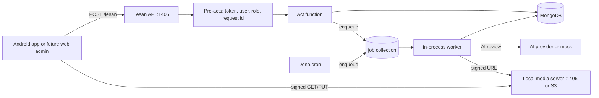
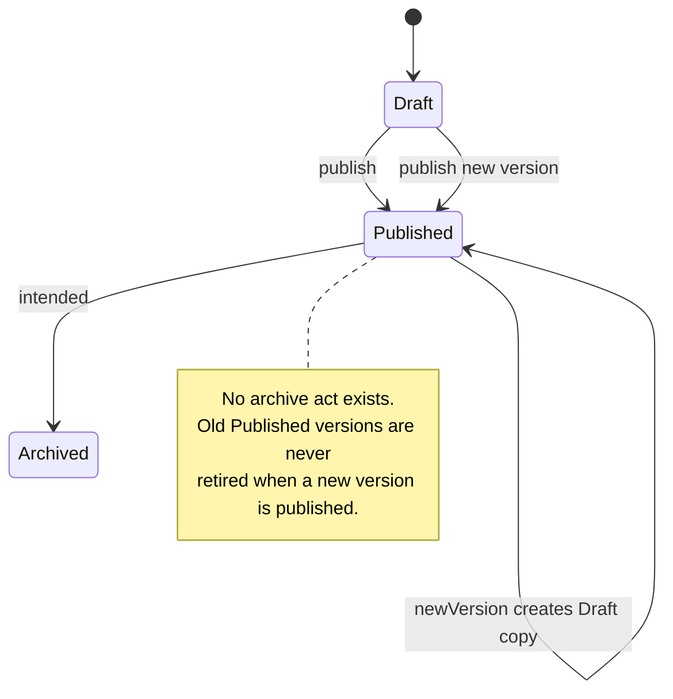
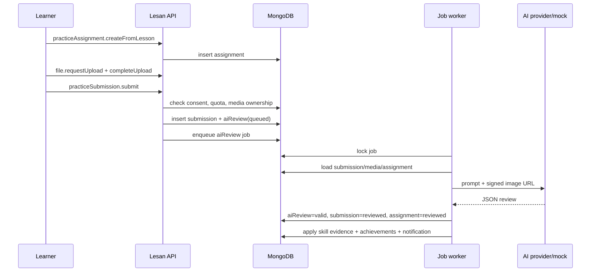

# CAMAI Current Project Status and Development Handoff

**Report date:** 2026-11-03  
**Audit type:** Read-only static audit; no repository files were changed except adding this report.  
**Primary contract:** `docs/CAMAI_Complete_Master_Specification_v4_1_Lesan_EN.md`  
**Code examined:** Deno + Lesan + MongoDB backend in `back/`  
**Status:** Pre-alpha, substantial backend implementation, not production-ready and not yet contract-complete.

---

## Table of Contents

1. [Executive Summary](#1-executive-summary)
2. [Scope, Method, and Evidence Limits](#2-scope-method-and-evidence-limits)
3. [Repository and Git State](#3-repository-and-git-state)
4. [Architecture and Runtime Topology](#4-architecture-and-runtime-topology)
5. [Data Model, Relations, and Indexes](#5-data-model-relations-and-indexes)
6. [Authentication, Authorization, and Security](#6-authentication-authorization-and-security)
7. [API Surface and Act Inventory](#7-api-surface-and-act-inventory)
8. [Learning Content, Publishing, and Versioning](#8-learning-content-publishing-and-versioning)
9. [Learning Progress and Resume](#9-learning-progress-and-resume)
10. [Photo Lab](#10-photo-lab)
11. [Real-World Practice and AI Review](#11-real-world-practice-and-ai-review)
12. [Notes and Offline Sync](#12-notes-and-offline-sync)
13. [Notifications, Email, Push, and Admin Operations](#13-notifications-email-push-and-admin-operations)
14. [Analytics, Recommendations, Skills, and Achievements](#14-analytics-recommendations-skills-and-achievements)
15. [Media and Storage](#15-media-and-storage)
16. [Jobs, Workers, and Reliability](#16-jobs-workers-and-reliability)
17. [Testing, CI/CD, Deployment, and Documentation](#17-testing-cicd-deployment-and-documentation)
18. [Findings, Roadmap, Final Answers, Assumptions, and Glossary](#18-findings-roadmap-final-answers-assumptions-and-glossary)

---

## 1. Executive Summary

### 1.1 Bottom line

CAMAI is **not** a scaffold any more. The backend contains a large, coherent first implementation of the domain: 28 domain models, 59 hand-written act folders, generic content CRUD, learning paths/courses/modules/lessons, labs, practice assignments/submissions, AI review jobs, notes, sync, progress, recommendations, achievements, audit, analytics, notifications, media signing, and MongoDB-backed jobs.

It is nevertheless **not ready for production, not ready for an app-store client, and not safe to treat as spec-complete**. The main reasons are:

- **No runtime verification was possible in this environment.** Deno is not installed, so `deno task check`, `lint`, `fmt`, and `test` were not run. All conclusions are static.
- **The working tree is an unreviewed, uncommitted WIP.** There are 55 modified tracked files, 100 untracked paths, and 1 deleted file on `main` at `3b4b352`. Critical code (`.github/`, media server, schedules, many acts, many tests) is untracked.
- **The content publishing/versioning contract is broken.** A new version can be published while the old version remains `Published`; there is no archive operation; learners can receive multiple published versions. Content can also be created directly as `Published`, bypassing the publish act.
- **Several correctness bugs affect core journeys.** Sync omits modules and lab scenes, sync pagination can skip changes, the AI quota is double-counted, and client-controllable `hardCascade` can delete content trees.
- **Production hardening is absent.** There is no rate limiting, no email/SMS/push delivery, no role-management/bootstrap path, no account data export, incomplete account deletion, and no startup validation of critical secrets. AI falls back to a mock provider by default.
- **Deployment is currently broken.** The production Docker stage does not copy `back/http/`, although `back/mod.ts` imports `back/http/mediaServer.ts`.

### 1.2 Status by major area

| Area | Status | Short assessment |
|---|---|---|
| User/session/auth | Partial | Registration, login, refresh, logout, getMe, reset exist; no email verification/delivery; reset-hash exposure risk; no rate limiting. |
| RBAC | Partial | Role gates and active-role selection exist; no role management, no bootstrap, scope fields mostly unused. |
| Learning content | Partial | Full CRUD/publish/new-version factory; archive/latest-version semantics missing; publish validation inert. |
| Lesson progress | Partial | Start/update/complete exist; no completed-block tracking; resume resolver is not wired to any act. |
| Photo Lab | Partial | Models, attempts, events, deterministic scoring, results exist; no dedicated lab-session API beyond attempts/events; no UI. |
| Practice + AI review | Partial | End-to-end queue/handler exists; quota bug, consent-recheck gap, prompt-injection surface, fake-provider fallback. |
| Reviewer workflow | Partial | Assignment/revoke and scoped reads exist; no review notifications/queue and limited scope enforcement. |
| Notes | Implemented | CRUD, pinning, targets, soft delete, operation IDs. |
| Offline sync | Partial | Push/pull and idempotency exist; missing module/lab-scene content; cursor/limit correctness issue. |
| Notifications | Partial | Inbox model and read/mark-all-read exist; no real delivery; dispatch handler is effectively a no-op. |
| Analytics | Partial | Event capture and daily rollup exist; no admin analytics endpoints; consent handling is shallow. |
| Achievements/skills | Partial | Engine and progress models exist; no seed data, no skill acts, no achievement notifications. |
| Recommendations | Partial | `getNext`/engine exist; limited activity types and no dismissal/completion loop. |
| Media/storage | Partial | Local/S3 adapter, magic-byte detection, signed URLs; no library/delete, S3 upload size not enforced at PUT, complete buffers entire object. |
| Jobs | Partial | Worker, locks, retries, dead state, cron schedules; stale `running` jobs are never reclaimed; notification queue is unused. |
| Admin operations | Partial | Dashboard stats, audit log, job retry, review assignment; no user detail/role management/notification creation/analytics endpoints. |
| Testing/CI | Weak | 58 unit tests in 10 files, mostly pure helpers; no integration/e2e; CI workflow exists but is untracked. |
| Deployment | Blocked | Production Docker stage omits `http/`; media port not exposed in compose; no lockfile in image; no migration/backup runbook. |
| Web admin/mobile | Not started | Explicitly out of scope for this backend phase. |

### 1.3 Go/no-go recommendation

- **Do not start the web admin or mobile client as if the backend were stable.** The backend can be used for internal demos with mock AI and a seeded database, but core contract gaps will force API changes.
- **Do not deploy to production.** Fix the P0/P1 findings first, especially secret validation, content versioning, sync correctness, auth abuse controls, account deletion, and the Docker build.
- **Proceed in this order:** Phase 0 containment (secrets, rate limits, build, git), Phase 1 contract correctness (content/sync/AI quota), Phase 2 operational completion (email, roles, deletion/export, notifications), Phase 3 tests/CI, then client work.

---

## 2. Scope, Method, and Evidence Limits

### 2.1 What was audited

The audit covered the backend implementation and its operational wiring:

- `back/mod.ts`, `back/src/mod.ts`
- all 32 TypeScript files in `back/models/`
- all act folders under `back/src/` (59 hand-written act folders, 118 `*.fn.ts`/`*.val.ts` files, 88 `mod.ts` files)
- core utilities in `back/utils/` (auth, CRUD, content, review scope, sync, notes, media, storage, AI, jobs, pagination, request IDs, audit)
- `back/jobs/worker.ts`, `back/jobs/handlers.ts`, `back/jobs/schedules.ts`
- `back/http/mediaServer.ts`
- `.github/workflows/backend.yml`, `back/Dockerfile`, `docker-compose.dev.yml`, `back/deno.json`
- `.env.backend.example`, `.gitignore`, `README.md`, root and backend `AGENTS.md`
- the master specification and the two plan documents under `docs/`

### 2.2 What was not possible

| Limitation | Consequence |
|---|---|
| Deno is not installed in the audit environment. | `deno task check`, `lint`, `fmt`, and `test` were not executed. Compile errors and test failures may exist. |
| MongoDB was not started or inspected. | Index creation success, migration state, actual data, and query performance were not verified. |
| No secrets or real environment files were read. | Production configuration is assessed from code defaults and `.env.backend.example`, not from deployed values. |
| No HTTP requests were made. | HTTP status mapping by Lesan, CORS behavior, and playground behavior were not runtime-verified. |
| No client exists. | End-to-end mobile/web journeys cannot be verified. |

### 2.3 Confidence labels used in this report

- **Confirmed:** directly visible in source, configuration, or git state.
- **Likely:** strongly implied by source but dependent on framework/database behavior that was not executed.
- **Unverified:** cannot be established without running Deno, MongoDB, or an HTTP client.
- **Recommendation:** proposed action, not an existing fact.

---

## 3. Repository and Git State

### 3.1 Git snapshot

| Item | Value |
|---|---|
| Branch | `main` |
| HEAD | `3b4b352` (`feat: bootstrap CAMAI project scaffold with docs and Deno/Lesan backend`) |
| Remote | `origin` → `github.com:amins7724-design/camai.git` (as reported by repository metadata) |
| Modified tracked files | 55 |
| Untracked paths | 100 |
| Deleted tracked files | 1 |
| Working tree | Large uncommitted WIP; no reviewable commit boundary |

The deleted file is the root `CAMAI_Complete_Master_Specification_v4_1_Lesan_EN.md`. A copy exists at `docs/CAMAI_Complete_Master_Specification_v4_1_Lesan_EN.md`, which is the path used by `README.md` and `back/AGENTS.md`. The deletion is likely harmless only if all links and workflows use the `docs/` path.

### 3.2 Critical untracked work

The following are untracked, so they are not in the current commit and may not exist on another machine or in CI:

- `.github/workflows/backend.yml`
- `back/deno.lock`
- `back/http/mediaServer.ts`
- `back/jobs/schedules.ts`
- `back/models/reviewAssignment.ts`
- most new `back/src/<domain>/` acts
- most `back/utils/*.ts` and all `back/utils/*.test.ts`
- the master specification copy and plan documents under `docs/`

This is a delivery risk: the repository’s committed state does not represent the code that exists locally.

### 3.3 Documentation drift

`README.md` says:

> “This repository is at the scaffold stage. The backend foundation includes user, session and file models plus authentication and shared authorization utilities.”

`back/AGENTS.md` similarly says only `User`, `Session`, `File` and auth are implemented, and that domain directories are placeholders.

Those statements are now false. The code contains 28 domain models and 59 act folders. New contributors following the documentation will underestimate the codebase and may duplicate existing implementations. The roadmap/plan documents are also stale relative to the current code.

### 3.4 Repository hygiene

- `back/deno.lock` is untracked, so dependency resolution is not reproducible.
- `back/http/` and `.github/` are excluded from formatting/linting configuration in `back/deno.json`.
- `back/scripts/migrations/` contains only `.gitkeep`; there is no migration framework.
- `back/http/e2e.json` and `back/http/e2e-with-remove.json` are both `[]`; there is no usable e2e collection.
- `back/src/skill/` contains only `.gitkeep`; the skill model exists but has no acts.

---

## 4. Architecture and Runtime Topology

### 4.1 Components

| Component | Implementation | Entry point |
|---|---|---|
| API server | Lesan acts over `POST /lesan` plus playground | `back/mod.ts` |
| Database | MongoDB via Lesan ODM | `back/mod.ts` |
| Media API | Deno HTTP server on `MEDIA_PORT` (default 1406) | `back/http/mediaServer.ts` |
| Jobs | In-process worker polling MongoDB `job` collection | `back/jobs/worker.ts`, `back/utils/jobs.ts` |
| Schedules | `Deno.cron` enqueues cleanup, analytics rollup, notification dispatch | `back/jobs/schedules.ts` |
| AI review | Job handler calls provider adapters; mock fallback available | `back/jobs/handlers.ts`, `back/utils/ai/` |
| Storage | Local filesystem or S3-compatible adapter | `back/utils/storage/` |
| Auth | HS512 access JWT + rotating refresh token | `back/utils/tokens.ts`, `back/src/session/` |

### 4.2 Runtime diagram

### 4.3 Startup sequence

`back/mod.ts` does the following at module evaluation time:

1. Reads environment with development defaults.
2. Connects to MongoDB.
3. Instantiates all 28 models.
4. Calls `functionsSetup()` to register acts.
5. Runs `createIndexes()`.
6. Starts the job worker.
7. Starts cron schedules.
8. Starts the local media server when `STORAGE_DRIVER=local`.
9. Starts `coreApp.runServer()` with generated types and development-only playground.

### 4.4 Architectural risks

- **No fail-fast configuration validation.** `TOKEN_KEY`, `MONGO_URI`, storage credentials, and AI provider settings all have fallbacks or are optional. A production process can start with insecure defaults.
- **Worker and API share one process.** Heavy AI jobs can compete with HTTP request handling; there is no separate worker deployment.
- **`Deno.cron` requires unstable features.** `back/deno.json` enables `"unstable": ["cron"]`, but this is an operational dependency that must be verified in the target Deno version.
- **In-process media server is separate from the API.** It uses its own port and its own token scheme; `docker-compose.dev.yml` exposes only 1405, so host clients cannot reach the local media server at `localhost:1406` through the container.
- **No transactions.** Multi-document workflows (submission + AI review + assignment update; lab completion + result + skill evidence; account deletion) can leave partial state.
- **No structured request logging or tracing.** `setRequestId` is used on a subset of acts and is not surfaced in error responses or logs.

---

## 5. Data Model, Relations, and Indexes

### 5.1 Domain models

There are 28 domain models exported by `back/models/mod.ts`:

| Group | Models |
|---|---|
| Identity | `user`, `session`, `file` |
| Content | `learningPath`, `course`, `module`, `lesson`, `labScene`, `lab`, `labChallenge` |
| Learning | `lessonProgress`, `practiceAssignment`, `practiceSubmission`, `reviewAssignment` |
| Labs | `labAttempt`, `labEvent`, `labResult` |
| AI | `aiReview` |
| Notes | `note` |
| Skills/gamification | `skill`, `skillProgress`, `achievement`, `userAchievement` |
| Guidance | `recommendation` |
| Operations | `job`, `notification`, `analyticsEvent`, `auditLog` |

`back/models/content.ts` provides shared `version`, `status` (`Draft`, `Published`, `Archived`), `publishedAt`, and timestamps. The content lifecycle is only partially implemented; see Section 8.

### 5.2 Relations and ownership

Relations are one-directional on the owning/child model, consistent with the backend convention:

- User-owned: `session`, `note`, `lessonProgress`, `labAttempt`, `practiceAssignment`, `skillProgress`, `recommendation`, `notification`, `analyticsEvent`, `aiReview`.
- Content-owned: course → path, module → course, lesson → module, lab → lesson/scene, challenge → lab, scenes → file.
- Submission-owned: practice submission → assignment/media; AI review → submission/user; review assignment → assignment/reviewer.
- Lab results → attempt.

The implementation generally derives ownership from the authenticated user rather than trusting a client user ID. This is a strength. The main exceptions and risks are documented below.

### 5.3 Indexes and lifecycle

`back/models/indexes.ts` creates indexes for most hot paths, including:

- unique user email;
- session `expiresAt` TTL and user/revoked lookup;
- file owner/status;
- content status/key/version and parent order;
- unique `lessonProgress` user/lesson;
- unique `labAttempt` user/operationId;
- unique `labEvent` attempt/operationId;
- unique `practiceSubmission` assignment/operationId;
- partial unique active `reviewAssignment` assignment/reviewer;
- unique `note` user/operationId;
- AI review status/user/submission;
- unique job idempotency key;
- unique skill key, skill progress user/skill, achievement key, user achievement user/achievement;
- unique `syncOperation` user/operationId;
- unique `analyticsDaily` date/eventType;
- analytics event 90-day TTL;
- notification user/read/dedupe.

Important gaps:

- Content `key` is **not unique**, even per version. Multiple documents with the same key/version can exist.
- `practiceAssignment` has no unique user/lesson constraint; concurrent create requests can duplicate.
- `labResult` has no unique attempt constraint; retries/completion races can duplicate results.
- `aiReview` has no unique submission constraint; only the submission operation ID prevents most duplicates.
- `syncOperation`, `recommendation`, and unread notifications have no retention/cleanup policy.
- `file` pending uploads are never cleaned up.
- `auditLog` has no retention policy; this may be intentional for compliance but should be explicit.
- User email uniqueness is case-sensitive in MongoDB by default; `Foo@example.com` and `foo@example.com` can become separate accounts.
- The user text index is not used for the current regex-based search.

### 5.4 Content version integrity

The model permits `Archived`, but the act surface does not implement archive. The remove guard explicitly says “archive it instead” but no archive act exists (`back/utils/content.ts:35-43`). This is a contract-level gap, not just a missing convenience endpoint.

### 5.5 Account deletion data handling

`handleAccountDeletion` in `back/jobs/handlers.ts` marks the user `deleted`, revokes sessions, soft-deletes notes and files, writes an audit record, and lets the cleanup job remove file objects later.

It does **not** delete or anonymize:

- user profile PII (display name, email, mobile, avatar);
- lesson progress;
- lab attempts, events, results;
- practice assignments/submissions;
- AI reviews and their results;
- skill progress;
- achievements;
- recommendations;
- notifications;
- analytics events;
- review assignments.

There is also no user data-export act. This is a privacy/compliance risk and a direct gap against a production account lifecycle.

---

## 6. Authentication, Authorization, and Security

### 6.1 Authentication flow

- Registration: email/password, bcrypt password hash, default `Learner` role, `is_verified=false`, `isGhost=false`, `status=active`.
- Login: finds user by exact email, verifies bcrypt, issues short-lived HS512 access JWT and rotating refresh token.
- Refresh: stores bcrypt hash of refresh secret in `Session`; on reuse of a revoked session, revokes all active sessions for that user.
- Logout: revokes the session.
- Password reset: creates a random secret, stores a bcrypt hash, expires after 30 minutes; successful reset revokes all sessions.
- Access token TTL defaults to 900 seconds; refresh TTL defaults to 30 days.

### 6.2 Strengths

- Refresh tokens are stored hashed, not plaintext.
- Refresh rotation plus reuse detection is implemented.
- Password reset revokes existing sessions.
- `setUser` reloads the user from MongoDB on each authenticated request and rejects non-active accounts.
- Ownership checks are present on notes, assignments, submissions, files, labs, progress, AI reviews, and review access.
- Reviewers are checked against active `reviewAssignment` records for practice assignment/submission and media access.
- Media URLs are short-lived HMAC-signed tokens bound to file ID and action.
- Local storage keys are path-traversal guarded.
- AI provider keys are read from environment variables and kept behind adapters.

### 6.3 Critical and high-risk security findings

| ID | Severity | Finding | Evidence |
|---|---|---|---|
| S-01 | Critical (conditional) | JWT secret falls back to a public development constant and is not validated at startup. If `TOKEN_KEY` is missing in production, tokens are forgeable. | `back/utils/tokens.ts:5` |
| S-02 | High | Media signing falls back to `TOKEN_KEY` and then a development constant; the same misconfiguration risk applies. | `back/utils/signedUrl.ts:3-5` |
| S-03 | High | Authenticated users can select `passwordResetTokenHash` and `passwordResetExpiresAt` through `getMe` and other user-returning acts. This violates the “never expose reset token hashes” contract and exposes sensitive material to the account owner and to Managers/Admins through user list/detail acts. | `back/models/user.ts:77-78`, `back/src/user/getMe/getMe.val.ts`, `back/src/user/getMe/getMe.fn.ts`, `back/declarations/selectInp.ts:1499-1500` |
| S-04 | High | No rate limiting or account lockout on register, login, forgot-password, reset-password, AI submission, or upload. Credential stuffing and AI cost abuse are unmitigated. | no middleware; all acts call functions directly |
| S-05 | High | No email/SMS/push delivery. `forgotPassword` returns the reset token when `ENV !== "production"`; a misconfigured production environment leaks a reset token in the response. | `back/src/user/forgotPassword/forgotPassword.fn.ts:48` |
| S-06 | High | There is no role-management or bootstrap path. The first registered user is always a `Learner`; privileged roles exist only if inserted directly into MongoDB. A fresh deployment may have no Manager/Admin. | `back/src/user/register/register.fn.ts`, no roles act |
| S-07 | High | Content removal accepts client-supplied `hardCascade`. A Manager/Admin can delete an entire content tree through a normal act, contrary to the spec’s restriction that only the audited account-deletion job may hard-cascade. | `back/utils/crud.ts:468-502` |
| S-08 | Medium | Login and registration use exact, case-sensitive email matching; duplicate accounts with different casing can be created. | `back/src/user/login/login.fn.ts:12-13`, `back/src/user/register/register.fn.ts:12-13` |
| S-09 | Medium | Password policy is only length 8-100; no complexity, breached-password, or email-verification requirement. | `back/src/user/register/register.val.ts`, `back/src/user/resetPassword/resetPassword.val.ts` |
| S-10 | Medium | `setStatus` allows Manager/Admin to suspend another Manager/Admin, with no protection for the last privileged account. | `back/src/user/setStatus/setStatus.fn.ts` |
| S-11 | Medium | `deleteMe` has no re-authentication/password confirmation and starts deletion immediately; no grace period/cancel act. | `back/src/user/deleteMe/deleteMe.fn.ts` |
| S-12 | Medium | Security-relevant events (login success/failure, logout, password reset, role changes, media access) are not audited. Audit is limited mostly to admin content/job/user mutations. | `back/utils/audit.ts`, act implementations |
| S-13 | Medium | No security headers or application-level CSRF strategy. Bearer JWTs reduce CSRF exposure, but headers, HSTS, and CSP are absent from the API and media server. | `back/mod.ts`, `back/http/mediaServer.ts` |
| S-14 | Medium | CORS defaults to `http://localhost:3000` and is environment-driven; the production allowlist is unverified. | `back/mod.ts:92-95` |
| S-15 | Medium | `getMe`/`gets` allow arbitrary projection selection within the schema; excluding sensitive fields only in relation definitions is insufficient. | `back/models/excludes.ts`, `back/declarations/selectInp.ts` |
| S-16 | Low | Access tokens lack `iat`, `iss`, `aud`, and `jti`; revocation relies on DB user status, not token revocation. | `back/utils/tokens.ts:25-34` |
| S-17 | Low | `setUser` loads reset-token fields into request context even though most acts do not need them. | `back/utils/setUser.ts` |

### 6.4 Authorization matrix

| Capability | Learner | Reviewer | ContentEditor | Admin | Manager |
|---|---|---|---|---|---|
| Own profile/progress/notes/labs | Yes | Yes | Yes | Yes | Yes |
| Read published content | Yes | Yes | Yes | Yes | Yes |
| Read drafts | No | No | Yes | Yes | Yes |
| Create/update content | No | No | Yes | Yes | Yes |
| Publish content | No | No | Yes | Yes | Yes |
| Remove content | No | No | No | Yes | Yes |
| Review assigned submissions | No | Yes (scoped) | No | Yes | Yes |
| View admin dashboard/audit/jobs | No | No | No | Yes | Yes |
| Manage roles/permissions | No | No | No | No | No |

The `scopeType`/`scopeId` fields exist on roles and review helpers, but no admin role-management act and little scope enforcement exist. `isGhostScopeBypass` lets a ghost user bypass role checks when no scope is set; there is no UI/bootstrap to create such users.

### 6.5 Error and observability behavior

- `throwError` creates `AppError` with `code`, `status`, and `retryable` (`back/utils/throwError.ts`).
- The error message carries `CODE: message`, matching the contract shape.
- There is **no confirmed Lesan error handler** that maps `AppError.status` to the HTTP response. Lesan may return HTTP 500 for all thrown errors. This is unverified but likely unless the framework does the mapping.
- `requestId` is generated for some acts but is not returned in responses or consistently logged. There is no structured logger, request log, or provider/queue metric.

---

## 7. API Surface and Act Inventory

### 7.1 Act counts

| Metric | Count |
|---|---|
| Hand-written act folders | 59 |
| `*.fn.ts` + `*.val.ts` files | 118 |
| Act/setup `mod.ts` files under `back/src` | 88 |
| Domain source directories (including empty `skill/`) | 29 |
| CRUD domains using `registerCrud` | 8 |
| Domain setups registered in `back/src/mod.ts` | 28 |
| TypeScript files excluding generated declarations | 298 |
| Lines excluding generated declarations | 12,956 |
| Generated `selectInp.ts` | 15,944 lines |

The 8 CRUD domains are `learningPath`, `course`, `module`, `lesson`, `labScene`, `lab`, `labChallenge`, and `achievement`. Each gets `get`, `gets`, `add`, `update`, `updateRelations`, `remove`, `count`, plus `publish`/`newVersion` where configured.

### 7.2 Hand-written acts by domain

| Domain | Acts |
|---|---|
| user | `register`, `login`, `forgotPassword`, `resetPassword`, `getMe`, `updateMe`, `updateSettings`, `get`, `gets`, `setStatus`, `deleteMe`, `dashboardStatistic` |
| session | `refresh`, `logout` |
| file | `requestUpload`, `completeUpload`, `getSignedUrl`, `getReviewMediaUrl` |
| note | `add`, `update`, `remove`, `gets` |
| practiceAssignment | `createFromLesson`, `get`, `gets` |
| practiceSubmission | `submit`, `get`, `gets` |
| reviewAssignment | `assign`, `revoke`, `gets` |
| aiReview | `gets`, `getForAssignment`, `retry` |
| sync | `push`, `pull` |
| job | `gets`, `retry` |
| analyticsEvent | `add`, `gets` |
| auditLog | `gets` |
| notification | `gets`, `markRead`, `markAllRead` |
| lessonProgress | `start`, `update`, `complete` |
| labAttempt | `add`, `complete`, `get`, `gets` |
| labEvent | `addBatch` |
| labResult | `gets` |
| skillProgress | `get`, `gets`, `getOverview`, `getHistory` |
| recommendation | `getNext` |
| userAchievement | `gets` |
| achievement | CRUD only |
| learningPath/course/module/lesson/labScene/lab/labChallenge | CRUD only |

### 7.3 Missing act families

- No `file.gets` / photo-library listing, search, or user delete.
- No `lessonProgress.gets` / lesson history / resume read.
- No `skill` catalog acts (the model exists; `back/src/skill/` is empty).
- No user data export.
- No role/permission management.
- No admin notification creation.
- No admin user detail/session list.
- No admin analytics/top-content/weak-skill endpoints.
- No content archive act.
- No media moderation/approval act.
- No notification preferences delivery act.
- No email verification act.
- No account deletion cancel/restore act.

### 7.4 Pagination and filtering

Most `gets` acts use offset pagination from `back/utils/pagination.ts` (`page`, `limit`, skip). The spec’s preference for cursor pagination is not consistently met. `sync.pull` has a cursor, but its per-group limiting makes the cursor incorrect (Section 12). Content `gets` has no latest-version filter and no stable key/version uniqueness.

### 7.5 Error contracts

Error codes exist for `UNAUTHORIZED`, `FORBIDDEN`, `NOT_FOUND`, `VALIDATION_FAILED`, `PUBLISHED_IMMUTABLE`, `QUOTA_EXCEEDED`, `DUPLICATE_OPERATION`, `AI_UNAVAILABLE`, and `MEDIA_UPLOAD_FAILED`. Unknown codes map to status 500. There is no centralized mapping to HTTP status visible in `back/mod.ts`; verify with a runtime request before client integration.

---

## 8. Learning Content, Publishing, and Versioning

### 8.1 Implemented behavior

- Content models share `version`, `status`, `publishedAt`, `createdAt`, `updatedAt`.
- `registerCrud` enforces role gates, relation building, learner published-only reads, and immutable-when-published updates.
- `registerNewVersion` clones allowed fields and relations from a published document into a new `Draft` with `version + 1`.
- `registerPublish` sets `status=Published` and `publishedAt`.
- `registerRemove` refuses to remove published content.
- Content editors can update drafts and replace relations.

### 8.2 Intended lifecycle versus actual lifecycle

The result is that multiple versions can simultaneously have `status=Published`. Learner reads and sync return all of them. There is no `latest`, `supersedes`, or `archivedAt` field.

### 8.3 High-severity content findings

| ID | Severity | Finding | Evidence |
|---|---|---|---|
| C-01 | High | `add` accepts `status`, `version`, and `publishedAt`; a ContentEditor can create a document directly as `Published`, bypassing the publish act and its audit action. | `back/utils/crud.ts:279-306` |
| C-02 | High | Publishing a new version does not archive or supersede the old published version. Learners can see both. | `back/utils/crud.ts:538-575`, `back/utils/crud.ts:598-674` |
| C-03 | High | No archive act exists despite the remove guard instructing “archive it instead.” | `back/utils/content.ts:35-43` |
| C-04 | High | Learner `gets` filters only `status=Published`; it does not select the latest version. | `back/utils/crud.ts:164` |
| C-05 | Medium | `validatePublish` is called with a projection containing only `_id` and `status`; any real validation cannot inspect the document. No config currently supplies `validatePublish`, so publish validation is effectively absent. | `back/utils/crud.ts:546`, `:557` |
| C-06 | Medium | Content `key`/`version` has no unique index; concurrent new-version requests can create duplicate version numbers. | `back/models/indexes.ts:37-39` |
| C-07 | Medium | Publishing does not validate parent/child content (e.g., lesson→module, lab→lesson/scene, challenge→lab). Orphan or incomplete content is possible. | `back/utils/crud.ts:538-575` |
| C-08 | Medium | Relations supplied to `add`/`updateRelations` are converted to ObjectIds without explicit existence/ownership checks. Dangling relations are possible if Lesan does not validate them. | `back/utils/crud.ts:120-160` |
| C-09 | Medium | Audit is written after the mutation. A failed audit write leaves the mutation committed and the act failed, which can trigger retries and duplicates. | `back/utils/crud.ts:300-306` |
| C-10 | Low | `newVersion` clones relation IDs but not audit/version lineage metadata; there is no explicit parent/supersedes link beyond version number. | `back/utils/crud.ts:598-674` |

### 8.4 Required content fixes

1. Strip `status`, `version`, and `publishedAt` from `add` and `update` inputs; publish only through `publish`.
2. Add `archive` (or `retire`) and set the prior published version to `Archived` when a new version is published.
3. Add explicit `latest`/`supersedes` semantics and enforce a unique current published version per logical key.
4. Make `validatePublish` receive the full document and implement per-content requirements.
5. Add parent-publish validation.
6. Add a unique partial index for `(key, version)` and a unique partial index for one `Published` document per key.
7. Write audit before or transactionally with the mutation, or make audit best-effort with explicit logging.

---

## 9. Learning Progress and Resume

### 9.1 Implemented behavior

- `lessonProgress.start`, `update`, and `complete` create/update a unique user/lesson document.
- Progress records have `version`, `currentBlock`, `status`, `completedAt`, `lastOpenedAt`.
- `start` verifies the lesson is published and owns the record.
- `update` advances `currentBlock`.
- `complete` marks status `completed` and sets `completedAt`.
- Sync supports `lessonProgress.start`, `update`, and `complete`.

### 9.2 Gaps

| ID | Severity | Finding |
|---|---|---|
| L-01 | High | `resolveResume` exists and is unit-tested but is not called by any act or sync path. The five resume states/block-aware resume are not delivered. |
| L-02 | Medium | `lessonProgress` stores only `currentBlock`; it has no `completedBlockIds`, so resume cannot distinguish started/partially completed/completed blocks precisely. |
| L-03 | Medium | `complete` marks the whole lesson complete without verifying required blocks; a client can complete a lesson immediately. |
| L-04 | Medium | There is no read act for a single lesson's progress or a user’s recent lessons; clients must use sync or infer from writes. |
| L-05 | Low | Progress `version` is fixed at 1 and not tied to content versioning. |

### 9.3 Recommendation

Wire `resolveResume` into a `lessonProgress.getResume`/`lesson.getProgress` act, add `completedBlockIds`, validate block completion server-side, and return the documented resume label/next block. Do this before mobile work because it changes the API shape.

---

## 10. Photo Lab

### 10.1 Implemented behavior

- `lab`, `labScene`, `labChallenge`, `labAttempt`, `labEvent`, `labResult` models exist.
- Staff can CRUD labs/scenes/challenges through the generic content factory.
- Learners can create a lab attempt and complete it.
- `labAttempt.complete` uses deterministic scoring from `back/utils/labScoring.ts`, writes a `labResult`, applies skill evidence, and evaluates achievements.
- Lab events are batch-added with per-attempt idempotency (`operationId`).
- Lab results are scoped to the owning attempt via the parent relation.
- Sync exposes lab attempts/results.

### 10.2 Gaps and risks

| ID | Severity | Finding |
|---|---|---|
| PL-01 | Medium | `labEvent.addBatch` has no maximum event count and accepts arbitrary `eventType`/payload; a client can submit very large batches. |
| PL-02 | Medium | Lab completion is multi-write (attempt status, result, skill evidence, achievements) with no transaction; partial completion is possible. |
| PL-03 | Medium | Lab results have no unique attempt constraint; concurrent/retried completion can create duplicates. |
| PL-04 | Medium | There is no explicit lab-session state machine beyond attempt status; no cancel/abandon/resume act. |
| PL-05 | Low | Challenge correctness and scoring are deterministic but there is no act to fetch the scoring breakdown/history beyond `labResult.gets`. |
| PL-06 | Low | Lab event payloads are unvalidated and may contain arbitrary nested data. |

### 10.3 Smart Camera

The Smart Camera is a mobile/client feature. There is no backend module or act for live camera guidance in this repository. This is not necessarily a bug if the architecture intends client-side guidance, but the report marks it **out of backend scope** rather than implemented. The mobile app is not started.

---

## 11. Real-World Practice and AI Review

### 11.1 Flow

### 11.2 Implemented behavior

- Consent check (`aiProcessingConsent`) is required at submit time.
- Media ownership and uploaded status are checked.
- Submission operation ID prevents most duplicate submissions.
- AI review record is created before enqueue.
- Worker retries with backoff and marks dead after max attempts.
- AI output is schema-validated and sanitized for invented camera settings.
- Skill evidence and achievements are applied on success.
- Reviewer assignment/revoke and reviewer-scoped reads exist.

### 11.3 High-risk findings

| ID | Severity | Finding | Evidence |
|---|---|---|---|
| A-01 | High | AI quota is checked twice for one submission. Submit counts the queued review, then `runAiReview` checks again. When usage is `quota - 1`, submit succeeds but the job fails quota; when usage is at quota, submit creates a review before failing. Off-by-one and orphaned queued reviews. | `back/src/practiceSubmission/submit/submit.fn.ts:72`, `back/utils/ai/gateway.ts:44` |
| A-02 | High | Mock provider fallback is enabled by default. `AI_MOCK_FALLBACK` must be explicitly `"false"` and at least one real provider must exist to disable it; with no providers, mock is always appended. Production can silently serve fake reviews. | `back/utils/ai/providers/index.ts:27-32` |
| A-03 | High | AI processing/retry does not re-check consent. A user who revokes AI consent after submission can still have their media sent to a provider. | `back/jobs/handlers.ts`, `back/src/aiReview/retry/retry.fn.ts` |
| A-04 | High | Assignment fields (`title`, `objective`, `constraints`, `requirements`) are learner-controlled in `createFromLesson` and are inserted into the AI prompt. A learner can prompt-inject the review. | `back/src/practiceAssignment/createFromLesson/createFromLesson.fn.ts:46-70`, `back/utils/ai/prompts.ts:11-20` |
| A-05 | Medium | Client-supplied `exif` is trusted and placed in the prompt/technical analysis; a learner can fabricate settings to influence the critique. Media-metadata EXIF is preferred, but fallback is client data. | `back/src/practiceSubmission/submit/submit.fn.ts:80`, `back/jobs/handlers.ts:136-155` |
| A-06 | Medium | Local-storage signed URLs point at `localhost:1406`; an external AI provider cannot reach them, so real providers effectively cannot see local images. Only mock reviews work in that configuration. | `back/utils/storage/local.ts`, `back/jobs/handlers.ts:156-175` |
| A-07 | Medium | `aiReview.retry` uses a timestamp in the job key, allowing multiple duplicate retry jobs; it also bypasses user quota. | `back/src/aiReview/retry/retry.fn.ts` |
| A-08 | Medium | On AI failure, the assignment remains `submitted`, the submission remains `submitted`, and only `aiReview` becomes `failed`; there is no user-visible failed/retry state contract. | `back/jobs/handlers.ts:385-400` |
| A-09 | Medium | Multi-write success path has no transaction; a crash after AI validation can leave `aiReview=valid` but submission/assignment unreviewed. | `back/jobs/handlers.ts:186-230` |
| A-10 | Medium | No content moderation or safety filter on AI text; only JSON shape and invented-settings sanitization are enforced. | `back/utils/ai/schema.ts`, `truthfulness.ts` |
| A-11 | Medium | `sanitizeAiOutput` uses a global regex with `.test`; `lastIndex` state can cause a later string containing camera settings to skip sanitization. | `back/utils/ai/truthfulness.ts:3-19` |
| A-12 | Low | The signed media URL is included in the prompt sent to a third-party provider; token lifetime is 900 seconds and access is bearer-only. Privacy disclosure/retention policy is absent. | `back/jobs/handlers.ts:156`, `back/utils/ai/prompts.ts:28-29` |

### 11.4 Reviewer workflow gaps

- No notification/email/push when a review is assigned or ready.
- No reviewer queue/claim act.
- No explicit rubric, review decision, or reviewer comment act in the AI review path; reviewers can retry AI or read submissions but cannot record their own review.
- `reviewAssignment` scope fields are absent/limited; active assignment is the only reviewer authorization dimension.
- Reviewers can access a file if it belongs to any assignment they are assigned to; `assignmentIdForFile` takes the first matching submission. Low risk, but ambiguous if files are reused.

---

## 12. Notes and Offline Sync

### 12.1 Notes

Notes have `targetType` (lesson/lab/practice/etc.), optional `targetId`, body, pinning, soft delete, and operation IDs. `note.add`, `update`, `remove`, and `gets` are implemented with owner checks. There is no restore act for soft-deleted notes and no note attachment model.

### 12.2 Sync implementation

`sync.push` accepts note, lesson-progress, lab-attempt, and lab-event operations. Each operation is deduplicated in the `syncOperation` collection by user/operationId. `sync.pull` returns owned documents plus published content since a cursor.

### 12.3 Sync findings

| ID | Severity | Finding | Evidence |
|---|---|---|---|
| SY-01 | High | `sync.pull` filters `module` and `labScene` with `status: "Published"`, but those models have no `status` field. Sync therefore never returns modules or lab scenes; lessons can reference missing parents/scenes. | `back/utils/sync.ts:391-430`, `back/models/module.ts`, `back/models/labScene.ts` |
| SY-02 | High | `sync.pull` applies the same `limit` to every collection independently but returns one global cursor computed from all returned rows. If a group exceeds the limit, its older/newer rows can be skipped when the client uses the global cursor. | `back/utils/sync.ts:227-238`, `:442-490` |
| SY-03 | Medium | `sync.pull` uses the client-provided projection (`get`) for some groups, so the server does not control the response shape/fields; clients can request extra fields. | `back/src/sync/pull/pull.fn.ts` |
| SY-04 | Medium | `sync.push` bypasses act validators: note bodies have no 10,000-character limit, lab event batches are unbounded, and operation payloads are arbitrary. This is a data-integrity/DoS path. | `back/utils/sync.ts:51-129`, `back/src/sync/push/push.val.ts` |
| SY-05 | Medium | No conflict detection/version check on note updates; last write wins silently. | `back/utils/notes.ts:64-90` |
| SY-06 | Medium | `syncOperation` records have no TTL/cleanup, growing without bound. | `back/models/indexes.ts` |
| SY-07 | Low | Sync response can be large (many groups × up to 500 docs), with no aggregate response-size limit. | `back/utils/sync.ts:227-490` |

### 12.4 Recommendation

Fix the module/labScene filter first. Then redesign pull to use a single ordered change feed (or per-group cursors with explicit next tokens), enforce server-side projections, apply the same validators as online acts, and bound push batch size.

---

## 13. Notifications, Email, Push, and Admin Operations

### 13.1 Notifications

Implemented:

- `notification` model with type, title, body, read/scheduled/dispatched timestamps, dedupe key, user relation.
- `notification.gets`, `markRead`, `markAllRead`.
- `createNotification` helper with dedupe.
- AI-ready notification on successful review.
- `notificationDispatch` cron job.

Critical gaps:

| ID | Severity | Finding |
|---|---|---|
| N-01 | High | There is no email, SMS, FCM, APNs, or web-push sender. `notificationDispatch` only sets `dispatchedAt`; it does not deliver anything. |
| N-02 | High | No notification is generated for practice reminders, challenge results, achievement unlocks, new courses, continue-learning, or system messages. Only the AI-ready path is wired. |
| N-03 | Medium | Notification preferences (`settings.notifications.push/email`) are stored but not consulted by any delivery path. |
| N-04 | Medium | There is no admin `notification.create` act; the `notification` queue handler is effectively unreachable from the act surface. |
| N-05 | Medium | Scheduled notifications are never created by any current path; `scheduledAt` is unused. |
| N-06 | Low | Read notifications are cleaned after 30 days, but unread notifications and old dispatched records accumulate. |

### 13.2 Admin operations

Implemented:

- `user.dashboardStatistic` for Manager/Admin.
- `auditLog.gets`.
- `job.gets` and `job.retry`.
- `reviewAssignment.assign`, `revoke`, `gets`.
- Content CRUD/publish/newVersion for staff.

Missing:

- User detail, user session listing/revocation, user role management, permission management.
- Admin notification creation.
- Admin content archive/unpublish.
- Admin analytics (top lessons/labs, weak skills, completion funnels, AI usage).
- Admin review queue/rubric.
- Content import/export and bulk operations.
- Moderation queue for media.
- System health/metrics endpoints.

### 13.3 Audit

`writeAudit` is used for content mutations, job retry, user status changes, account deletion, and AI retry. It is not used for authentication events, password changes, media access, review assignment claims, or role changes. There is no audit retention/export policy.

---

## 14. Analytics, Recommendations, Skills, and Achievements

### 14.1 Analytics

Implemented:

- `analyticsEvent.add` with consent check, operation-ID dedupe, and top-level payload sanitization.
- 90-day TTL on analytics events.
- `analyticsDaily` rollup collection and cron job.
- `auditLog` and admin dashboard counts.

Gaps:

| ID | Severity | Finding |
|---|---|---|
| AN-01 | Medium | No admin analytics read endpoints; only aggregate counts in `dashboardStatistic`. |
| AN-02 | Medium | `dashboardStatistic.syncFailures` is set to `deadJobs`, which is not a sync-failure count. |
| AN-03 | Medium | Event types are arbitrary strings; there is no schema/catalog, making rollups and reporting unreliable. |
| AN-04 | Medium | Payload sanitization removes only top-level keys; nested base64/image data can still be stored. |
| AN-05 | Medium | Most server-side domain events (lesson started/completed, lab completed, review assigned, content published) are not emitted; analytics depend on clients. |
| AN-06 | Low | `analyticsDaily` has no retention/backfill/correction policy. |

### 14.2 Recommendations

`recommendation.getNext` and `recommendationEngine` support continue-learning, pending practice, weak skill, lab repeat, next lesson, and review-lesson reasons. Gaps:

- No dismiss/complete/feedback act.
- No recommendation history/admin view.
- `nextLesson` has no completion-aware path traversal beyond the supplied input.
- Recommendation records have no cleanup policy.
- The engine is only as good as the progress/skill data, which is partial.

### 14.3 Skills

- `skill` model and `SKILL_CATALOG`/`skillEngine` exist.
- `skillProgress` supports get, gets, overview, history.
- `ensureSkill` creates skills on demand from assignment/lab evidence.
- There are no `skill` acts, no admin catalog seed, and no user-facing catalog endpoint.
- Arbitrary `skillKey` values can create ad-hoc skills if the engine allows them; the catalog should constrain them.

### 14.4 Achievements

- Achievement definitions and user achievements exist.
- `evaluateAchievements` supports lesson/lab/challenge/practice counts and skill mastery/count.
- Unique user/achievement index prevents duplicates.
- No achievement seed/migration exists; a fresh database has no definitions.
- No notification is emitted on unlock.
- `practiceCount` is evaluated only after AI success, so a submitted but failed review does not count for that evaluation path.

---

## 15. Media and Storage

### 15.1 Implemented behavior

- `file.requestUpload` creates a pending file record with declared name/MIME/size and returns a signed upload URL.
- `file.completeUpload` reads the object, detects magic bytes, checks declared MIME, checks size, updates the file to uploaded with metadata.
- `file.getSignedUrl` returns a short-lived owner/staff/Reviewer-scoped download URL.
- `file.getReviewMediaUrl` is restricted to Reviewer/Admin/Manager and checks active review assignment.
- Local storage path traversal is guarded.
- S3 adapter signs PUT/GET/HEAD requests with `aws4fetch`.
- Local media server enforces method, signed token, pending/uploaded status, and a 25 MB maximum.
- Account deletion soft-deletes files and cleanup removes storage objects after retention.

### 15.2 Findings

| ID | Severity | Finding |
|---|---|---|
| M-01 | High | S3 presigned PUT does not sign `Content-Length`; a client can upload an object larger than the declared size. `completeUpload` downloads the entire object before enforcing 25 MB, so a huge upload can exhaust memory/cost before rejection. |
| M-02 | High | No photo-library API: no user file listing, search, delete, restore, or bulk metadata update. This is a core learner feature, not a nice-to-have. |
| M-03 | Medium | Pending uploads are never expired/cleaned; abandoned uploads accumulate forever. |
| M-04 | Medium | Local media server reads the entire request body before enforcing the size limit when `Content-Length` is absent/chunked; memory DoS is possible. |
| M-05 | Medium | Upload signed tokens are bearer tokens valid until expiry and are not single-use; a pending file can be overwritten until completion. |
| M-06 | Medium | Local media server serves PDFs inline with the stored MIME type and no `Content-Disposition`; PDF active content risk depends on client handling. |
| M-07 | Medium | The local media server is not exposed by `docker-compose.dev.yml` (only 1405), so signed URLs using `localhost:1406` fail for host clients. |
| M-08 | Medium | Real AI providers cannot fetch local-storage signed URLs in typical deployments; local mode only supports mock/self-hosted reachable providers. |
| M-09 | Low | File metadata `exif` is accepted during completion and can contain arbitrary nested values; AI prompt injection/metadata pollution is possible. |
| M-10 | Low | There is no media virus scan, image re-encoding, or thumbnail pipeline. |

### 15.3 Recommendation

Add a user file library, pending-upload cleanup cron, signed `Content-Length`/content-type constraints for S3, streaming size enforcement, single-use upload tokens, and a media processing pipeline (thumbnails, EXIF normalization, optional malware scan). Publish the media port in compose or route media through the API/proxy.

---

## 16. Jobs, Workers, and Reliability

### 16.1 Implemented behavior

- MongoDB-backed `job` collection with queue, payload, status, attempts, maxAttempts, runAt, lockedUntil, lastError, idempotency key.
- `enqueueJob` deduplicates by key.
- Worker locks queued jobs with `findOneAndUpdate`, increments attempts, handles them, marks done/failed/dead with exponential backoff.
- Queues: `aiReview`, `accountDeletion`, `cleanup`, `analyticsRollup`, `notification`, `notificationDispatch`.
- Cron schedules enqueue cleanup, analytics rollup, and notification dispatch.

### 16.2 Reliability findings

| ID | Severity | Finding |
|---|---|---|
| J-01 | High | A job stuck in `running` past `lockedUntil` is never reclaimed because `lockNextJob` only selects `status: "queued"`. A worker crash permanently strands the job. |
| J-02 | High | `enqueueJob` catches all errors and returns `findOne(...)`; if the insert fails for a non-duplicate reason (DB outage/validation), the caller gets `null` and does not handle it. Jobs can be silently lost. |
| J-03 | Medium | No idempotency on `handleAccountDeletion` beyond the job key; a manual/duplicate requeue could repeat side effects. |
| J-04 | Medium | `notification` queue handler is unreachable because no act enqueues it. `notificationDispatch` is a no-op delivery marker. |
| J-05 | Medium | Retry key for AI reviews includes `Date.now()`, so the queue's idempotency is intentionally bypassed; duplicate provider calls/cost are possible. |
| J-06 | Medium | Worker and API share a process; long AI calls can reduce API availability. |
| J-07 | Medium | No job metrics/alerts, dead-letter inspection beyond `job.gets`, or stale-lock monitoring. |
| J-08 | Low | Cleanup deletes done jobs after 30 days but keeps dead jobs indefinitely; no operator policy for dead-job growth. |
| J-09 | Low | No graceful shutdown/drain for in-flight jobs. |

### 16.3 Recommendation

Make locking reclaim stale `running` jobs (`lockedUntil < now`), return/throw on enqueue failure, add unique keys for all retries, separate worker deployment or concurrency limits, and add metrics/alerts for queue depth, age, dead jobs, and stale locks.

---

## 17. Testing, CI/CD, Deployment, and Documentation

### 17.1 Tests

- 58 `Deno.test` declarations in 10 files:
  - `authzPolicy.test.ts`
  - `tokens.test.ts`
  - `content.test.ts`
  - `media.test.ts`
  - `signedUrl.test.ts`
  - `labScoring.test.ts`
  - `recommendationEngine.test.ts`
  - `resumeResolver.test.ts`
  - `reviewAccess.test.ts`
  - `ai/schema.test.ts`
- Tests are unit-level and mostly pure. There are no model/database integration tests, no act-level tests, no HTTP/e2e tests, no security cross-tenant tests, and no test fixtures/seed.
- Tests were not executed; pass status is unverified.
- The roadmap document records earlier `deno task check` failures; current status is unverified.

### 17.2 CI

`.github/workflows/backend.yml` runs `deno check`, `deno lint`, `deno fmt --check`, and `deno test` in `back/` on push/PR touching `back/` or the workflow.

Problems:

- The workflow is **untracked**, so it is not in the current commit and may not run on the remote.
- It has no MongoDB service, so no integration tests are possible.
- `deno fmt --check` and `deno lint` exclude `http/` and `.github/`; the media server is not covered by formatting/lint.
- The workflow does not check `deno.lock` reproducibility or build the Docker production stage.

### 17.3 Deployment

| ID | Severity | Finding |
|---|---|---|
| D-01 | High | `back/Dockerfile` production stage copies `models/`, `src/`, `utils/`, `jobs/`, but not `http/`. `back/mod.ts` imports `./http/mediaServer.ts`, so the production image fails to start. |
| D-02 | High | `docker-compose.dev.yml` exposes only 1405; local media 1406 is unreachable from the host. |
| D-03 | Medium | `back/deno.lock` is not copied into the image and is untracked; builds are not reproducible. |
| D-04 | Medium | No production compose/manifests, no TLS/reverse-proxy config, no Mongo auth/replica-set guidance, no backup/restore runbook. |
| D-05 | Medium | No healthcheck endpoints for API/media/worker. |
| D-06 | Medium | No migration framework; `back/scripts/migrations/` is empty. |
| D-07 | Medium | No structured logs, metrics, tracing, or alerting; only occasional `console.log`/`console.error`. |
| D-08 | Low | Development compose runs MongoDB without authentication; acceptable for local only, but must never be copied to production. |

### 17.4 Configuration gaps

`.env.backend.example` is missing variables used by code:

- `CORS_ORIGINS`
- `AI_PROVIDER_A_URL`, `AI_PROVIDER_A_MODEL`
- `AI_PROVIDER_B_URL`, `AI_PROVIDER_B_MODEL`
- `AI_MOCK_FALLBACK`

It also leaves `TOKEN_KEY` and `MEDIA_SECRET` empty/placeholder, with no startup enforcement. The `AI_DAILY_QUOTA` and provider keys are present, but provider endpoint/model configuration is undocumented.

### 17.5 Documentation

`README.md`, root `AGENTS.md`, and `back/AGENTS.md` describe a scaffold that no longer matches the code. They should be updated before onboarding contributors. The root specification was deleted; the `docs/` copy should be treated as canonical and all links checked.

---

## 18. Findings, Roadmap, Final Answers, Assumptions, and Glossary

### 18.1 Consolidated findings register

Severity reflects production/user impact, not implementation effort.

| ID | Severity | Area | Finding | Required action |
|---|---|---|---|---|
| S-01 | Critical | Security | JWT secret defaults to a public constant and is not validated. | Fail startup if `TOKEN_KEY` is missing/short in non-development; rotate secrets. |
| S-02 | High | Security | Media signing falls back to JWT secret/dev constant. | Require a dedicated `MEDIA_SECRET` in production; validate at startup. |
| S-03 | High | Security | User acts expose `passwordResetTokenHash`/expiry through projections. | Exclude reset fields at the model/response layer; restrict `selectStruct` fields. |
| C-01 | High | Content | `add` can create content directly as `Published`. | Remove status/version/publishedAt from create/update; publish only through publish. |
| C-02 | High | Content | Publishing a new version leaves the old version published. | Archive/supersede old version atomically. |
| C-03 | High | Content | No archive act despite the guard requiring it. | Add archive/unpublish. |
| C-04 | High | Content | Learner reads return all published versions, not the latest. | Add latest/current filter and unique current-version invariant. |
| C-05 | Medium | Content | Publish validation receives only `_id`/`status`; no validators configured. | Pass full document; implement per-type validation. |
| C-06 | Medium | Content | No unique key/version or single-published-version index. | Add partial unique indexes and conflict handling. |
| C-07 | Medium | Content | No parent/child publish validation. | Validate parent published/order/required relations. |
| C-08 | Medium | Content | Relations accepted without existence checks. | Validate target existence/ownership or rely on documented framework behavior. |
| C-09 | Medium | Content | Audit after mutation can fail after commit. | Transaction or pre-write audit; retry-safe design. |
| S-04 | High | Security | No rate limiting/lockout. | Add per-IP/user limits, login backoff, quota middleware, upload limits. |
| S-05 | High | Security | No email delivery; dev reset token leak if `ENV` misconfigured. | Integrate email provider; never return reset token outside explicit dev/test flag. |
| S-06 | High | Security | No role bootstrap/management. | Seed first Manager or provide audited bootstrap; add role management. |
| S-07 | High | Security | Client-controlled `hardCascade` can delete content trees. | Remove from client validators; restrict to account-deletion job. |
| S-12 | Medium | Security | Security/auth events not audited. | Audit login/logout/reset/role/media access with request IDs. |
| S-13 | Medium | Security | No security headers. | Add via proxy or server; HSTS/CSP/nosniff/frame policy. |
| S-14 | Medium | Security | CORS allowlist unverified. | Document and test production origins. |
| S-08 | Medium | Identity | Case-sensitive email duplicate risk. | Normalize to lowercase at registration/login; unique index. |
| S-09 | Medium | Identity | Weak password policy; no email verification. | Add policy, verification flow, and abuse controls. |
| S-10 | Medium | Admin | No last-privileged-account protection. | Prevent removing/suspending the last Manager/Admin. |
| S-11 | Medium | Privacy | Delete-me has no re-auth/grace/cancel. | Require password/re-auth; define grace and cancel. |
| A-01 | High | AI | Quota double check/off-by-one creates orphaned queued reviews. | Check quota once before creating review; reserve quota atomically. |
| A-02 | High | AI | Mock fallback default-on in production. | Require explicit opt-in for mock; fail closed when no real provider in production. |
| A-03 | High | Privacy | AI processing/retry does not re-check consent. | Re-check consent in handler/retry; cancel/delete on revocation. |
| A-04 | High | AI | Learner-controlled assignment fields are prompt-injectable. | Derive assignment text from trusted lesson content; sanitize/limit. |
| A-05 | Medium | AI | Client EXIF trusted as evidence. | Prefer server metadata; mark client EXIF untrusted; validate types. |
| A-06 | Medium | AI | Local signed URLs unreachable by external providers. | Use reachable media URL or upload image bytes to provider. |
| A-07 | Medium | AI | Retry duplicate jobs and quota bypass. | Stable retry key; enforce quota on provider calls. |
| A-08 | Medium | AI | Failed review leaves assignment/submission in submitted state. | Define failed/retry status and user-visible state. |
| A-09 | Medium | AI | Success multi-write not transactional. | Use transaction/reconciliation; idempotent handler. |
| A-10 | Medium | Safety | No AI content moderation. | Add safety filter/allowlist and abuse handling. |
| A-11 | Medium | AI | Regex `.test` state can skip sanitization. | Remove global flag from test or use `match`/replace directly. |
| SY-01 | High | Sync | Modules and lab scenes are never returned. | Remove status filter or add publication semantics to those models. |
| SY-02 | High | Sync | Per-group limit with global cursor can skip changes. | Single change feed or per-group cursors; test large datasets. |
| SY-03 | Medium | Sync | Client controls pull projection. | Server-enforced projections. |
| SY-04 | Medium | Sync | Push bypasses validators/unbounded arrays. | Apply act validators and batch limits. |
| SY-05 | Medium | Sync | No conflict detection. | Add version/updatedAt precondition or documented LWW. |
| SY-06 | Medium | Sync | `syncOperation` unbounded. | TTL/cleanup. |
| PL-01 | Medium | Labs | Unbounded event batches/arbitrary event types. | Cap batch size; enum event types; payload schema. |
| PL-02 | Medium | Labs | Completion multi-write not transactional. | Transaction/idempotent reconciliation. |
| PL-03 | Medium | Labs | Duplicate lab results possible. | Unique attempt index; upsert. |
| L-01 | High | Learning | Resume resolver not wired. | Add resume read act and use it in clients. |
| L-02 | Medium | Learning | No completed block tracking. | Add `completedBlockIds` and validation. |
| L-03 | Medium | Learning | Complete without required blocks. | Server-side completion rules. |
| N-01 | High | Notifications | No email/SMS/push delivery. | Add provider adapters + dispatcher. |
| N-02 | High | Notifications | Most notification types never generated. | Hook domain events; schedule reminders. |
| N-03 | Medium | Notifications | Preferences ignored. | Honor push/email prefs. |
| N-04 | Medium | Notifications | No admin create act; notification queue unused. | Add audited admin create/queue. |
| M-01 | High | Media | S3 upload size not enforced; complete buffers whole object. | Sign content-length; stream/limit before download. |
| M-02 | High | Media | No photo-library API. | Add list/search/delete/restore/metadata acts. |
| M-03 | Medium | Media | Pending uploads leak. | Cleanup stale pending files. |
| M-04 | Medium | Media | Chunked upload memory DoS. | Enforce streaming max before buffering. |
| M-05 | Medium | Media | Upload token replay. | Single-use token or nonce. |
| M-06 | Medium | Media | Inline PDF risk. | Force attachment for docs or sanitize. |
| M-07 | Medium | Media | Compose doesn't expose 1406. | Publish port or reverse proxy. |
| M-08 | Medium | Media | AI cannot reach local media. | Configure reachable URL/bytes. |
| J-01 | High | Jobs | Stale running jobs never reclaimed. | Requeue `lockedUntil < now`. |
| J-02 | High | Jobs | Enqueue errors swallowed. | Propagate/handle insert failures. |
| J-04 | Medium | Jobs | Notification queue unreachable; dispatch no-op. | Wire admin/domain enqueues and real delivery. |
| J-05 | Medium | Jobs | AI retry duplicates. | Stable key + attempt tracking. |
| J-09 | Low | Jobs | No graceful shutdown. | Drain/stop worker. |
| AN-01 | Medium | Analytics | No admin analytics reads. | Add aggregate endpoints with scopes. |
| AN-02 | Medium | Analytics | `syncFailures` is dead-job count. | Compute actual sync failure metric. |
| AN-03 | Medium | Analytics | Arbitrary event types. | Catalog/enforce event taxonomy. |
| AN-04 | Medium | Analytics | Nested sensitive payloads allowed. | Recursive allowlist/redaction. |
| AN-05 | Medium | Analytics | Server domain events missing. | Emit canonical events server-side. |
| G-01 | High | Gamification | No achievement seed. | Migration/seed definitions. |
| G-02 | Medium | Gamification | No `skill` acts/catalog. | Add catalog/list/admin. |
| G-03 | Medium | Gamification | No achievement notifications. | Emit notification on unlock. |
| G-04 | Medium | Guidance | Recommendation no dismiss/complete. | Add feedback lifecycle. |
| D-01 | High | Deployment | Production Docker omits `http/`. | Copy `http/`; build/start smoke test. |
| D-02 | High | Deployment | Media port not exposed. | Compose/proxy fix. |
| D-03 | Medium | Deployment | No lockfile in image/tracked. | Commit lock; use `--cached-only`/`--frozen`. |
| D-04 | Medium | Deployment | No production manifests/backup/restore. | Add deployment runbook and backups. |
| D-05 | Medium | Deployment | No healthchecks. | Add `/health` and worker/media checks. |
| T-01 | High | Quality | No integration/e2e tests. | Add Mongo-backed act tests and critical journeys. |
| T-02 | High | Quality | CI untracked; tests unverified. | Commit workflow and lock; run all checks. |
| T-03 | Medium | Quality | No coverage thresholds. | Add coverage reporting and gates. |
| DOC-01 | Medium | Docs | README/AGENTS stale; root spec deleted. | Update status/architecture; fix links. |

### 18.2 Missing features prioritized by user impact

**P0 — blocks any credible beta**

1. Content version/archive/latest correctness.
2. Sync module/lab-scene and cursor correctness.
3. AI quota, consent, and mock-fallback correctness.
4. Auth abuse controls and secret validation.
5. Account deletion/export privacy path.
6. Role bootstrap/management.
7. Production Docker build and media reachability.
8. Integration tests for the above.

**P1 — required for a usable learner experience**

1. Photo library/list/delete.
2. Lesson progress read + resume.
3. Notification delivery and domain notifications.
4. Review assignment notifications and reviewer decision flow.
5. Skill catalog and achievement seed.
6. Admin analytics and user/session management.
7. Email verification and real password-reset delivery.
8. Content publish validation and parent checks.

**P2 — quality, scale, and polish**

1. Cursor pagination across list acts.
2. Transactions/reconciliation for multi-write workflows.
3. Structured logging, metrics, tracing, healthchecks.
4. Rate limits/quota middleware, security headers.
5. Media processing/thumbnails/moderation.
6. Backup/restore, migration framework, deployment manifests.
7. Documentation refresh and ADRs for all deviations.

### 18.3 Recommended phased roadmap

| Phase | Goal | Exit criteria |
|---|---|---|
| Phase 0: Containment | Make the repo reviewable and production-safe to build. | Commit/untracked triage; fix Docker `http/`; secret validation; rate limits; remove reset-hash exposure; remove client `hardCascade`; add healthchecks; commit CI and lockfile. |
| Phase 1: Contract correctness | Fix core domain semantics. | Content archive/latest/publish validation; sync modules/scenes/cursor; AI quota/consent/mock; delete/export; tests for each. |
| Phase 2: Learner journey | Make the app usable end-to-end. | Photo library; progress/resume; practice/review UX APIs; notifications/email; skill/achievement seeding; reviewer decision flow. |
| Phase 3: Admin/operations | Make it operable. | Role management; admin analytics/user detail; notification admin; audit coverage; dashboards; backup/restore; migration tooling. |
| Phase 4: Hardening/scale | Prepare for production traffic. | Load tests, cursor pagination, worker separation, observability, security review, pen-test fixes. |
| Phase 5: Clients | Start web admin/mobile only after Phase 1-3 API freeze. | Explicit human approval per AGENTS.md; API contract versioning; client integration tests. |

### 18.4 Answers to the five handoff questions

**1. What is the real current status?**

The backend is a substantial pre-alpha implementation, not a scaffold. It has 28 domain models and 59 act folders covering auth, content, labs, practice, AI, notes, sync, progress, recommendations, achievements, analytics, audit, notifications, media, and jobs. It has not been runtime-verified here, has no integration tests, and has several contract-breaking defects. The repository is an uncommitted WIP with critical files untracked.

**2. Is it functional enough to demo?**

Yes, for an internal static/mock demo with a seeded database: auth, content CRUD, labs, notes, progress, practice submission, and mock AI review can plausibly run. No, for a trustworthy learner demo: content version duplication, sync gaps, AI quota failures, missing notifications, and the absent photo library will be visible. Deno/Mongo must be installed and the checks run before claiming a working demo.

**3. Can web admin or mobile development start now?**

Not as a stable integration target. The API surface exists, but content versioning, sync, AI, deletion, roles, and notifications are likely to change. Follow `AGENTS.md`: do not create `web/` or `mobile/` until the backend is functional and the human partner explicitly requests them. At most, build a disposable API-contract spike after Phase 1.

**4. What blocks production?**

At minimum: secret validation/default removal, reset-hash exposure, rate limiting/lockout, real email delivery, account deletion/export, role bootstrap/management, content archive/latest semantics, sync correctness, AI consent/quota/mock behavior, S3 upload limits, stale-job recovery, integration tests, and the Docker `http/` build failure. Media port/TLS/backup/observability also block a credible operations launch.

**5. What is the recommended next development sequence?**

Phase 0 containment first (git triage, build, secrets, rate limits, reset-hash, hardCascade, CI); then Phase 1 contract correctness (content, sync, AI, deletion, tests); then Phase 2 learner journey (photo library, resume, notifications, review flow, seed data); then Phase 3 admin/ops; then hardening; only then clients. Do not start the web admin or mobile app before Phase 1 exit criteria and explicit approval.

### 18.5 Assumptions and unverified items

- **Assumption:** Lesan’s `selectStruct` does not automatically apply model `excludes` to direct document projections. The generated `selectInp.ts` includes reset-hash fields, and `getMe` passes the client projection directly, so this is treated as a confirmed exposure risk pending runtime verification.
- **Assumption:** Lesan does not map `AppError.status` to HTTP status automatically. No custom error handler is visible. Verify with a 401/403/404 request.
- **Assumption:** Production runs behind a TLS-terminating proxy that could add security headers. No such configuration exists in the repository.
- **Unverified:** `deno check`, `lint`, `fmt`, and `test`; Mongo index creation; actual query performance; CORS behavior; playground; signed URL reachability; Docker build; S3 signing; AI provider compatibility; mobile emulator networking.
- **Unverified:** Whether `Deno.cron` works in the deployed Deno version and whether the unstable flag is sufficient.
- **Unverified:** Whether Lesan validates related ObjectIds on `insertOne`/`addRelation`; if it does, C-08 is lower risk.
- **Unverified:** Actual production environment values for `TOKEN_KEY`, `MEDIA_SECRET`, `ENV`, `CORS_ORIGINS`, storage, and AI providers. No secrets were read.
- **Not assessed:** web/mobile code (not present), infrastructure cost, legal/compliance requirements, and AI provider data-processing terms.

### 18.6 Glossary

| Term | Meaning |
|---|---|
| Act | Lesan API operation with `mod.ts`, `[action].fn.ts`, `[action].val.ts`. |
| Active role | The role selected by `activeRoleId` for an authenticated request. |
| CRUD factory | `registerCrud` in `back/utils/crud.ts`, generating standard content acts. |
| Immutable when published | Published content cannot be edited; a new version must be created. |
| New version | Cloned draft with `version + 1`; intended to replace the old published version. |
| Hard cascade | Deletion of dependent records; currently client-controllable on content remove. |
| Sync operation | Client operation ID recorded in `syncOperation` for push idempotency. |
| Dead job | Job that exhausted `maxAttempts`; retryable by Admin/Manager. |
| Signed URL | HMAC token binding file ID, action, and expiry; used by local media/S3-adjacent flows. |
| Mock fallback | Built-in AI provider used when real providers are unavailable or not configured. |
| Resume resolver | `resolveResume` helper that computes resume state from completed blocks; currently unwired. |
| P0/P1/P2 | Priority levels used in the roadmap: blocker, important, polish. |

---

## Appendix A. Evidence Index

Key files and symbols referenced in this report:

- Runtime: `back/mod.ts`, `back/src/mod.ts`, `back/jobs/worker.ts`, `back/jobs/handlers.ts`, `back/jobs/schedules.ts`, `back/http/mediaServer.ts`
- Models: `back/models/*.ts`, `back/models/content.ts`, `back/models/indexes.ts`, `back/models/excludes.ts`
- Auth/security: `back/utils/tokens.ts`, `signedUrl.ts`, `grantAccess.ts`, `authzPolicy.ts`, `activeRole.ts`, `setUser.ts`, `setToken.ts`, `throwError.ts`, `requestId.ts`
- Content: `back/utils/crud.ts`, `content.ts`
- Review: `back/utils/reviewAccess.ts`, `reviewScope.ts`
- AI: `back/utils/ai/gateway.ts`, `schema.ts`, `truthfulness.ts`, `prompts.ts`, `providers/index.ts`, `providers/openaiCompatible.ts`, `providers/mock.ts`
- Sync/notes: `back/utils/sync.ts`, `notes.ts`, `noteTargets.ts`
- Progress/labs: `back/utils/learning.ts`, `labScoring.ts`, `skillEngine.ts`, `recommendationEngine.ts`, `resumeResolver.ts`, `achievements.ts`
- Media: `back/utils/media.ts`, `file.ts`, `storage/local.ts`, `storage/s3.ts`, `storage/index.ts`
- Jobs: `back/utils/jobs.ts`, `back/jobs/*`
- Config/deploy: `back/deno.json`, `back/Dockerfile`, `docker-compose.dev.yml`, `.env.backend.example`, `.github/workflows/backend.yml`, `.gitignore`
- Docs: `README.md`, `AGENTS.md`, `back/AGENTS.md`, `docs/CAMAI_Complete_Master_Specification_v4_1_Lesan_EN.md`, `docs/superpowers/plans/2026-10-27-camai-development-roadmap.md`, `docs/superpowers/plans/2026-10-27-camai-backend-completion.md`

## Appendix B. Read-Only Verification Checklist for the Next Session

Run these only when Deno and a disposable MongoDB are available; do not run them against production data:

1. `cd back && deno task check`
2. `cd back && deno task lint`
3. `cd back && deno fmt --check`
4. `cd back && deno task test`
5. Start a disposable Mongo, run the API, and verify `POST /lesan` with register/login/getMe.
6. Attempt to select `passwordResetTokenHash` via `getMe`; confirm whether it is returned.
7. Create content directly with `status: "Published"`; confirm the bypass.
8. Publish two versions; confirm both are returned to a Learner.
9. Call `sync.pull`; confirm modules/lab scenes are absent.
10. Submit a practice with quota at the boundary; confirm the off-by-one.
11. Build the production Docker stage; confirm the missing `http/` failure.
12. Verify media URL reachability from a host client and from a real AI provider.
13. Verify stale job recovery by killing the worker mid-job.
14. Verify error HTTP status mapping and request ID behavior.

---

*End of report.*
